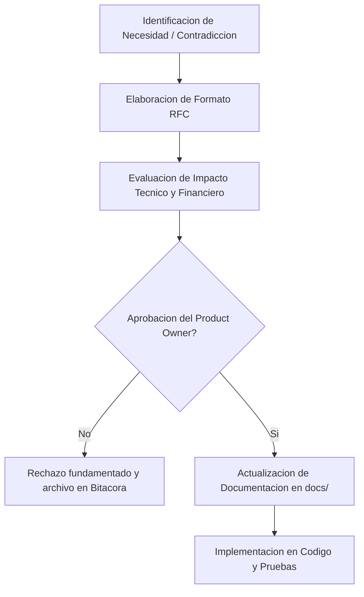

# Control de Cambios del Proyecto
## Prisma Business Dashboard - Grupo Prisma S.A.P.I. de C.V.

Este documento establece el procedimiento formal para registrar, analizar, autorizar e implementar cualquier modificación sobre los requisitos, la arquitectura, el modelo de datos o el alcance del sistema **Prisma Business Dashboard**.

---

## 1. Procedimiento de Solicitud de Cambio (RFC - Request For Change)

Cualquier propuesta de modificación técnica o de negocio debe seguir el siguiente flujo antes de ser implementada:



1. **Detección:** Se detecta una discrepancia técnica, una nueva necesidad de negocio o un ajuste de diseño.
2. **Registro:** Se formula una Solicitud de Cambio utilizando la plantilla oficial.
3. **Análisis de Impacto:** El arquitecto de software evalúa el impacto sobre la base de datos, seguridad, plazos y fases del Plan Maestro.
4. **Decisión:** El Propietario del Proyecto (Product Owner) es la única persona con autoridad para aprobar o desestimar el cambio.
5. **Actualización Documental:** Si se aprueba, se actualizan primero los documentos afectados en `docs/`.
6. **Implementación:** Se procede con el desarrollo en el código fuente.

---

## 2. Formato Estándar de Solicitud de Cambio (RFC)

```markdown
### RFC-XXX: [Título breve del cambio propuesto]
- **Fecha de Solicitud:** [AAAA-MM-DD]
- **Solicitante:** [Nombre / Rol]
- **Fase Afectada:** [Fase 0 a Fase 9]
- **Descripción del Cambio:** [Detalle conciso de qué se desea alterar]
- **Justificación:** [Motivo técnico o de negocio que sustenta la propuesta]
- **Impacto Evaluado:**
  - Base de Datos / Modelo: [Sí / No - Detalles]
  - Reglas de Negocio / Finanzas: [Sí / No - Detalles]
  - Arquitectura / Seguridad: [Sí / No - Detalles]
- **Dictamen del Product Owner:** [APROBADO / RECHAZADO / CONDICIONADO]
- **Fecha de Decisión:** [AAAA-MM-DD]
- **Documentos Actualizados:** [Lista de archivos en docs/]
```

---

## 3. Matriz Histórica de Control de Cambios

| ID Cambio | Fecha | Fase | Descripción Sintética | Solicitante | Estado |
| :--- | :--- | :--- | :--- | :--- | :--- |
| **RFC-001** | 2026-11-05 | FASE 0 | Establecimiento de la línea base documental, gobernanza y reglas financieras inmutables iniciales. | Russiele Valdez (PO) / Arquitecto | **APROBADO** |
| **RFC-002** | 2026-11-05 | FASE 0 | Auditoría integral y refinamiento: 6 roles oficiales combinables, 24 entidades relacionales, separación de autorización y ejecución, y clarificación de participación inicial acordada del 10%. | Russiele Valdez (PO) / Arquitecto | **APROBADO** |
| **RFC-003** | 2026-11-05 | FASE 0 | Formalización de Decisiones de Arquitectura del Propietario (Monorepo npm workspaces, Prisma en apps/api, abstracción StorageService, seed ficticio) y Normalización de Correspondencia de 28 Entidades Físicas Relacionales. | Russiele Valdez (PO) / Arquitecto | **APROBADO** |
| **RFC-004** | 2026-11-05 | FASE 1 | Aprobación formal de Fase 0, autorización de inicio de Fase 1 (Monorepo npm workspaces) y universalización de doble autorización para todas las operaciones financieras (Aportaciones, Ingresos, Egresos, Transferencias, Distribuciones). | Russiele Valdez (PO) | **APROBADO** |
| **RFC-005** | 2026-11-06 | FASE 1 / FASE 2 | Aprobación formal de Fase 1 tras auditoría técnica satisfactoria de 5 puntos clave, ratificación de versiones de Prisma en package-lock.json y directrices de preparación de Fase 2. | Russiele Valdez (PO) | **APROBADO** |
| **RFC-006** | 2026-11-06 | FASE 2 | Tercera Revisión de Diseño: Resolución de 6 inconsistencias críticas (idempotencia en transferencias, versionado de FinancialClose, centavos residuales, vigencias de PartnerShare, reversión inmutable y reglas de dos autorizadores) y eliminación de 15 contradicciones transversales. | Russiele Valdez (PO) / Arquitecto | **EN REVISIÓN FORMAL (FASE 2 NO APROBADA)** |
| **RFC-007** | 2026-11-06 | FASE 2 | Cuarta Revisión Correctiva: Cierre de 6 inconsistencias técnicas (desacoplamiento de unicidad en reversiones totales vs parciales, erradicación de entidad 29 SystemSequence preservando 28 entidades oficiales, especificación de contrato completo de 10 puntos de idempotencia, vigencias de PartnerShare con prevención de solapamientos históricos mediante trigger SQLite, protocolo de 3 escenarios en cierres rectificatorios y unificación de máquina de estados de 9 estados en FinancialOperation). | Russiele Valdez (PO) / Arquitecto | **FASE 2 NO APROBADA (EN REVISIÓN TÉCNICA — NO SE AUTORIZA ESQUEMA NI MIGRACIONES)** |

---

## 4. Registro Detallado de Cambios

### RFC-001: Línea Base Documental y Reglas de Negocio Iniciales
- **Fecha de Solicitud:** 2026-11-05
- **Solicitante:** Russiele Valdez (Product Owner) & Arquitecto de Software
- **Fase Afectada:** FASE 0 (Definición y Documentación)
- **Descripción del Cambio:** Creación y estructuración de los 33 archivos documentales del proyecto dentro del directorio `docs/`, fijando las reglas inmutables de:
  - Padrón inicial de 10 socios fundadores al 10% de participación.
  - Almacenamiento monetario en enteros (centavos de peso MXN).
  - Doble autorización obligatoria e independiente para toda operación de tesorería.
  - Inmutabilidad de transacciones ejecutadas y soporte de reversión compensatoria.
  - Separación entre participación societaria y acuerdos específicos de utilidades por proyecto al 100%.
- **Impacto Evaluado:** Define las bases conceptuales, arquitectónicas y de gobernanza para todas las fases futuras.
- **Dictamen del Product Owner:** **APROBADO**
- **Fecha de Decisión:** 2026-11-05
- **Documentos Afectados:** Totalidad de la estructura en `docs/`.

---

### RFC-002: Auditoría Integral y Refinamiento Documental de Fase 0
- **Fecha de Solicitud:** 2026-11-05
- **Solicitante:** Russiele Valdez (Product Owner) & Arquitecto de Software
- **Fase Afectada:** FASE 0 (Definición y Documentación)
- **Descripción del Cambio:**
  1. **Participación Societaria:** Eliminación del término "estatutario"; clarificación de que los 10 socios fundadores tienen una participación inicial acordada del 10% cada uno (acuerdo de voluntades inicial), distinguiendo claramente: 1) participación societaria base, 2) aportaciones reales de capital al fondo común (`CapitalContribution`), y 3) acuerdos de utilidades por proyecto (`ProfitAgreement`).
  2. **Autorizaciones Financieras y Separación de Ejecución:** Refuerzo de la regla 2-Man independiente; solicitante excluido de autorizar; `SUPER_ADMIN` sin bypass; separación formal entre el acto de autorizar (2 firmas de `FINANCE_APPROVER`) y el acto de desembolso bancario y afectación de saldo (`TREASURER`), que genera el registro en `AccountMovement`.
  3. **Homologación de Roles Oficiales:** Establecimiento del catálogo oficial de 6 roles (`SUPER_ADMIN`, `PARTNER`, `TREASURER`, `FINANCE_APPROVER`, `PROJECT_MANAGER`, `PROJECT_MEMBER`), con soporte de asignación combinada y matriz de permisos granulares para evitar duplicidades.
  4. **Expansión y Cobertura de Base de Datos:** Actualización del MER, Diccionario de Datos y Reglas de Integridad para cubrir las 24 entidades funcionales identificadas (Usuarios, Roles, Permisos, Sesiones, Socios, Participaciones, Aportaciones, Cuentas, Operaciones, Autorizaciones, Movimientos contables, Proyectos, Integrantes, Presupuestos, Hitos, Actualizaciones, Reuniones, Minutas, Actividades, Documentos, Acuerdos, Cierres financieros, Distribuciones y Auditoría).
  5. **Resolución de Contradicción en Repositorio:** Clasificación de la estructura monorepo como propuesta técnica de referencia en evaluación, reconociendo la decisión pendiente del PO entre Monorepo (Opción A) y Subproyectos desacoplados (Opción B).
  6. **Requisitos No Funcionales:** Clasificación explícita de métricas numéricas arbitrarias (tiempos de respuesta, token lifetimes, cobertura) como propuestas técnicas preliminares sujetas a ratificación del PO.
- **Impacto Evaluado:**
  - Base de Datos / Modelo: Sí (modelo relacional expandido a 24 entidades con integridad estricta).
  - Reglas de Negocio / Finanzas: Sí (separación de autorización vs ejecución contable, precisión jurídica en participaciones).
  - Arquitectura / Seguridad: Sí (RBAC granular y roles combinables).
- **Dictamen del Product Owner:** **EN REVISIÓN FORMAL (FASE 0 NO MARCADA COMO APROBADA)**
- **Documentos Modificados:**
  - `docs/00_GESTION_PROYECTO/PROJECT_CHARTER.md`
  - `docs/00_GESTION_PROYECTO/ESTADO_ACTUAL.md`
  - `docs/01_REQUISITOS/REGLAS_DE_NEGOCIO.md`
  - `docs/01_REQUISITOS/REQUISITOS_FUNCIONALES.md`
  - `docs/01_REQUISITOS/REQUISITOS_NO_FUNCIONALES.md`
  - `docs/01_REQUISITOS/HISTORIAS_DE_USUARIO.md`
  - `docs/02_ARQUITECTURA/ESTRUCTURA_PROYECTO.md`
  - `docs/02_ARQUITECTURA/SERVICIOS_WEB.md`
  - `docs/03_BASE_DE_DATOS/MODELO_ENTIDAD_RELACION.md`
  - `docs/03_BASE_DE_DATOS/DICCIONARIO_DE_DATOS.md`
  - `docs/03_BASE_DE_DATOS/REGLAS_INTEGRIDAD.md`
  - `docs/04_SEGURIDAD_Y_FINANZAS/MODELO_ROLES_PERMISOS.md`
  - `docs/04_SEGURIDAD_Y_FINANZAS/FLUJO_AUTORIZACIONES.md`
  - `docs/04_SEGURIDAD_Y_FINANZAS/REGLAS_FINANCIERAS.md`
  - `docs/04_SEGURIDAD_Y_FINANZAS/AUDITORIA_Y_TRAZABILIDAD.md`
  - `docs/06_PRUEBAS/CASOS_PRUEBA.md`
  - `docs/00_GESTION_PROYECTO/CONTROL_DE_CAMBIOS.md`

---

### RFC-003: Formalización de Decisiones del Propietario y Normalización de 28 Entidades Físicas
- **Fecha de Solicitud:** 2026-11-05
- **Solicitante:** Russiele Valdez (Product Owner) & Arquitecto de Software
- **Fase Afectada:** FASE 0 (Definición y Documentación)
- **Descripción del Cambio:**
  1. **Normalización y Correspondencia Estricta de 28 Entidades:**
     - Se resuelve la aparente discrepancia "24 conceptos funcionales vs 28 tablas relacionales". Los 24 conceptos funcionales del negocio se implementan como exactamente 28 entidades físicas relacionales debido a: tablas intermedias de normalización (`RolePermission`, `UserRole`), descomposición de autorizaciones en cabecera y firmas individuales (`ApprovalRequest`, `ApprovalSignature`), y descomposición de acuerdos de utilidades en cabecera y desgloses porcentuales (`ProfitAgreement`, `ProfitShareItem`).
     - Se integró la **Matriz de Correspondencia de 28 Entidades** en `MODELO_ENTIDAD_RELACION.md`, `DICCIONARIO_DE_DATOS.md` y `REGLAS_INTEGRIDAD.md`, garantizando una simetría exacta del 100% en nombres, campos y reglas.
  2. **Formalización de Decisiones de Arquitectura del Propietario:**
     - **Estructura del Repositorio:** Monorepo gobernado con npm workspaces (`apps/web` para frontend y `apps/api` para backend), manteniendo la carpeta `docs/` independiente en la raíz del espacio de trabajo.
     - **Ubicación de Prisma ORM:** Esquema `schema.prisma`, migraciones y base de datos SQLite alojados estrictamente dentro de `apps/api/prisma/`.
     - **Almacenamiento de Evidencias:** Almacenamiento inicial en disco local (`apps/api/uploads/`) protegido, desacoplado mediante la interfaz de abstracción `StorageService` (`IStorageProvider`), asegurando portabilidad directa hacia la nube (S3, Cloud Storage).
     - **Protección de Privacidad y Semillas:** Configuración de `seed.ts` con 10 socios ficticios de prueba. Queda estrictamente prohibido registrar o incluir datos personales reales de los socios en repositorios públicos.
     - **Métricas No Funcionales:** Las metas numéricas de rendimiento, tiempos de respuesta, expiración de tokens y cobertura de pruebas se consolidan como objetivos técnicos preliminares orientativos y no como garantías contractualmente cerradas.
- **Impacto Evaluado:**
  - Base de Datos / Modelo: Sí (28 entidades físicas normalizadas con matriz de correspondencia completa campo por campo y regla por regla).
  - Arquitectura / Infraestructura: Sí (definición final de monorepo con npm workspaces, estructura de paquetes y abstracción de almacenamiento).
  - Privacidad y Gobernanza: Sí (protección de identidad real de socios mediante seed ficticio).
- **Dictamen del Product Owner:** **APROBADO** (Ratificado el 2026-11-05)
- **Documentos Modificados:**
  - `docs/03_BASE_DE_DATOS/MODELO_ENTIDAD_RELACION.md`
  - `docs/03_BASE_DE_DATOS/DICCIONARIO_DE_DATOS.md`
  - `docs/03_BASE_DE_DATOS/REGLAS_INTEGRIDAD.md`
  - `docs/02_ARQUITECTURA/ESTRUCTURA_PROYECTO.md`
  - `docs/00_GESTION_PROYECTO/PROJECT_CHARTER.md`
  - `docs/00_GESTION_PROYECTO/PLAN_MAESTRO.md`
  - `docs/00_GESTION_PROYECTO/ESTADO_ACTUAL.md`
  - `docs/05_PLANIFICACION/SEGUIMIENTO_FASES.md`
  - `docs/00_GESTION_PROYECTO/CONTROL_DE_CAMBIOS.md`
  - `docs/BITACORA/BITACORA_SESIONES.md`
  - `docs/BITACORA/PROXIMA_SESION.md`

---

### RFC-004: Aprobación Formal de Fase 0, Inicio de Fase 1 y Universalización de Doble Autorización Financiera
- **Fecha de Solicitud:** 2026-11-05
- **Solicitante:** Russiele Valdez (Product Owner)
- **Fase Afectada:** FASE 0 (Cierre y Aprobación) / FASE 1 (Configuración de Monorepo)
- **Descripción del Cambio:**
  1. **Aprobación Formal de Fase 0:** Se aprueba formalmente la totalidad de la documentación de la Fase 0 (33 documentos, 28 entidades, roles, reglas de negocio e integridad) y se autoriza la transición a la Fase 1.
  2. **Autorización de Fase 1:** Se autoriza la preparación física del monorepo con npm workspaces (`apps/api` y `apps/web`), configuración de NestJS, React + Vite + TypeScript, Tailwind CSS, Prisma ORM con SQLite, y documentación de comandos de ejecución.
  3. **Universalización de Doble Autorización Financiera:** Se formaliza el requisito de que las dos autorizaciones independientes aplican a **todas las operaciones financieras sujetas a autorización**, no únicamente a egresos. Esto incluye de forma expresa: Aportaciones de capital (`APORTACION_CAPITAL`), Ingresos (`INGRESO`), Egresos (`EGRESO`), Transferencias entre cuentas (`TRANSFERENCIA`) y Distribuciones de utilidades (`DISTRIBUCION_UTILIDADES`).
- **Impacto Evaluado:**
  - Gestión del Proyecto: Cierre oficial de Fase 0 y arranque de Fase 1.
  - Reglas de Negocio / Finanzas: Ampliación explícita del control de 2 firmas independientes a toda operación financiera con impacto en tesorería.
  - Repositorio y Arquitectura: Creación de `package.json` raíz con npm workspaces, `apps/api` y `apps/web`.
- **Dictamen del Product Owner:** **APROBADO** (Autorización expresa emitida el 2026-11-05)
- **Documentos Modificados:**
  - `docs/00_GESTION_PROYECTO/ESTADO_ACTUAL.md`
  - `docs/05_PLANIFICACION/SEGUIMIENTO_FASES.md`
  - `docs/04_SEGURIDAD_Y_FINANZAS/REGLAS_FINANCIERAS.md`
  - `docs/04_SEGURIDAD_Y_FINANZAS/FLUJO_AUTORIZACIONES.md`
  - `docs/00_GESTION_PROYECTO/CONTROL_DE_CAMBIOS.md`
  - `docs/BITACORA/BITACORA_SESIONES.md`
  - `docs/BITACORA/PROXIMA_SESION.md`

---

### RFC-005: Aprobación Formal de Fase 1, Ratificación de Dependencias de Prisma y Regla de Revisión Previa de Fase 2
- **Fecha de Solicitud:** 2026-11-06
- **Solicitante:** Russiele Valdez (Product Owner)
- **Fase Afectada:** FASE 1 (Aprobación y Cierre) / FASE 2 (Preparación de Inicio)
- **Descripción del Cambio:**
  1. **Aprobación Formal de Fase 1:** Se emite dictamen de aprobación formal definitiva para la **FASE 1: Configuración del Entorno y Repositorio Monorepo**, fundamentado en la auditoría técnica satisfactoria sobre: 1) versiones de Prisma ORM, 2) protección en `.gitignore`, 3) repositorio Git independiente, 4) estructura física de monorepo, y 5) configuración de Prisma con SQLite.
  2. **Ratificación de Versiones de Prisma:** Se valida que la versión instalada `6.19.3` de `@prisma/client` y `prisma` es plenamente compatible con el rango `^6.4.1` según las reglas SemVer de npm. Se ratifica `package-lock.json` como referencia reproducible inmutable y se establece la directriz de no alterar versiones de Prisma en este cierre.
  3. **Regla Crítica de Control de Fase 2:** Se formaliza la directriz inmutable de que no se generarán migraciones ni se crearán tablas físicas en SQLite hasta que el diseño completo de las 28 entidades en `apps/api/prisma/schema.prisma` sea revisado y aprobado formalmente por el Propietario.
  4. **Universalización de Control Financiero:** Se reitera el requisito de doble autorización independiente para todas las operaciones financieras sujetas a autorización: Aportaciones, Ingresos, Egresos, Transferencias y Distribuciones de utilidades.
  5. **Archivos Preexistentes y Git:** Se registra la clasificación de los archivos preexistentes `New Text Document.txt` (vacío) y `prompt inicio de proyecto.txt` (requerimientos iniciales), quedando pendiente la decisión del propietario sobre su destino, así como la ejecución del primer commit de Git.
- **Impacto Evaluado:**
  - Gestión del Proyecto: Cierre formal y aprobado de Fase 1; Fase 2 en estado preparado pero sin ejecución adelantada.
  - Base de Datos y Persistencia: Se asegura que el esquema relacional de 28 entidades sea auditado campo a campo antes de cualquier migración en SQLite.
  - Trazabilidad y Estabilidad: Congelamiento de dependencias en `package-lock.json`.
- **Dictamen del Product Owner:** **APROBADO** (Dictamen formal emitido el 2026-11-06)
- **Documentos Modificados:**
  - `docs/00_GESTION_PROYECTO/ESTADO_ACTUAL.md`
  - `docs/05_PLANIFICACION/SEGUIMIENTO_FASES.md`
  - `docs/00_GESTION_PROYECTO/CONTROL_DE_CAMBIOS.md`
  - `docs/BITACORA/BITACORA_SESIONES.md`
  - `docs/BITACORA/PROXIMA_SESION.md`

---

### RFC-006: Tercera Revisión de Diseño — Resolución de Inconsistencias Críticas y Contradicciones Transversales de Fase 2
- **Fecha de Solicitud:** 2026-11-06
- **Solicitante:** Russiele Valdez (Product Owner) & Arquitecto de Software
- **Fase Afectada:** FASE 2: Modelo de Datos y Migraciones SQLite
- **Descripción del Cambio:**
  1. **Resolución de 6 Inconsistencias Críticas:**
     - **Punto 1 (Idempotencia y Transferencias):** Incorporación de `execution_idempotency_key` única en `FinancialOperation`, transacción atómica `$transaction` con optimistic locking e inserción simultánea de exactamente 1 CARGO y 1 ABONO con importes idénticos.
     - **Punto 2 (Versionado de FinancialClose):** Eliminación de `@unique(projectId)`; adopción de `@@unique([projectId, version])`, autorreferencia reflexiva `previousCloseId` (`onDelete: Restrict`) y estado `status = 'VIGENTE'/'SUPERADO'`. Inmutabilidad estricta de dividendos históricos.
     - **Punto 3 (Centavos Residuales):** Sustitución de asignación arbitraria al fondo común por el algoritmo determinista de Mayores Residuos (Hamilton) con desempate por UUID, formulando 3 alternativas formales para elección del Propietario.
     - **Punto 4 (Vigencias de PartnerShare):** Reemplazo de `@@unique([partnerId, is_current])` por intervalos temporales (`effectiveFrom`, `effectiveTo`), índice único parcial nativo en SQLite (`WHERE effective_to IS NULL`) y validación transaccional de 10,000 puntos base exactos.
     - **Punto 5 (Reversión Compensatoria):** Inmutabilidad del libro mayor; reversión como nueva `FinancialOperation` de tipo `REVERSION_COMPENSATORIA` con doble firma obligatoria y contrasientos contables opuestos. Formulación de Alternativa A (Total) y B (Parcial) para decisión del PO.
     - **Punto 6 (Identidad de Autorizadores):** Desacoplamiento entre permiso `finance:approve` (rol `FINANCE_APPROVER`) y condición de socios; exclusión de autoautorización para el solicitante; unicidad de firmas `@@unique([approvalRequestId, userId])`; rechazo como detención inmediata. Formulación de Política A y Política B para decisión del PO.
  2. **Eliminación de 15 Contradicciones Transversales:**
     - Derivación dinámica de `ApprovalRequest.currentSignatures`.
     - Restricción estricta de `ApprovalSignature.signatureOrder` a `[1, 2]` vía check y unique compuesto.
     - Formalización de máquina de estados de `FinancialOperation`.
     - Alineación estricta de `CapitalContribution.accountId` con la cuenta destino de la operación.
     - Distinción entre socio aportante (`partnerId`) y usuario que captura el comprobante (`createdByUserId`).
     - Aprobación de cierre financiero por permiso `project:close_approve` (no exclusivo a `SUPER_ADMIN`).
     - Restricción física `amount_cents > 0` en `AccountMovement`.
     - Rango válido $1 \dots 10,000$ en puntos base de participaciones y utilidades.
     - Almacenamiento de ponderación de hitos en puntos base enteros (`weight_basis_points`).
     - Unicidad compuesta de cuentas bancarias `[bankName, accountNumber]` y CLABE única de 18 dígitos.
     - Bloqueo de operaciones en cuentas inactivas manteniendo consulta histórica completa.
     - Folios consecutivos atómicos mediante tabla de secuencias bajo `BEGIN IMMEDIATE`.
     - Auditoría mediante lista permitida (*Allowlist*) y sanitización recursiva de secretos.
     - Política obligatoria `onDelete: Restrict` en todas las entidades probatorias y financieras (cero cascadas).
     - Fórmula estricta de utilidad neta de proyecto excluyendo capital social y transferencias internas.
  3. **Restricciones de Gobernanza:** Se mantiene inmutable `apps/api/prisma/schema.prisma` y no se ejecutan migraciones ni se declara aprobada la Fase 2.
- **Impacto Evaluado:**
  - Base de Datos y Modelo: Sí (resolución arquitectónica y relacional completa para las 28 entidades físicas).
  - Reglas Financieras y Seguridad: Sí (idempotencia, inmutabilidad contable, partida doble garantizada y segregación estricta de funciones).
  - Gobernanza y Planificación: Sí (documento entregable `02_ARQUITECTURA/TERCERA_REVISION_RESOLUCION_INCONSISTENCIAS.md` generado, 4 decisiones de negocio expuestas formalmente al PO).
- **Dictamen del Product Owner:** **FASE 2 NO APROBADA** (El propietario evaluó la cuarta revisión correctiva: la arquitectura presenta avances, pero todavía no está lista para implementar; se mantienen pendientes las decisiones de negocio y los hallazgos técnicos identificados; **no se autoriza iniciar la creación o modificación del esquema de Prisma ni las migraciones**).
- **Documentos Modificados / Creados:**
  - Creado: `docs/02_ARQUITECTURA/TERCERA_REVISION_RESOLUCION_INCONSISTENCIAS.md`
  - Modificado: `docs/00_GESTION_PROYECTO/CONTROL_DE_CAMBIOS.md`
  - Modificado: `docs/00_GESTION_PROYECTO/ESTADO_ACTUAL.md`
  - Modificado: `docs/BITACORA/BITACORA_SESIONES.md`
  - Modificado: `docs/BITACORA/PROXIMA_SESION.md`

---

### RFC-007: Cuarta Revisión Correctiva — Cierre de Inconsistencias Técnicas y Unificación de Modelo de Fase 2
- **Fecha de Solicitud:** 2026-11-06
- **Solicitante:** Russiele Valdez (Product Owner) & Arquitecto de Software
- **Fase Afectada:** FASE 2: Modelo de Datos y Migraciones SQLite
- **Descripción del Cambio:**
  1. **Corrección 1 (Reversión Compensatoria):** Desacoplamiento de la restricción `@unique(reversalOfOperationId)` para no bloquear reversiones parciales; documentación formal y comparación técnica entre Alternativa A (1:1 exclusivamente total con `@unique`) y Alternativa B (1:N parciales acumulables con índice ordinario y control de sumas concurrentes).
  2. **Corrección 2 (Preservación Estricta de 28 Entidades):** Eliminación definitiva de la propuesta de tabla `SystemSequence` (entidad 29). Adopción de código autónomo basado en tiempo y entropía (`OP-YYYY-HASH`) u obtención correlativa en `BEGIN IMMEDIATE`, preservando el catálogo oficial de 28 entidades.
  3. **Corrección 3 (Contrato Completo de Idempotencia):** Especificación de los 10 puntos del contrato de idempotencia (generación en cliente de UUIDv4, cabecera HTTP, persistencia en BD, Safe Replay con HTTP 200, conflicto con HTTP 409/422, recuperación post-falla de red) e invariantes absolutos de partida doble en transferencias.
  4. **Corrección 4 (Vigencias de PartnerShare sin Superposiciones):** Superación de la brecha del índice parcial mediante arquitectura defensiva multicapa: SQLite CHECK (cronología válida), SQLite Partial Unique Index (un solo socio activo), Trigger SQLite `BEFORE INSERT` (prohibición de intervalos temporales superpuestos) y validación transaccional NestJS ($\sum = 10,000$ bps).
  5. **Corrección 5 (Cierres Rectificatorios y Distribuciones Pagadas):** Definición de protocolo inmutable para los 3 escenarios operativos (sin pagos, parcialmente pagados y totalmente pagados); los movimientos contables previos jamás se modifican ni se borran; cálculo del diferencial por socio y alternativas de negocio para absorción de déficits (retención vs reembolso vs fondo común).
  6. **Corrección 6 (Máquina de Estados Única):** Unificación de estados en `FinancialOperation` como única fuente de verdad (9 estados oficiales: `REGISTRADO`, `PENDIENTE_FIRMA_1`, `PENDIENTE_FIRMA_2`, `AUTORIZADO`, `EJECUTADO`, `RECHAZADO`, `CANCELADO`, `REVERTIDO`, `PARCIALMENTE_REVERTIDO`), con matriz exhaustiva de transiciones, actores autorizados y eventos de auditoría.
  7. **Preservación Normativa:** Mantenimiento de `apps/api/prisma/schema.prisma` intacto, cero migraciones ejecutadas, cero tablas creadas y Fase 2 no declarada como aprobada.
- **Impacto Evaluado:**
  - Base de Datos y Modelo: Sí (resolución de inconsistencias de unicidad, fechas e índices; confirmación de 28 entidades exactas).
  - Integridad Financiera y Seguridad: Sí (contrato completo de idempotencia, partida doble garantizada, inmutabilidad de movimientos históricos).
  - Gobernanza y Control: Sí (elaboración del documento `02_ARQUITECTURA/CUARTA_REVISION_CORRECTIVA_CIERRE_TECNICO.md` y catálogo formal de 5 decisiones de negocio pendientes).
- **Dictamen del Product Owner:** **FASE 2 NO APROBADA** (El propietario evaluó la cuarta revisión correctiva: la arquitectura presenta avances, pero todavía no está lista para implementar; se mantienen pendientes las decisiones de negocio y los hallazgos técnicos identificados; **no se autoriza iniciar la creación o modificación del esquema de Prisma ni las migraciones**).
- **Documentos Modificados / Creados:**
  - Creado: `docs/02_ARQUITECTURA/CUARTA_REVISION_CORRECTIVA_CIERRE_TECNICO.md`
  - Modificado: `docs/00_GESTION_PROYECTO/CONTROL_DE_CAMBIOS.md`
  - Modificado: `docs/00_GESTION_PROYECTO/ESTADO_ACTUAL.md`
  - Modificado: `docs/BITACORA/BITACORA_SESIONES.md`
  - Modificado: `docs/BITACORA/PROXIMA_SESION.md`

