# Plan Maestro de Desarrollo
## Prisma Business Dashboard - Grupo Prisma S.A.P.I. de C.V.

El presente Plan Maestro define la hoja de ruta integral y secuencial para la construcción del sistema **Prisma Business Dashboard**. Cada fase posee criterios de salida estrictos que deben ser validados antes de dar inicio a la siguiente etapa.

---

## 1. Principio de Ejecución Secuencial

```mermaid
flowchart LR
    F0[Fase 0: Documentacion] --> F1[Fase 1: Entorno & Repo]
    F1 --> F2[Fase 2: BD & Migraciones]
    F2 --> F3[Fase 3: Auth & Socios]
    F3 --> F4[Fase 4: Tesoreria & Firmas]
    F4 --> F5[Fase 5: Proyectos]
    F5 --> F6[Fase 6: Dashboard]
    F6 --> F7[Fase 7: Web Services]
    F7 --> F8[Fase 8: Pruebas & QA]
    F8 --> F9[Fase 9: Despliegue & PDF]
```

> [!IMPORTANT]
> **Regla de Oro:** No está permitido iniciar una fase posterior si los criterios de aceptación y pruebas de salida de la fase previa no han sido formalmente auditados y registrados en `ESTADO_ACTUAL.md` y `BITACORA_SESIONES.md`.

---

## 2. Detalle de Fases de Desarrollo

### FASE 0: Definición y Documentación
- **Objetivo:** Establecer toda la infraestructura documental, de gobernanza, requisitos técnicos, arquitectura de software, modelo de datos y reglas de negocio para el proyecto.
- **Actividades:**
  1. Creación de la estructura documental en `docs/` (9 carpetas, 33 archivos).
  2. Redacción técnica de requisitos funcionales y no funcionales.
  3. Formalización de reglas de negocio inmutables (socios, centavos, doble autorización, inmutabilidad).
  4. Diseño conceptual y lógico de base de datos y arquitectura en capas.
  5. Definición de casos de prueba y matrices de evidencia académica.
- **Dependencias:** Ninguna (Fase inicial).
- **Entregables:** Árbol documental completo en `docs/` con contenido técnico coherente y sin secciones vacías.
- **Criterios de Aceptación:** Verificación del 100% de los 33 archivos requeridos y aprobación formal del Product Owner.
- **Pruebas Requeridas:** Inspección estática documental y verificación de coherencia estructural.
- **Estado Actual:** 🟢 **APROBADA FORMALMENTE (2026-11-05)**.

---

### FASE 1: Configuración del Entorno y Repositorio Monorepo
- **Objetivo:** Inicializar la estructura monorepo gestionada mediante npm workspaces, configurando `apps/api` (NestJS) y `apps/web` (Vite + React), manteniendo la carpeta `docs/` independiente en la raíz, linters, TypeScript estricto y variables de entorno protegidas.
- **Actividades:**
   1. Configuración de la raíz del monorepo con `package.json` gobernando workspaces (`apps/*`) y `.gitignore` exhaustivo (exclusión de `.env`, SQLite `*.db`, evidencias locales en `uploads/`, `node_modules` y compilados `dist`).
   2. Inicialización del backend en `apps/api` con NestJS y TypeScript en modo estricto.
   3. Inicialización del frontend en `apps/web` con Vite + React + TypeScript + Tailwind CSS.
   4. Configuración de scripts unificados de compilación y herramientas de formateo y linting (ESLint, Prettier).
- **Dependencias:** FASE 0 aprobada.
- **Entregables:** Estructura monorepo operativa con backend (`apps/api`) y frontend (`apps/web`) compilables en limpio, sin dependencias circulares ni exposición de secretos.
- **Criterios de Aceptación:** Ambos paquetes inicializan y compilan sin errores; `.gitignore` protege la base de datos, evidencias y secretos.
- **Pruebas Requeridas:** Verificación de compilación limpia (`npm run build` en la raíz del monorepo).
- **Estado Actual:** 🟢 **APROBADA FORMALMENTE (2026-11-06 tras auditoría técnica de 5 ejes)**.

---

### FASE 2: Modelo de Datos Relacional y Migraciones SQLite
- **Objetivo:** Implementar el esquema relacional de 28 entidades en Prisma ORM alojado en `apps/api/prisma/schema.prisma`, generar las migraciones en SQLite local y configurar el script de semillas con 10 socios ficticios para salvaguardar la privacidad.
- **Actividades:**
   1. Definición de `apps/api/prisma/schema.prisma` cubriendo las 28 entidades normalizadas (Usuarios, Roles, Socios, Cuentas, Operaciones, Aprobaciones, Movimientos, Proyectos, Hitos, Minutas, Acuerdos, Auditoría, etc.).
   2. Tipificación obligatoria de todos los importes monetarios como enteros en centavos (`BigInt` / `Int`).
   3. Ejecución de la migración inicial de Prisma ORM sobre SQLite local en `apps/api/prisma/`.
   4. Creación del script de semillas (`apps/api/prisma/seed.ts`) con 10 socios ficticios de prueba (sin registrar datos personales reales en repositorios públicos) y usuario administrador base.
- **Dependencias:** FASE 1 aprobada.
- **Entregables:** Archivo `schema.prisma` completo en `apps/api/prisma/`, migraciones generadas y script de seed con datos ficticios funcional.
- **Criterios de Aceptación:** La base de datos SQLite se genera con llaves foráneas íntegras y el seed inserta a los 10 socios ficticios con su 10% acordado de participación.
- **Pruebas Requeridas:** Ejecución de `npx prisma migrate dev` y `npx prisma db seed` en `apps/api` sin errores de integridad referencial.
- **Estado Actual:** 🟡 **EN REVISIÓN DE DISEÑO Y ARQUITECTURA (NO APROBADA — NO SE AUTORIZAN MIGRACIONES NI CREACIÓN DE ESQUEMA)**.

---

### FASE 3: Autenticación, Usuarios, Socios y Permisos
- **Objetivo:** Construir el módulo de seguridad perimetral y administración de socios, implementando JWT, bcrypt, Guards de NestJS y control de acceso basado en roles (RBAC).
- **Actividades:**
  1. Implementación del módulo `Auth` (login, validación de credenciales con bcrypt, emisión y verificación de JWT).
  2. Implementación de Guards y Decorators para verificación de roles (`SUPER_ADMIN`, `ADMIN_FINANCIERO`, etc.).
  3. Endpoints de consulta y gestión del padrón de los 10 socios fundadores.
  4. Creación de pantallas de login y administración de socios en React.
- **Dependencias:** FASE 2 aprobada.
- **Entregables:** Módulo de autenticación funcional en API y frontend; pantallas de gestión de socios operativas.
- **Criterios de Aceptación:** Las contraseñas se almacenan con salt/hash; los endpoints protegidos devuelven 401 si no hay token y 403 si el rol no es adecuado.
- **Pruebas Requeridas:** Pruebas unitarias de hashing y pruebas de integración con Supertest sobre `/api/v1/auth/login`.
- **Estado Actual:** **NO INICIADA**.

---

### FASE 4: Tesorería, Cuentas, Movimientos y Autorizaciones
- **Objetivo:** Implementar la lógica contable del sistema: cuentas de capital común, registro inmutable de transacciones, cálculo dinámico de saldos y el motor de doble autorización estricta.
- **Actividades:**
  1. Módulo `Treasury` para cuentas financieras y visualización de saldos calculados.
  2. Módulo de solicitud de transacciones (ingreso, egreso, transferencia interna neutra).
  3. Módulo `Approvals` con flujo de dos firmas obligatorias e independientes.
  4. Lógica de reversión compensatoria para movimientos erróneos (prohibición de DELETE).
  5. Vistas de tesorería y bandeja de autorizaciones en React.
- **Dependencias:** FASE 3 aprobada.
- **Entregables:** Motor transaccional financiero y UI de autorizaciones operando con validaciones en frontend y backend.
- **Criterios de Aceptación:** Ningún movimiento se ejecuta sin dos firmas distintas del solicitante; los saldos se derivan únicamente de transacciones ejecutadas.
- **Pruebas Requeridas:** Pruebas automatizadas de intento de auto-aprobación (debe fallar) y cálculo de balances con enteros en centavos.
- **Estado Actual:** **NO INICIADA**.

---

### FASE 5: Administración de Proyectos y Seguimiento
- **Objetivo:** Desarrollar el módulo para gestionar los proyectos de inversión (automotriz e inmobiliario), sus presupuestos, gastos reales vinculados a tesorería, hitos, documentos probatorios bajo almacenamiento local desacoplado y acuerdos de utilidades.
- **Actividades:**
  1. CRUD de proyectos con cálculo de desviaciones temporales (días de atraso, tiempo restante).
  2. Módulo de acuerdos económicos de utilidades (validación estricta de suma al 100%).
  3. Registro de hitos, minutas de reunión y metadatos de documentos probatorios (`ProjectDocument`).
  4. Implementación del almacenamiento local de evidencias en `apps/api/uploads/` gobernado mediante la interfaz abstracta `StorageService` (`IStorageProvider`), garantizando portabilidad futura a la nube.
  5. Lógica de cierre financiero formal y habilitación de distribución de utilidades.
  6. Interfaz de detalle de proyecto en React con barras de progreso y línea de tiempo.
- **Dependencias:** FASE 4 aprobada.
- **Entregables:** Módulo de proyectos completo con gestión de evidencias desacoplada y soporte de casos de remate de autos e inmuebles.
- **Criterios de Aceptación:** La distribución de ganancias no puede ejecutarse si el proyecto no tiene cierre financiero y el acuerdo al 100% aprobado. Las evidencias se almacenan localmente y se gestionan a través de la interfaz de almacenamiento.
- **Pruebas Requeridas:** Validación de restricciones de suma en acuerdos económicos, pruebas unitarias del servicio de almacenamiento y cálculo de rentabilidad proyectada vs real.
- **Estado Actual:** **NO INICIADA**.

---

### FASE 6: Dashboard Ejecutivo
- **Objetivo:** Construir la interfaz de alta dirección con gráficos interactivos basados en Recharts, métricas consolidadas y filtros analíticos para los 10 socios.
- **Actividades:**
  1. Endpoint analítico optimizado que devuelva KPIs globales (capital total, monto invertido, utilidades generadas, proyectos activos).
  2. Componentes gráficos en React: flujo de efectivo mensual, distribución de cartera por tipo de proyecto y porcentaje de avance.
  3. Tableros diferenciados según perfil (resumen global para SUPER_ADMIN, rendimiento de proyectos para gestores).
- **Dependencias:** FASE 5 aprobada.
- **Entregables:** Dashboard interactivo, completamente responsivo y alimentado por datos dinámicos de la API.
- **Criterios de Aceptación:** Los gráficos responden de forma reactiva y los totales coinciden al centavo con el módulo de tesorería.
- **Pruebas Requeridas:** Pruebas de renderizado de componentes y verificación de consistencia matemática de KPIs.
- **Estado Actual:** **NO INICIADA**.

---

### FASE 7: Web Services Propios y Terceros
- **Objetivo:** Exponer la documentación formal de la API propia mediante Swagger/OpenAPI y consumir un servicio web externo (ej. API de divisas/UDIs) para enriquecer los reportes financieros.
- **Actividades:**
  1. Configuración de SwaggerModule en NestJS con anotaciones y DTOs documentados (`@ApiProperty`, `@ApiResponse`).
  2. Integración de servicio externo HTTP (ej. tipo de cambio USD/MXN para valuación referencial de autos e inmuebles).
  3. Manejo de resiliencia y caché para el servicio externo.
- **Dependencias:** FASE 6 aprobada.
- **Entregables:** Interfaz Swagger interactiva en `/api/docs` y módulo de servicio externo integrado.
- **Criterios de Aceptación:** La documentación de la API es interactiva y ejecutable; el servicio externo maneja fallos de red sin tumbar la aplicación.
- **Pruebas Requeridas:** Pruebas de integración sobre el endpoint de integración externa con mock y fallback.
- **Estado Actual:** **NO INICIADA**.

---

### FASE 8: Pruebas, Seguridad y QA
- **Objetivo:** Ejecutar la suite integral de pruebas unitarias y de integración (Jest + Supertest), auditoría de seguridad y verificación de no regresión.
- **Actividades:**
  1. Ejecución de pruebas unitarias de servicios de backend y funciones de utilidad matemática.
  2. Pruebas E2E de flujos críticos (creación de movimiento -> doble autorización -> ejecución -> balance).
  3. Análisis estático de código y revisión de vulnerabilidades en dependencias (`npm audit`).
  4. Verificación de logs de auditoría en todas las acciones críticas.
- **Dependencias:** FASE 7 aprobada.
- **Entregables:** Reporte de cobertura de pruebas y matriz de casos de prueba ejecutados al 100% de éxito.
- **Criterios de Aceptación:** Cero vulnerabilidades críticas o altas; 100% de casos de prueba financieros superados.
- **Pruebas Requeridas:** Cobertura de pruebas superior al 80% en lógica de negocio crítica.
- **Estado Actual:** **NO INICIADA**.

---

### FASE 9: Publicación, Evidencias y Documento Académico PDF
- **Objetivo:** Consolidar el proyecto para su presentación final, recopilación de evidencias, captura de pantallas y redacción del documento académico formal de la Unidad 3.
- **Actividades:**
  1. Elaboración del documento académico final en formato PDF con portada institucional UTC, índice, introducción, arquitectura, pruebas y conclusiones.
  2. Generación de matriz de evidencias cotejada contra la rúbrica de evaluación docente.
  3. Preparación de script de demostración guiada para la defensa del proyecto.
- **Dependencias:** FASE 8 aprobada.
- **Entregables:** Documento académico final en PDF, matriz de evidencias completada y repositorio listo para entrega.
- **Criterios de Aceptación:** Cumplimiento total de los criterios de la rúbrica de la Unidad 3 de Desarrollo Web Integral.
- **Pruebas Requeridas:** Verificación visual de documentos, enlaces y consistencia de datos de demostración.
- **Estado Actual:** **NO INICIADA**.

