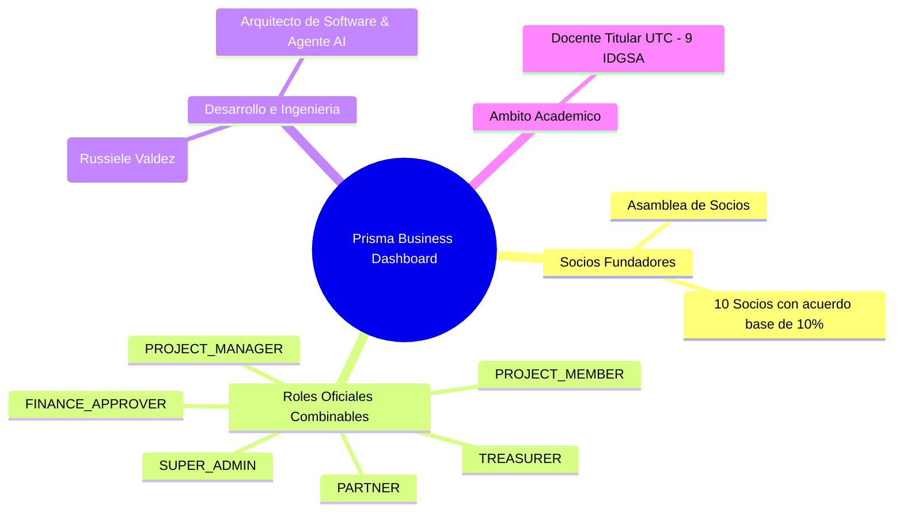

# Project Charter (Acta de Constitución del Proyecto)
## Prisma Business Dashboard

---

## 1. Información General del Proyecto

| Parámetro | Detalle |
| :--- | :--- |
| **Nombre del Sistema** | Prisma Business Dashboard |
| **Organización Propietaria** | Grupo Prisma S.A.P.I. de C.V. |
| **Naturaleza Jurídica** | Sociedad Anónima Promotora de Inversión de Capital Variable (México) |
| **Institución Académica** | Universidad Tecnológica de Coahuila (UTC) |
| **Programa Académico** | Ingeniería en Desarrollo y Gestión de Software (9 IDGSA) |
| **Asignatura** | Desarrollo Web Integral (Unidad 3) |
| **Repositorio Oficial** | `prisma-business-dashboard` |
| **Fecha de Inicio Documental** | Noviembre 2026 |
| **Líder / Propietario del Proyecto** | Russiele Valdez (Product Owner) |

---

## 2. Justificación y Contexto del Negocio

**Grupo Prisma S.A.P.I. de C.V.** es una entidad de inversión estructurada bajo el régimen de Sociedad Anónima Promotora de Inversión. La empresa cuenta inicialmente con **10 socios fundadores**, quienes mantienen un acuerdo inicial de participación paritaria del **10%** cada uno. Se documenta como acuerdo base de voluntades entre socios fundadores, distinguiendo claramente:
1. **Participación societaria inicial acordada (10% de base).**
2. **Aportaciones reales de capital al fondo común o cuentas de tesorería.**
3. **Derechos económicos y distribución de utilidades independientes por cada proyecto de inversión.**

Actualmente, las operaciones del grupo presentan las siguientes problemáticas:
- **Dispersión de la información:** Registro informal o manual de aportaciones, tesorería y acuerdos económicos en hojas de cálculo no auditables.
- **Riesgo en autorizaciones de gasto:** Ausencia de un flujo estricto de doble autorización electrónica para erogaciones de capital común y separación formal respecto a la ejecución de pagos.
- **Falta de visibilidad de proyectos:** Dificultad para rastrear tiempos, atrasos, presupuestos, gastos reales ejecutados y utilidades proyectadas en proyectos de inversión rápida (compra-venta de vehículos en remates y adecuación/venta de inmuebles en remates bancarios).
- **Complejidad en la distribución de utilidades:** La necesidad de separar estrictamente la tenencia societaria base acordada (10%) de los acuerdos económicos específicos por proyecto de inversión, requiriendo un cierre financiero formal antes de repartir ganancias.

---

## 3. Objetivos del Proyecto

### 3.1. Objetivo General
Diseñar y desarrollar una plataforma web integral, robusta y segura (Prisma Business Dashboard) que centralice la administración de socios, cuentas de tesorería, flujos de doble autorización de transacciones, seguimiento exhaustivo de proyectos de inversión y generación de indicadores clave (KPIs) financieros para la toma de decisiones directivas de Grupo Prisma S.A.P.I. de C.V.

### 3.2. Objetivos Específicos
1. **Gobernanza Societaria:** Gestionar el padrón de socios fundadores, sus perfiles de acceso y la trazabilidad de sus aportaciones y acuerdos.
2. **Control Riguroso de Tesorería:** Implementar un sistema de registro de transacciones con almacenamiento de importes en enteros (centavos de peso MXN) y cálculo dinámico de balances a partir de movimientos formalmente confirmados.
3. **Mecanismo de Doble Autorización Inexcusable:** Establecer un flujo transaccional donde cada movimiento financiero exija la aprobación de dos autorizadores distintos, excluyendo al solicitante e imposibilitando la excepción por parte del `SUPER_ADMIN`.
4. **Administración Integral de Proyectos:** Monitorear el ciclo de vida de los proyectos de inversión en remates de vehículos e inmuebles, registrando presupuestos, gastos reales, hitos, minutas, documentos probatorios y cierre de utilidades.
5. **Dashboard Ejecutivo y Analítica:** Proveer un tablero de control con gráficos interactivos que refleje el rendimiento financiero, utilidades acumuladas, balance global y salud operativa de los proyectos activos.
6. **Cumplimiento Académico:** Acreditar los requisitos de la Unidad 3 de la materia de Desarrollo Web Integral, documentando arquitectura de microservicios/REST, consumo de servicios externos, persistencia con ORM y modelo de seguridad.

---

## 4. Alcance del Sistema

### 4.1. Alcance Incluido (In Scope)
- **Módulo de Usuarios, Socios y Autenticación:** Registro de socios, asignación de roles RBAC, autenticación segura mediante JSON Web Tokens (JWT) y cifrado de contraseñas con bcrypt.
- **Módulo de Tesorería:** Catálogo de cuentas financieras (bancarias, efectivo, inversión), solicitud de movimientos, transferencias internas y bitácora de saldos calculados.
- **Módulo de Aprobaciones:** Motor de autorizaciones con regla 2-man (doble firma), bitácora de firmas, rechazos fundamentados y soporte de reversión compensatoria.
- **Módulo de Proyectos de Inversión:** Registro de proyectos (Automotriz, Inmobiliario, Otros), asignación de responsable y equipo, hitos con porcentaje de avance, gestión documental (metadatos de facturas/fotos) y minutas de juntas.
- **Módulo de Acuerdos Económicos y Utilidades:** Configuración de reparto de utilidades por proyecto con validación obligatoria de suma al 100% y liquidación vinculada al cierre financiero.
- **Módulo de Tablero Ejecutivo (Dashboard):** Gráficas de flujo de efectivo, estado de proyectos y retorno de inversión utilizando Recharts.
- **Servicios Web:** API REST interna documentada mediante Swagger/OpenAPI y consumo de un servicio web externo (ej. tipo de cambio oficial).

### 4.2. Alcance Excluido (Out of Scope)
- Conexión directa a pasarelas de pago bancarias (SPEI automático en tiempo real); las operaciones se concilian y registran dentro del sistema.
- Procesamiento contable fiscal (emisión y timbrado de CFDI ante el SAT en esta versión preliminar).
- Aplicación móvil nativa (el sistema contará con interfaz web responsive adaptada a dispositivos móviles).

---

## 5. Stakeholders y Equipo de Trabajo

---

## 6. Restricciones y Supuestos Clave

### Restricciones Tecnológicas y Arquitectónicas Confirmadas:
- **Estructura de Repositorio:** Monorepo gestionado mediante npm workspaces (`apps/web` para frontend y `apps/api` para backend), manteniendo la carpeta `docs/` independiente en la raíz del espacio de trabajo.
- **Frontend:** React + Vite, TypeScript, Tailwind CSS, Recharts (ubicado en `apps/web`).
- **Backend:** NestJS, TypeScript, API REST, JWT, bcrypt (ubicado en `apps/api`).
- **Persistencia y Prisma ORM:** SQLite gobernado exclusivamente por Prisma ORM, con el esquema `schema.prisma`, migraciones y base local alojados estrictamente dentro de `apps/api/prisma/`.
- **Almacenamiento de Evidencias:** Almacenamiento local inicial (`apps/api/uploads/`), implementado bajo una capa de abstracción desacoplada (`StorageService` / `IStorageProvider`) para permitir una migración futura a almacenamiento en la nube (S3, Cloud Storage) sin alterar la lógica de negocio.
- **Moneda:** Todos los importes en base de datos se registran estrictamente como enteros en centavos para evitar discrepancias de redondeo por coma flotante (IEEE 754).
- **Seguridad y Privacidad de Datos:** La base de datos SQLite, los archivos de evidencia y los secretos de entorno (`.env`) jamás se versionan ni exponen en repositorios públicos. El seeder inicial (`seed.ts`) utiliza datos de 10 socios ficticios para desarrollo y pruebas; queda estrictamente prohibido registrar o commitear datos personales o reales de socios en el repositorio público.
- **Métricas de Calidad:** Las metas de cobertura de pruebas, tiempos de respuesta y rendimiento se clasifican como objetivos técnicos preliminares orientativos sujetos a validación empírica, no como garantías definitivas cerradas.

### Supuestos y Reglas de Negocio Clave:
- Los 10 socios fundadores mantienen inicialmente una participación acordada del 10% cada uno.
- El capital inicial y el financiamiento de proyectos proviene del fondo común del grupo.
- Las transferencias entre cuentas propias de Grupo Prisma no representan egresos ni ingresos netos.
- Toda operación de egreso exige dos autorizaciones independientes registradas por usuarios con rol `FINANCE_APPROVER` o facultados (solicitante excluido, `SUPER_ADMIN` sin bypass).
- La ejecución y desembolso bancario se registra de manera separada de la autorización, a cargo del rol `TREASURER`.

