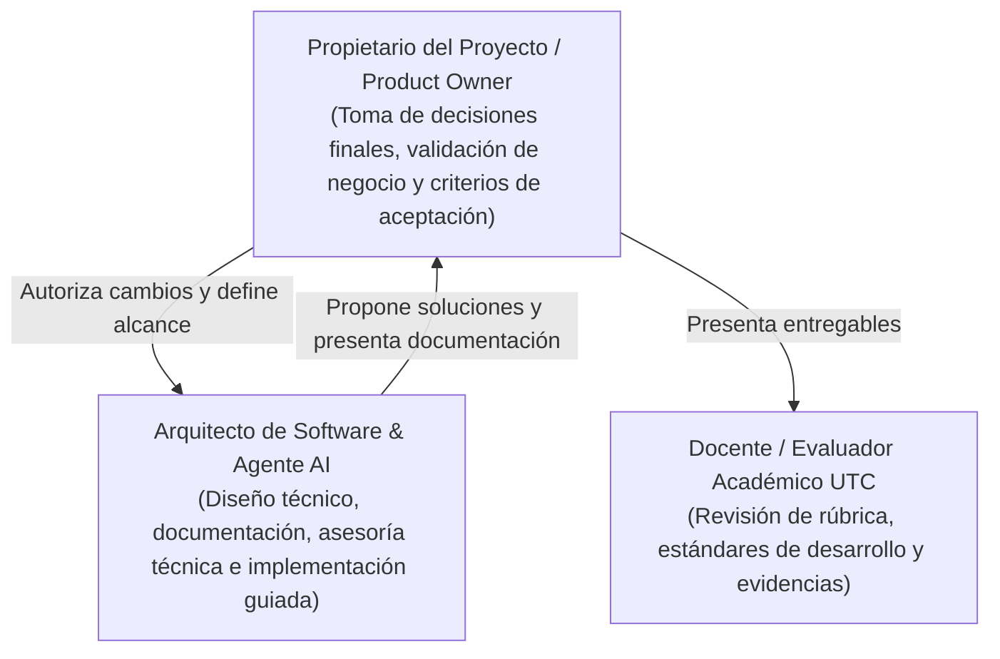

# Reglas de Trabajo y Gobierno Documental
## Prisma Business Dashboard - Grupo Prisma S.A.P.I. de C.V.

Este documento establece el marco normativo y operativo obligatorio que rige a todos los participantes (desarrolladores, arquitectos, agentes de IA y evaluadores) durante la ejecución, mantenimiento y evolución del sistema **Prisma Business Dashboard**.

---

## 1. Propósito del Repositorio Documental

La carpeta `docs/` constituye la **fuente oficial y única de la verdad** técnica, funcional y de negocio para el proyecto. Ninguna decisión técnica, cambio de arquitectura, alteración de modelo de datos o modificación de reglas de negocio puede implementarse en código sin estar previamente documentada y aprobada en esta estructura.

### Estructura General de Navegación

| Directorio | Propósito y Contenido Principal |
| :--- | :--- |
| `00_GESTION_PROYECTO/` | Gobernanza, Project Charter, Plan Maestro de Fases, Control de Cambios y Estado Actual. |
| `01_REQUISITOS/` | Requisitos funcionales, no funcionales, historias de usuario detalladas y reglas de negocio. |
| `02_ARQUITECTURA/` | Diseño arquitectónico (C4), patrones de diseño, estructura de código y servicios web. |
| `03_BASE_DE_DATOS/` | Modelo Entidad-Relación, Diccionario de Datos y Reglas de Integridad Referencial. |
| `04_SEGURIDAD_Y_FINANZAS/` | Modelo de roles (RBAC), reglas financieras, flujo de doble autorización y auditoría. |
| `05_PLANIFICACION/` | Product Backlog, Roadmap de entregas, Criterios de Aceptación (DoD/DoR) y Seguimiento de Fases. |
| `06_PRUEBAS/` | Estrategia de pruebas (Jest, Supertest), catálogo de casos de prueba y registro de resultados. |
| `07_ENTREGA_ACADEMICA/` | Requisitos de la Unidad 3 (UTC), matriz de evidencias y control de pendientes de entrega. |
| `BITACORA/` | Bitácora histórica de sesiones, plantilla reutilizable de cierre y guía de próxima sesión. |

---

## 2. Las 12 Reglas Obligatorias de Trabajo para Todas las Sesiones

Estas reglas son inmutables y de cumplimiento estricto en cada interacción con el proyecto:

1. **Lectura Previa Obligatoria:** Leer `docs/00_GESTION_PROYECTO/ESTADO_ACTUAL.md` y `docs/BITACORA/PROXIMA_SESION.md` antes de iniciar cualquier sesión de trabajo.
2. **Consulta del Plan Maestro:** Consultar `docs/00_GESTION_PROYECTO/PLAN_MAESTRO.md` para verificar cuál es la fase vigente y sus límites de alcance.
3. **Consulta de Documentación Técnica:** Consultar los documentos técnicos y especificaciones vinculadas a la actividad antes de escribir o modificar código.
4. **Respeto a Criterios de Aceptación de Fase:** No avanzar de fase sin haber cumplido y validado documental y técnicamente los criterios de aceptación y salida de la fase previa.
5. **Inmutabilidad de Reglas de Negocio:** No modificar bajo ninguna circunstancia las reglas de negocio aprobadas sin la autorización expresa y documentada del propietario del proyecto.
6. **Gestión de Contradicciones Técnicas:** Si surge una contradicción técnica, ambigüedad o impedimento, documentarla inmediatamente en la bitácora y proponer alternativas de solución antes de alterar cualquier diseño.
7. **Criterio de Terminación Real:** No asumir jamás que una tarea o funcionalidad está terminada únicamente porque el código compila o no arroja errores de sintaxis; debe cumplir su Definition of Done (DoD).
8. **Registro Obligatorio en Bitácora:** Registrar todas las actividades, modificaciones, errores y decisiones relevantes en `docs/BITACORA/BITACORA_SESIONES.md`.
9. **Actualización al Cierre:** Al finalizar cada sesión de trabajo, actualizar obligatoriamente:
   - `docs/BITACORA/BITACORA_SESIONES.md` (con la entrada detallada de la sesión).
   - `docs/00_GESTION_PROYECTO/ESTADO_ACTUAL.md` (resumen ejecutivo del estado del proyecto).
   - `docs/BITACORA/PROXIMA_SESION.md` (instrucciones claras para la reanudación).
10. **Trazabilidad de Código con Backlog:** Cada avance implementado, commit o módulo de código debe estar directamente vinculado a una historia de usuario o tarea específica del Product Backlog (`docs/05_PLANIFICACION/PRODUCT_BACKLOG.md`).
11. **Autorización Previa para Operaciones Técnicas:** No ejecutar validaciones automáticas, servidores, pruebas, automatizaciones ni instalaciones de dependencias sin la autorización expresa del propietario del proyecto.
12. **Delimitación Estricta del Alcance:** No modificar archivos, rutas o componentes fuera del alcance específico de la tarea solicitada.

---

## 3. Roles y Gobierno del Proyecto

### Propietario del Proyecto (Product Owner)
- Máxima autoridad en decisiones de negocio, financieras y de alcance.
- Única persona facultada para autorizar cambios en las reglas de negocio y transiciones de fase.
- Valida los entregables frente a los criterios de aceptación.

### Arquitecto de Software y Agente de Desarrollo
- Responsable de velar por la coherencia técnica, modularidad, rendimiento y seguridad de la arquitectura.
- Asesor técnico: expone implicaciones, riesgos y ventajas de cada decisión técnica.
- Ejecutor estricto del alcance definido, respetando las 12 reglas de trabajo sin tomar iniciativas unilaterales.

---

## 4. Protocolo de Inicio y Cierre de Sesión

### Al Iniciar Sesión:
1. Abrir y revisar `docs/00_GESTION_PROYECTO/ESTADO_ACTUAL.md`.
2. Abrir y revisar `docs/BITACORA/PROXIMA_SESION.md`.
3. Confirmar con el usuario el objetivo específico de la jornada.

### Al Finalizar Sesión:
1. Copiar la estructura de `docs/BITACORA/PLANTILLA_CIERRE_SESION.md`.
2. Completar los 12 puntos obligatorios de la plantilla en `docs/BITACORA/BITACORA_SESIONES.md`.
3. Sincronizar el estado en `docs/00_GESTION_PROYECTO/ESTADO_ACTUAL.md`.
4. Dejar redactada la guía en `docs/BITACORA/PROXIMA_SESION.md`.

