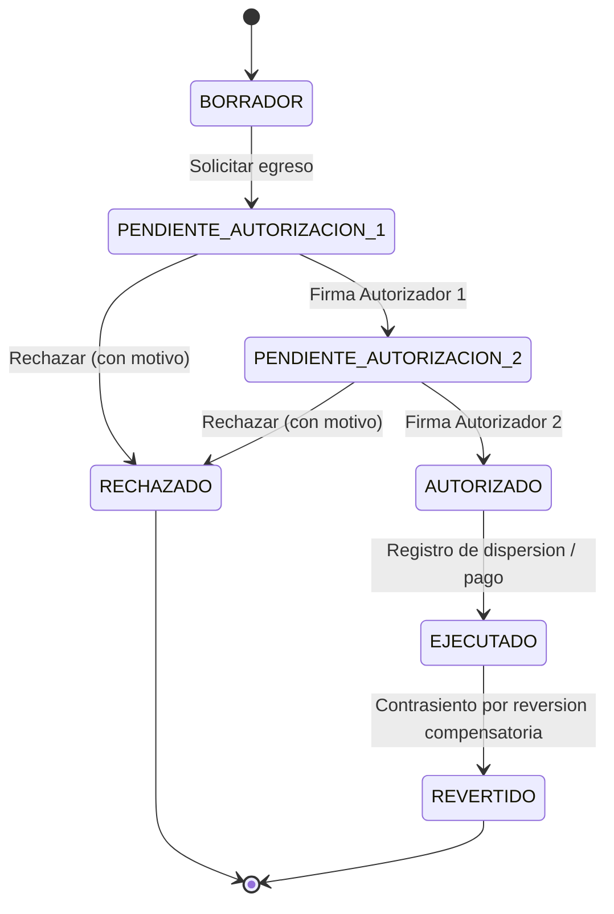

# Reglas de Negocio Oficiales (RN)
## Prisma Business Dashboard - Grupo Prisma S.A.P.I. de C.V.

Este documento contiene las reglas de negocio confirmadas y aprobadas que rigen el funcionamiento del sistema. **Estas decisiones no pueden ser modificadas unilateralmente por ningún desarrollador ni agente técnico.**

---

## 1. Reglas sobre Socios y Gobierno Corporativo (RN-SOC)

### RN-SOC-01: Constitución de Socios Fundadores
- El grupo empresarial inicia formalmente con exactamente **diez (10) socios fundadores**.
- La participación societaria inicial acordada corresponde al **10.00%** para cada uno de los diez socios fundadores.
- Esta participación del 10% se registra como un acuerdo de voluntades inicial entre fundadores; no se declara formalizada estatutariamente en tanto no se aporte el acta constitutiva debidamente protocolizada.
- La suma de las participaciones acordadas del grupo debe totalizar siempre el **100.00%**.

### RN-SOC-02: Condición del SUPER_ADMIN
- El usuario con rol `SUPER_ADMIN` debe ser necesariamente **uno de los diez socios fundadores**.
- No pueden existir cuentas `SUPER_ADMIN` asignadas a personal externo que no ostente la calidad de socio fundador en la base de datos.

### RN-SOC-03: Independencia Conceptual
El sistema debe mantener estricta separación lógica y contable entre los siguientes tres conceptos:
1. **Participación Societaria:** Porcentaje acordado de tenencia en la sociedad (10.00% base inicial entre los fundadores).
2. **Aportaciones de Capital:** Montos dinerarios reales aportados por los socios al fondo común o cuentas de tesorería para fondear operaciones.
3. **Distribución de Utilidades:** Ganancias netas generadas en proyectos específicos y liquidadas de acuerdo con el acuerdo económico individual de cada proyecto.
> *Participar con el 10% en el acuerdo de socios de la empresa no obliga ni implica que en cada proyecto de inversión el socio participe con el 10% de la utilidad ni que deba aportar el 10% del capital requerido.*

### RN-SOC-04: Exclusividad en Administración de Socios
- El alta, modificación de datos de contacto o reasignación de partes de participación de los socios corresponde **exclusivamente al usuario con rol `SUPER_ADMIN`**.

---

## 2. Reglas sobre Financiamiento y Tesorería (RN-FIN)

### RN-FIN-01: Almacenamiento Numérico en Centavos
- Todo valor monetario que exprese dinero en pesos mexicanos (MXN) debe almacenarse en la base de datos exclusivamente como un **número entero en centavos**.
- *Ejemplo:* `$12,450.75 MXN` se almacena estrictamente como `1245075`.
- Se prohíbe el uso de tipos de datos de punto flotante (`REAL`, `FLOAT`, `DOUBLE`) para magnitudes financieras en SQLite y Prisma ORM, con el fin de evitar discrepancias aritméticas por redondeo IEEE 754.

### RN-FIN-02: Fondo Común de Financiamiento
- Los proyectos de inversión se financian a través del **capital común** acumulado en las cuentas de tesorería del grupo.
- Ningún proyecto opera con cuentas externas o no fiscalizadas por el sistema de tesorería central.

### RN-FIN-03: Neutralidad de Transferencias Internas
- Una transferencia de fondos entre dos cuentas pertenecientes a Grupo Prisma (ej. de "Cuenta Bancaria Banorte" a "Caja Chica Operativa") **no constituye un ingreso ni un egreso** para el grupo.
- El sistema debe debitar de la cuenta origen y acreditar a la cuenta destino de forma atómica sin afectar el estado de resultados ni las métricas de utilidad global.

### RN-FIN-04: Cálculo Dinámico de Saldos
- El saldo disponible de una cuenta financiera nunca se almacena como un valor estático editable.
- El saldo se calcula en tiempo real (o mediante vistas materializadas calculadas) a través de la sumatoria de todos los movimientos que cuenten con estatus formal de **CONFIRMADO / EJECUTADO**.

---

## 3. Reglas sobre Autorizaciones y Control Interno (RN-AUT)

### RN-AUT-01: Doble Autorización Inexcusable (Regla 2-Man)
- Toda operación financiera de egreso o retiro de fondos exige de forma obligatoria **dos autorizaciones independientes previas** otorgadas por usuarios con facultad autorizadora (`FINANCE_APPROVER` o roles facultados) para poder pasar al estado `AUTORIZADO`.

### RN-AUT-02: Segregación Estricta de Personas
- Los dos autorizadores de una transacción deben ser **dos personas físicas distintas** registradas como usuarios del sistema.
- Ningún usuario puede firmar como Autorizador 1 y Autorizador 2 de la misma operación.

### RN-AUT-03: Exclusión Obligatoria del Solicitante
- El usuario que genera o registra la solicitud de la operación financiera **tiene estrictamente prohibido autorizar su propia operación**, ya sea como Autorizador 1 o como Autorizador 2.

### RN-AUT-04: Inviolabilidad de la Regla por el SUPER_ADMIN
- Ni siquiera el usuario con rol `SUPER_ADMIN` tiene facultades para omitir, saltarse o forzar la ejecución de una operación financiera sin haber reunido las dos firmas independientes requeridas.

### RN-AUT-05: Separación Estricta entre Autorización y Ejecución
- El acto de **autorizar** (evaluación y firma digital por `FINANCE_APPROVER`) es técnica y procedimentalmente independiente del acto de **ejecutar** (desembolso bancario y afectación contable por `TREASURER`).
- Un movimiento en estado `AUTORIZADO` no descuenta saldo de la cuenta de tesorería hasta que el usuario con rol `TREASURER` registra formalmente la ejecución bancaria (`EJECUTADO`) con comprobante y datos de dispersión.

### RN-AUT-06: Inmutabilidad de Operaciones Ejecutadas y Movimientos Contables
- Una vez que una operación financiera alcanza el estado `EJECUTADO`, **queda estrictamente prohibido eliminarla (`DELETE`) o modificar sus datos sustantivos (`UPDATE`)**.
- Los registros y movimientos contables asociados son inmutables para efectos de auditoría y trazabilidad.

### RN-AUT-07: Procedimiento de Reversión Compensatoria
- Cuando se detecte un error de captura, duplicidad bancaria o cobro improcedente sobre un movimiento ejecutado:
  1. No se elimina ni altera el registro original.
  2. Se genera una solicitud de **Reversión Compensatoria (Contrasiento)** que ingresa con signo inverso y vinculada a la operación original.
  3. La reversión requiere justificación obligatoria y debe someterse al mismo flujo de doble autorización independiente antes de ser ejecutada.
  4. La operación original pasa al estado de `REVERTIDO`.

### RN-AUT-08: Trazabilidad y Segregación de Roles en el Registro
- Cada operación financiera debe registrar de manera indeleble y diferenciada:
  - Identificador de usuario que solicitó la operación.
  - Identificador y sello de tiempo del Autorizador 1 (`FINANCE_APPROVER`).
  - Identificador y sello de tiempo del Autorizador 2 (`FINANCE_APPROVER`).
  - Identificador y sello de tiempo del Tesorero que registró la ejecución y desembolso (`TREASURER`).

---

## 4. Reglas sobre Proyectos y Utilidades (RN-PRJ)

### RN-PRJ-01: Acuerdo Económico Individualizado
- La distribución de las ganancias de cada proyecto de inversión se define de manera individual e independiente mediante un **Acuerdo Económico de Proyecto**.

### RN-PRJ-02: Integridad del 100% en Utilidades
- Los porcentajes de participación asignados a los socios en el acuerdo económico de un proyecto deben sumar **exactamente el 100.00%**.
- El sistema no permitirá guardar ni aprobar ningún acuerdo cuya suma porcentual sea diferente a 100.00% (ej. 99.99% o 100.01% serán rechazados).

### RN-PRJ-03: Requisito de Cierre Financiero Formal
- Queda prohibida la dispersión o distribución de utilidades de un proyecto si este no cuenta con:
  1. Estado de **Cierre Financiero Formalmente Aprobado**.
  2. Todos sus gastos e ingresos reales liquidados y conciliados contra tesorería.
  3. Acuerdo económico vigente debidamente validado al 100%.

### RN-PRJ-04: Casos de Negocio Específicos
El sistema debe estar parametrizado desde el inicio para gestionar dos líneas estratégicas de inversión:
1. **Adquisición y Reventa de Vehículos en Remates:** Control de costo de lote, flete, mecánica, hojalatería, estética automotriz y venta final.
2. **Remates Bancarios Inmobiliarios:** Control de cesión de derechos litigiosos, gastos notariales, trámites de desalojo/posesión, remodelación y comercialización de la propiedad.

---

## 5. Reglas de Seguridad y Persistencia (RN-SEG)

### RN-SEG-01: Aislamiento del Motor SQLite
- La base de datos SQLite opera en el servidor y es manipulada exclusivamente a través del servicio backend mediante Prisma ORM.
- El cliente frontend jamás interactúa directamente con el archivo físico de base de datos.

### RN-SEG-02: Confidencialidad del Repositorio
- El archivo de base de datos SQLite (`*.db`, `*.sqlite`) y los archivos de secretos (`.env`) están catalogados como información clasificada del grupo.
- Está terminantemente prohibido hacer commit o publicar dichos archivos en repositorios públicos de control de versiones (Git).

