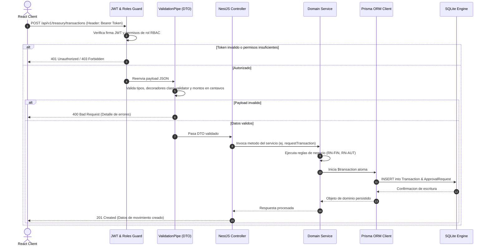

# Arquitectura de Software
## Prisma Business Dashboard - Grupo Prisma S.A.P.I. de C.V.

Este documento describe la arquitectura global del sistema **Prisma Business Dashboard**, fundamentada en una arquitectura de monolito modular desacoplado (Decoupled Modular Architecture) con separación total entre la capa de presentación (Frontend SPA) y la capa de servicios de negocio (Backend REST API).

---

## 1. Visión General de la Arquitectura

```mermaid
flowchart TB
    subgraph ClientTier ["Capa de Presentacion (Frontend SPA)"]
        UI["React 18 + TypeScript + Vite"]
        Tailwind["Tailwind CSS (Estilos y Diseno Adaptable)"]
        Recharts["Recharts (Visualizacion de Datos y KPIs)"]
        UI --- Tailwind
        UI --- Recharts
    end

    subgraph APITier ["Capa de Servicios y Logica de Negocio (Backend NestJS)"]
        Gateway["REST API Gateway (Express / NestJS Runtime)"]
        Security["Guards: AuthGuard (JWT) + RolesGuard (RBAC)"]
        Pipes["ValidationPipe (class-validator / class-transformer)"]
        
        subgraph Modules ["Modulos de Dominio (NestJS Modules)"]
            AuthMod["AuthModule"]
            UsersMod["UsersModule / PartnersModule"]
            TreasuryMod["TreasuryModule (Cuentas y Transacciones)"]
            ApprovalsMod["ApprovalsModule (Motor Doble Autorizacion)"]
            ProjectsMod["ProjectsModule (Autos e Inmuebles)"]
            DashboardMod["DashboardModule (Analitica)"]
            AuditMod["AuditModule (Trazabilidad)"]
        end

        PrismaService["Prisma ORM Client ($transaction / Models)"]
        
        Gateway --> Security --> Pipes --> Modules
        Modules --> PrismaService
    end

    subgraph DataTier ["Capa de Persistencia"]
        SQLite[("Base de Datos SQLite (Local Encapsulada)")]
        PrismaService -->|Acceso exclusivo SQL nativo| SQLite
    end

    subgraph ExternalServices ["Servicios Web Externos"]
        CurrencyAPI["API de Tipo de Cambio / Divisas"]
        Modules -.->|Consumo HTTP REST| CurrencyAPI
    end

    UI -->|Peticiones HTTP Asincronas (Axios/Fetch con Bearer JWT)| Gateway
```

---

## 2. Modelo C4 - Nivel Contenedores

| Contenedor | Tecnología | Responsabilidad |
| :--- | :--- | :--- |
| **Frontend Web App** | React 18, Vite, TypeScript, Tailwind CSS, Recharts | Interfaz interactiva de usuario. Renderizado de vistas, captura de formularios, presentación de gráficas financieras y manejo de sesión local. |
| **Backend API REST** | NestJS, TypeScript, Node.js (LTS), Passport JWT, bcrypt | Expone endpoints RESTful protegidos. Orquesta la lógica financiera, aplica la doble autorización, ejecuta transacciones atómicas y genera pistas de auditoría. |
| **ORM / Data Access** | Prisma ORM | Capa de abstracción y mapeo objeto-relacional. Gestiona el esquema tipado, migraciones automáticas y consultas seguras a la base de datos sin SQL injection. |
| **Persistencia Local** | SQLite | Archivo relacional embebido en el servidor. Almacena las tablas de usuarios, socios, proyectos, transacciones y bitácoras con soporte ACID local. |

---

## 3. Ciclo de Vida de una Petición HTTP (Request Pipeline)

Cada petición que ingresa al backend NestJS atraviesa el siguiente canal estructurado de procesamiento:



---

## 4. Desacoplamiento y Seguridad Arquitectónica

1. **Inyección de Dependencias (IoC):** Todos los servicios, repositorios y utilidades de backend se comunican mediante inversión de control e inyección de dependencias nativa de NestJS, asegurando bajo acoplamiento y alta capacidad de pruebas unitarias mediante mocks.
2. **Encapsulamiento del Motor SQLite:** El archivo de base de datos reside en el sistema de archivos del servidor backend. Ninguna parte del cliente React posee credenciales, ruta ni visibilidad de dicho archivo.
3. **Manejo Centralizado de Excepciones:** Se implementa un filtro de excepciones global (`AllExceptionsFilter`) que intercepta errores no controlados, los registra en el log interno y retorna al frontend respuestas JSON estructuradas y sanitizadas (evitando fugas de stack traces o nombres de tablas).
4. **Transformación de Datos:** Los importes monetarios se transfieren en centavos como enteros. En la capa de presentación de React, se cuenta con funciones puras de formateo a pesos mexicanos (`formatCentsToMXN(10050) -> "$100.50"`), garantizando consistencia y cero desajustes de precisión.

