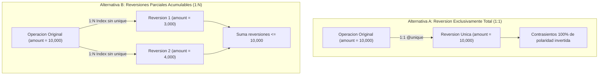
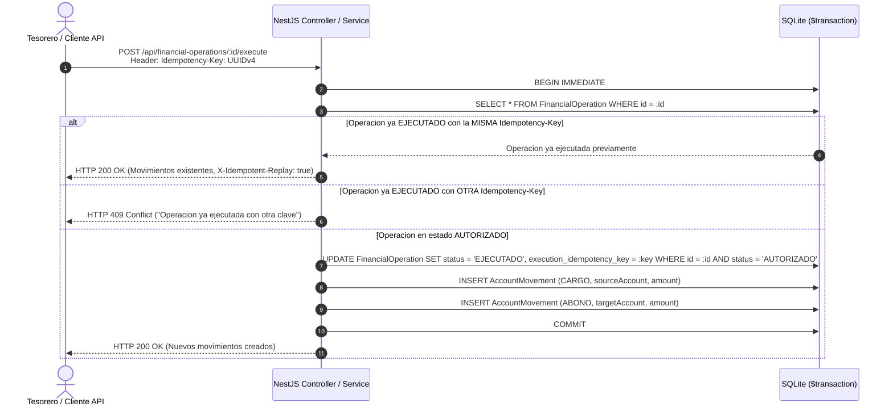
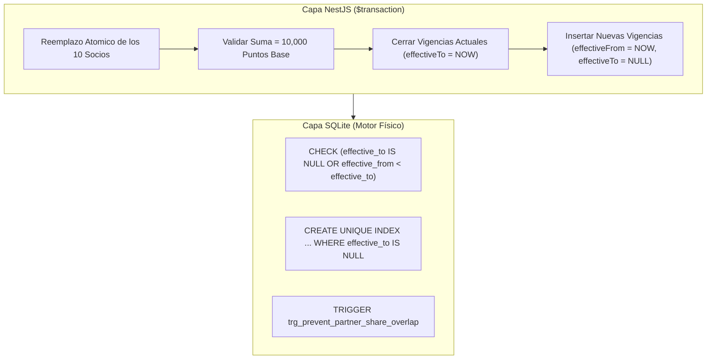
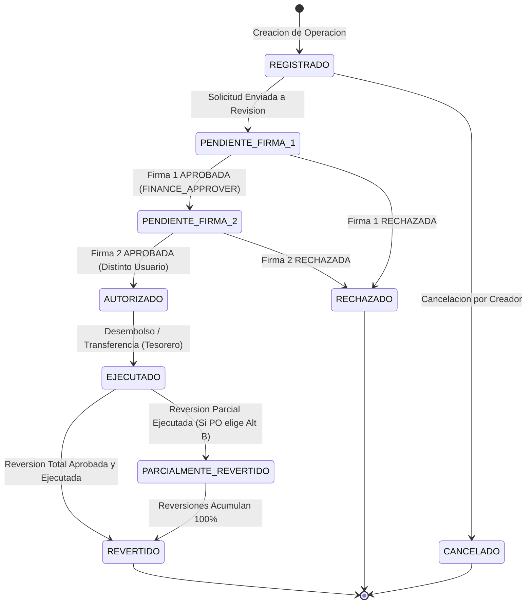

# CUARTA REVISIÓN CORRECTIVA — CIERRE DE INCONSISTENCIAS TÉCNICAS
## Prisma Business Dashboard — Grupo Prisma S.A.P.I. de C.V.
### Fase 2: Modelo de Datos y Migraciones SQLite

- **Fecha de Elaboración:** 2026-11-06  
- **Autor / Rol:** Arquitecto de Software Senior & Especialista en Sistemas Financieros Transaccionales  
- **Destinatario:** Russiele Valdez (Product Owner / Propietario del Proyecto)  
- **Estado del Dictamen:** REVISIÓN CORRECTIVA DE ARQUITECTURA (FASE 2 NO APROBADA)  
- **Línea Base Normativa:** RFC-001 al RFC-006, Plan Maestro de Desarrollo.

---

## 1. RESUMEN EJECUTIVO

El presente informe constituye la **Cuarta Revisión Correctiva de Diseño** para la **FASE 2: MODELO DE DATOS Y MIGRACIONES SQLITE** de **Prisma Business Dashboard**. 

Esta actividad actúa como auditoría y cierre riguroso de las soluciones planteadas en la Tercera Revisión (`TERCERA_REVISION_RESOLUCION_INCONSISTENCIAS.md`), resolviendo de forma definitiva seis inconsistencias técnicas específicas sin repetir diagnósticos preliminares ni alterar el catálogo oficial de **28 entidades relacionales**.

En cumplimiento estricto con las restricciones absolutas de gobernanza:
- **No se modifica `apps/api/prisma/schema.prisma`**.
- **No se generan migraciones ni se crean tablas físicas en SQLite**.
- **No se crea `seed.ts` ni se instalan dependencias**.
- **No se ejecutan servidores ni pruebas automáticas**.
- **No se agregan entidades oficiales (se mantienen exactamente las 28 entidades aprobadas)**.
- **No se declara aprobada la Fase 2**, preservando el derecho exclusivo del Propietario para la toma de decisiones de negocio.

---

## 2. REFERENCIA Y ALCANCE RESPECTO A LA TERCERA REVISIÓN

La Tercera Revisión aportó avances conceptuales definitivos (idempotencia, método de Hamilton para centavos residuales, separación de roles e inmutabilidad contable). No obstante, el escrutinio técnico detectó seis inconsistencias internas que requerían corrección inmediata:
1. **Conflicto de Unicidad en Reversiones:** La propuesta de `reversalOfOperationId @unique` bloqueaba físicamente cualquier soporte para reversiones parciales acumulables.
2. **Entidad 29 Silenciosa (`SystemSequence`):** La propuesta de una tabla de secuencias introducía una entidad no autorizada fuera del padrón de 28 entidades.
3. **Contrato Incompleto de Idempotencia:** Falta de especificación del ciclo de vida del token, colisiones, pérdida de respuestas de red y validación en transferencias.
4. **Vigencias de `PartnerShare` con Brechas de Superposición:** La unicidad parcial (`WHERE effective_to IS NULL`) no impedía intervalos históricos solapados.
5. **Indefinición Operativa en Cierres Rectificatorios:** Ausencia de políticas claras ante dividendos ya dispersados en exceso o proyectos con pérdida sobrevenida.
6. **Ambigüedad en la Máquina de Estados:** Dispersión de estados entre la operación financiera y la solicitud de aprobación.

A continuación se detalla la corrección exhaustiva de cada punto.

---

## 3. CORRECCIÓN 1 — REVERSIÓN COMPENSATORIA (TOTAL VS. PARCIAL Y RESTRICCIONES)

### 3.1. Diagnóstico del Conflicto de Unicidad
En la Tercera Revisión se formuló la restricción relacional:
```prisma
reversalOfOperationId String? @unique
```
Dicha restricción `@unique` impone a nivel del motor relacional una cardinalidad estricta $1:1$. Si bien esto es compatible con una reversión exclusivamente total, **invalida y bloquea de raíz la Alternativa B (reversiones parciales acumulables)**, ya que si una operación de \$10,000 MXN recibe dos reversiones parciales de \$5,000 MXN, la segunda inserción fallará con error `SQLITE_CONSTRAINT_UNIQUE`.

### 3.2. Análisis Formal de Alternativas



#### Alternativa A: Reversión Exclusivamente Total (Cardinalidad 1:1)
- **Concepto:** Una operación original solo puede ser objeto de una única reversión por el 100% exacto de su importe original.
- **1. Relaciones necesarias:**
  ```prisma
  // En FinancialOperation
  reversalOfOperationId String?             @unique
  reversalOf            FinancialOperation? @relation("OperationReversal", fields: [reversalOfOperationId], references: [id], onDelete: Restrict)
  reversalBy            FinancialOperation? @relation("OperationReversal")
  ```
- **2. Restricciones UNIQUE:** `@unique` sobre `reversalOfOperationId`. Garantiza físicamente que ninguna operación sea revertida más de una vez.
- **3. Restricciones CHECK:** `CHECK (amount_cents > 0)`.
- **4. Validaciones transaccionales en NestJS:**
  - Operación original debe estar estrictamente en estado `EJECUTADO`.
  - `reversal.amount_cents === original.amount_cents`.
  - Cuentas involucradas deben coincidir de forma invertida.
  - La reversión debe someterse a su propio flujo de doble aprobación (2 firmas independientes).
- **5. Riesgos de concurrencia:** Mínimos. Si dos solicitudes de reversión concurren, la restricción `@unique` de SQLite aborta inmediatamente la segunda con error de clave duplicada.
- **6. Impacto sobre saldos:** Neutralización contable exacta y simultánea del saldo dinámico.
- **7. Estados posibles:** La operación original pasa de `EJECUTADO` a `REVERTIDO`. La operación de reversión pasa por su ciclo hasta `EJECUTADO`.
- **8. Ejemplo numérico:** Operación OP-01 por \$10,000.00 MXN ($1,000,000$ cts). Reversión OP-02 por exactamente \$10,000.00 MXN ($1,000,000$ cts). Saldo neto resultante: \$0.00 MXN.

#### Alternativa B: Reversiones Parciales Acumulables (Cardinalidad 1:N)
- **Concepto:** Una operación original puede recibir múltiples reversiones parciales a lo largo del tiempo, siempre que la suma acumulada de las reversiones no exceda el importe original.
- **1. Relaciones necesarias:**
  ```prisma
  // En FinancialOperation
  reversalOfOperationId String?
  reversalOf            FinancialOperation?  @relation("OperationReversals", fields: [reversalOfOperationId], references: [id], onDelete: Restrict)
  reversals             FinancialOperation[] @relation("OperationReversals")
  ```
- **2. Restricciones UNIQUE:** **Se elimina `@unique`** en `reversalOfOperationId`; se sustituye por un índice ordinario `@@index([reversalOfOperationId])`.
- **3. Restricciones CHECK:** `CHECK (amount_cents > 0)`.
- **4. Validaciones transaccionales en NestJS:**
  - Se debe calcular dentro de una transacción serializada:
    $$\sum \text{reversiones\_ejecutadas} + \text{nueva\_reversion} \le \text{original.amount\_cents}$$
  - Si la suma supera el importe original, la transacción se aborta con `UnprocessableEntityException`.
- **5. Riesgos de concurrencia:** **Riesgo crítico de condición de carrera (*Race Condition*):** Dos reversiones parciales concurrentes de \$4,000 MXN sobre un saldo disponible de \$5,000 MXN podrían leer simultáneamente el mismo acumulado previo y autorizarse ambas, totalizando \$8,000 MXN y sobre-revirtiendo la operación. En SQLite, esto exige ejecutar la validación bajo `BEGIN IMMEDIATE` bloqueando escrituras concurrentes.
- **6. Impacto sobre saldos:** Afectación parcial del saldo dinámico proporcional a cada contrasiento ejecutado.
- **7. Estados posibles:**
  - Si $\sum \text{reversiones} < \text{original.amount\_cents} \implies$ Estado `PARCIALMENTE_REVERTIDO`.
  - Si $\sum \text{reversiones} == \text{original.amount\_cents} \implies$ Estado `REVERTIDO`.
- **8. Ejemplo numérico:** Operación OP-01 por \$10,000.00 MXN ($1,000,000$ cts). Reversión 1 (OP-02) por \$3,000.00 MXN $\rightarrow$ OP-01 pasa a `PARCIALMENTE_REVERTIDO`, saldo pendiente \$7,000.00 MXN. Reversión 2 (OP-03) por \$7,000.00 MXN $\rightarrow$ OP-01 pasa a `REVERTIDO`, saldo pendiente \$0.00 MXN.

### 3.3. Recomendación Técnica
Se recomienda la **Alternativa A (Reversión Exclusivamente Total)** para la arquitectura inicial debido a:
- Eliminación absoluta de condiciones de carrera y sobregiro de reversiones.
- Integridad forzada por el propio motor SQLite mediante `@unique(reversalOfOperationId)`.
- Alineación con las mejores prácticas de auditoría fiscal y contabilidad bancaria (notas de crédito y cancelaciones 1 a 1).
*Nota:* La selección de la política permanece como decisión abierta para el Propietario.

---

## 4. CORRECCIÓN 2 — IDENTIFICACIÓN DE OPERACIONES Y PRESERVACIÓN DE LAS 28 ENTIDADES

### 4.1. Diagnóstico del Conflicto de la Entidad 29
La Tercera Revisión propuso una tabla `SystemSequence` para folios correlativos (`OP-2026-0001`). Esto violaba el mandato de conservar estrictamente las 28 entidades oficiales, introduciendo una entidad 29 sin autorización del Propietario.

### 4.2. Comparación de Alternativas de Identificación Concurrente

| Criterio | Alternativa A: Identificador UUID + Código Alfanumérico Autónomo | Alternativa B: Incorporar Formalmente `SystemSequence` (Entidad 29) | Alternativa C: Secuencia Atómica en Transacción `BEGIN IMMEDIATE` (28 Entidades) |
| :--- | :--- | :--- | :--- |
| **Catálogo Oficial** | **Conserva estrictamente 28 entidades** | **Altera a 29 entidades** (requiere RFC) | **Conserva estrictamente 28 entidades** |
| **Garantía de Unicidad** | Absoluta (espacio probabilístico de UUIDv4 o ULID) | Absoluta (forzada por clave primaria de secuencia) | Absoluta (forzada por `code @unique` en `FinancialOperation`) |
| **Comportamiento en Concurrencia** | Excelente. Cero contención y cero bloqueos de base de datos. | Regular. Cuello de botella por contención de fila en la tabla de secuencias. | Bueno en SQLite con `BEGIN IMMEDIATE` y reintentos ante colisión. |
| **Atomicidad** | Generación previa en memoria sin depender de transacciones de base de datos. | Dependiente de la transacción de base de datos. | Atómica dentro de la transacción de creación de la operación. |
| **Facilidad de Implementación** | Muy alta. No requiere tablas ni triggers adicionales. | Media. Requiere tabla, seeds y lógica de incremento. | Media-Alta. Requiere cálculo de conteo transaccional o autoincremento nativo. |
| **Trazabilidad y Legibilidad** | Muy alta. Códigos como `OP-2026-7X9K2M` legibles para humanos. | Muy alta. Códigos estrictamente consecutivos `OP-2026-0001`. | Muy alta. Códigos correlativos `OP-2026-0001`. |
| **Complejidad de Mantenimiento** | Nula. Cero riesgo de desincronización de secuencias. | Media. Riesgo de huecos por transacciones abortadas. | Media. Manejo de huecos y control de concurrencia. |

### 4.3. Propuesta Técnica Recomendada (Sin Modificar las 28 Entidades)
Se descarta formalmente la creación de la tabla `SystemSequence`. Se presentan dos caminos que respetan el padrón de 28 entidades:
1. **Opción A (Recomendada Técnica): Código Autónomo Basado en Tiempo y Entropía:**
   - La llave primaria física sigue siendo `id String @id @default(uuid())`.
   - El código de negocio visible se genera en NestJS sin consultas previas:
     `code = "OP-" + YYYY + "-" + Base32(TimestampMs + RandomHex)` (ej. `OP-2026-8F3A92`).
   - Es humanamente legible, garantiza unicidad sin bloqueos concurrentes y respeta estrictamente las 28 entidades.
2. **Opción C: Correlativo Atómico en `BEGIN IMMEDIATE`:**
   - Dentro de la transacción atómica de creación, NestJS calcula el siguiente número mediante:
     ```sql
     SELECT coalesce(max(cast(substr(code, 9) as integer)), 0) + 1 
     FROM financial_operations 
     WHERE code LIKE 'OP-' || strftime('%Y', 'now') || '-%';
     ```
   - Gracias al cerrojo `BEGIN IMMEDIATE` de SQLite, ningún otro proceso puede intercalar un registro, asegurando consecutividad estricta sin requerir una tabla adicional.

---

## 5. CORRECCIÓN 3 — CONTRATO COMPLETO DE IDEMPOTENCIA FINANCIERA



### 5.1. Definición Formal de los 10 Puntos del Contrato
1. **Quién genera la clave:** El cliente que solicita la ejecución (interfaz React en `apps/web` o cliente API autorizado) genera un identificador universal criptográficamente seguro UUIDv4 (`crypto.randomUUID()`).
2. **Momento de generación:** Se genera en el cliente inmediatamente antes de despachar la petición de red, inyectándose en el encabezado HTTP: `Idempotency-Key: <UUIDv4>`.
3. **Lugar de almacenamiento:** Se persiste en la columna `execution_idempotency_key` de la tabla `FinancialOperation`.
4. **Alcance y unicidad:** Alcance global con restricción física `@unique` en `FinancialOperation`.
5. **Relación con la entidad:** Atributo unívoco de `FinancialOperation`. Es nulo mientras la operación está en estados previos y se asigna atómicamente al transicionar a `EJECUTADO`.
6. **Reintento con misma clave y mismos datos:** **Reproducción segura (*Safe Replay*).** Si la operación ya se encuentra en `EJECUTADO` y la clave coincide, NestJS recupera los `AccountMovement` ya persistidos y retorna HTTP 200 con el encabezado `X-Idempotent-Replay: true`. No se alteran saldos ni se duplican asientos.
7. **Reintento con misma clave pero datos/operación distinta:** **Conflicto de integridad.** Si una petición envía una clave ya asociada a otra operación, NestJS rechaza inmediatamente con `HTTP 409 Conflict` / `HTTP 422 Unprocessable Entity` ("Clave de idempotencia ya utilizada en otra operación financiera").
8. **Uso de clave distinta sobre operación ya ejecutada:** Si una operación ya fue ejecutada (posee clave $K_1$) y se recibe una nueva solicitud con clave $K_2$, NestJS rechaza con `HTTP 409 Conflict` ("La operación ya fue ejecutada bajo otra clave de idempotencia").
9. **Pérdida de respuesta HTTP post-commit (Falla de red):** Si el servidor ejecuta el commit en SQLite pero la conexión de red se interrumpe antes de entregar el HTTP 200 al cliente, el cliente reintentará automáticamente con la **misma clave de idempotencia**. Al llegar la nueva petición, el servidor aplica el punto 6, devolviendo el resultado exitoso sin duplicar cargos ni abonos.
10. **Recuperación del resultado confirmado:** El cliente puede recuperar en todo momento el resultado mediante la re-ejecución con la misma clave o mediante la consulta idempotente `GET /api/financial-operations/:id/movements`.

### 5.2. Invariantes Absolutos en Transferencias
Para que una transferencia financiera se considere íntegra, deben cumplirse simultáneamente los siguientes 6 invariantes:
- **Invariante 1:** Exactamente un movimiento de tipo `CARGO`.
- **Invariante 2:** Exactamente un movimiento de tipo `ABONO`.
- **Invariante 3:** Importes exactamente idénticos: `CARGO.amount_cents == ABONO.amount_cents == Operation.amount_cents`.
- **Invariante 4:** Cuentas correctas: El CARGO se aplica a `sourceAccountId` y el ABONO a `targetAccountId`.
- **Invariante 5:** Ambos movimientos comparten idéntico `financialOperationId`.
- **Invariante 6:** Prohibición de estado espurio: La operación **nunca se marca como `EJECUTADO` si falta cualquiera de los dos movimientos** o si la transacción falla.

### 5.3. Delimitación de Garantías: SQLite vs. NestJS

| Nivel de Garantía | Responsabilidad de SQLite | Responsabilidad de NestJS |
| :--- | :--- | :--- |
| **Atomicidad de Partida Doble** | Garantiza que o se insertan ambos movimientos o ninguno mediante `BEGIN IMMEDIATE ... COMMIT/ROLLBACK`. | Construye y envía ambas sentencias de inserción dentro del mismo bloque transaccional. |
| **Unicidad de Idempotencia** | Impide inserción duplicada en la columna `execution_idempotency_key` mediante índice `@unique`. | Captura el encabezado HTTP, valida formato UUIDv4 e implementa la lógica de retorno seguro (*Safe Replay*). |
| **Condición de Carrera en Estado** | Ejecuta la actualización atómica `WHERE id = ? AND status = 'AUTORIZADO'` rechazando concurrencia. | Comprueba filas afectadas (`count === 1`) y aborta con `ConflictException` si la operación ya no estaba autorizada. |
| **Solvencia y Fondos Suficientes** | Ejecuta la suma de saldos históricos. | Verifica que `saldo_dinamico >= amount_cents` antes de permitir la inserción del CARGO. |

---

## 6. CORRECCIÓN 4 — PARTNERSHARE Y VIGENCIAS TEMPORALES

### 6.1. Diagnóstico de la Brecha en Índices Únicos Parciales
El índice único parcial:
```sql
CREATE UNIQUE INDEX uq_partner_share_active ON partner_shares (partner_id) WHERE effective_to IS NULL;
```
Garantiza con éxito que ningún socio tenga dos participaciones vigentes simultáneas. **Sin embargo, es ciego ante los registros históricos ya cerrados (`effective_to IS NOT NULL`).** Un error en la aplicación o una inserción desfasada podría crear dos registros históricos superpuestos en el tiempo (ej. uno de enero a junio y otro de marzo a septiembre para el mismo socio), corrompiendo la línea de tiempo societaria.

### 6.2. Comparación de Mecanismos de Control

| Mecanismo | Capacidad de Control | Autoridad Asignada | Limitación en el Entorno |
| :--- | :--- | :--- | :--- |
| **A. Índice Único Parcial SQLite** | Garantiza exactamente un registro con `effective_to IS NULL` por socio. | **Autoridad en Motor de BD** | No previene solapamiento de fechas en registros históricos pasados. |
| **B. Trigger Nativo SQLite** | Valida que `[new.from, new.to)` no se solape con ningún intervalo existente del socio. | **Autoridad en Motor de BD (Regla de Integridad Física)** | Prisma Schema DSL no representa triggers; se debe inyectar en la migración SQL nativa. |
| **C. Validación Transaccional NestJS** | Valida suma exacta de 10,000 puntos base y reemplazo en bloque de los 10 socios. | **Autoridad en Aplicación (Regla de Negocio Global)** | No protege contra modificaciones directas en base de datos fuera de NestJS. |
| **D. Combinación Defensiva (Recomendada)** | Cobertura integral: BD valida unicidad y no-superposición; NestJS valida el negocio de los 10 socios. | **Estrategia Oficial** | Requiere documentar el archivo de migración SQL para no perder triggers en regeneraciones. |

### 6.3. Arquitectura de Garantías Integrada



1. **Regla de Cronología:** Restricción física en SQLite:
   ```sql
   CHECK (effective_to IS NULL OR effective_from < effective_to)
   ```
2. **Regla de Unicidad Activa:** Índice parcial físico en SQLite:
   ```sql
   CREATE UNIQUE INDEX uq_partner_share_active ON partner_shares (partner_id) WHERE effective_to IS NULL;
   ```
3. **Regla de No Superposición Histórica:** Trigger de validación física en SQLite:
   ```sql
   CREATE TRIGGER trg_prevent_partner_share_overlap
   BEFORE INSERT ON partner_shares
   BEGIN
     SELECT RAISE(ABORT, 'Intervalo temporal superpuesto detectado para este socio')
     WHERE EXISTS (
       SELECT 1 FROM partner_shares
       WHERE partner_id = NEW.partner_id
         AND id != NEW.id
         AND NEW.effective_from < coalesce(effective_to, '9999-12-31')
         AND coalesce(NEW.effective_to, '9999-12-31') > effective_from
     );
   END;
   ```
4. **Regla de Puntos Base (100%):** Validación transaccional en NestJS: Al actualizar participaciones societarias, se exige el reemplazo simultáneo de los 10 socios, verificando $\sum \text{basisPoints} == 10,000$.

---

## 7. CORRECCIÓN 5 — CIERRES RECTIFICATORIOS Y DISTRIBUCIONES PAGADAS

### 7.1. Análisis Exhaustivo de los Tres Escenarios

```mermaid
flowchart TD
    subgraph Esc1["Escenario 1: Sin Distribuciones Pagadas"]
        E1_A["Cierre v1 AUTORIZADO"] --> E1_B["Cierre v1 -> SUPERADO"]
        E1_B --> E1_C["Cancelar Solicitudes Distribucion v1"]
        E1_C --> E1_D["Crear Cierre v2 VIGENTE y Nuevas Solicitudes"]
    end
    subgraph Esc2["Escenario 2: Distribuciones Parcialmente Pagadas"]
        E2_A["Cierre v1 Parcialmente Pagado"] --> E2_B["Movimientos Pagados Quedan INMUTABLES"]
        E2_B --> E2_C["Cancelar Solicitudes No Pagadas"]
        E2_C --> E2_D["Calcular Diferencial vs Pagado Previo"]
        E2_D --> E2_E["Emitir Pagos Complementarios o Ajuste Deficit"]
    end
    subgraph Esc3["Escenario 3: Distribuciones 100% Pagadas"]
        E3_A["Cierre v1 Totalmente Pagado"] --> E3_B["Movimientos Pagados Quedan INMUTABLES"]
        E3_B --> E3_C["Detectar Costo Omitido (ej. $50,000)"]
        E3_C --> E3_D["Cierre v2 Registra Diferencia Negativa"]
        E3_D --> E3_E["Generar Ajuste de Recuperacion (Opciones A, B, C)"]
    end
```



#### Escenario 1: Cierre Aprobado SIN Distribuciones Ejecutadas
- **Creación de versión rectificatoria:** Se crea el cierre $v=2$ con `status = 'VIGENTE'`, `version = 2`, y `previousCloseId = close_v1.id`.
- **Preservación de versión anterior:** Cierre $v=1$ transiciona su estado a `SUPERADO`.
- **Registro de diferencias:** `difference_costs_cents = new_costs - old_costs`, `difference_profit_cents = new_profit - old_profit`.
- **Tratamiento de movimientos históricos:** Inexistentes (aún no había desembolsos en tesorería). Las operaciones de distribución vinculadas a $v=1$ pasan de `AUTORIZADO` a `CANCELADO`. Se generan nuevas solicitudes de distribución ligadas a $v=2$.

#### Escenario 2: Cierre Aprobado con Distribuciones PARCIALMENTE Ejecutadas
- **Tratamiento de movimientos históricos:** **Inmutabilidad absoluta.** Los movimientos de `AccountMovement` ya ejecutados por el Tesorero jamás se alteran ni se borran.
- **Acciones sobre pendientes:** Las órdenes de distribución aún no ejecutadas se cancelan inmediatamente.
- **Cálculo de diferencia por socio:** Para cada socio $i$:
  $$\text{cuota\_rectificada}_i = \frac{\text{nueva\_utilidad} \times \text{bps}_i}{10,000}$$
  $$\text{diferencia}_i = \text{cuota\_rectificada}_i - \text{importe\_ya\_pagado}_i$$
- **Tratamiento del resultado:**
  - Si $\text{diferencia}_i > 0$: Se emite una nueva operación de distribución complementaria por el saldo faltante.
  - Si $\text{diferencia}_i < 0$: El socio recibió un exceso de dividendos (déficit de cierre); el importe se registra en un asiento auxiliar de ajuste societario para compensación según la decisión del Propietario.

#### Escenario 3: Cierre Aprobado con TODAS las Distribuciones Ejecutadas
- **Tratamiento de movimientos históricos:** Cero alteraciones en el libro mayor. Todo comprobante bancario y movimiento contable previo permanece intacto.
- **Detección de costo omitido:** Si se descubre un costo omitido de \$50,000 MXN en un proyecto con utilidad original de \$500,000 MXN:
  - Cierre $v=2$ refleja: Utilidad rectificada = \$450,000 MXN.
  - Diferencia neta del proyecto = $-\$50,000$ MXN.
  - Para un socio con 10% de participación: Pagado previamente = \$50,000 MXN; cuota real = \$45,000 MXN; sobrepago = \$5,000 MXN.
- **Caso de Rectificación con Pérdida Sobrevenida:** Si el costo omitido convierte el proyecto en pérdida (ej. costo de \$600,000 MXN $\implies$ pérdida de $-\$100,000$ MXN):
  - La utilidad distribuible es \$0.00 MXN.
  - El 100% de los dividendos dispersados previamente constituye un déficit corporativo por recuperar.

### 7.2. Comparación de Alternativas de Negocio para Recuperación del Déficit

| Dimensión | Opción A: Retención de Futuras Distribuciones | Opción B: Cuenta por Cobrar a Socios y Reembolso | Opción C: Absorción por Fondo Común Corporativo |
| :--- | :--- | :--- | :--- |
| **Mecanismo Operativo** | El déficit se descuenta automáticamente de las utilidades que el socio genere en proyectos posteriores. | Se emite un requerimiento formal al socio para que transfiera el reembolso a la cuenta bancaria de Grupo Prisma. | La empresa absorbe la pérdida contra sus reservas de capital sin requerir pago a los socios. |
| **Impacto en Flujo de Efectivo** | Diferido en el tiempo. Requiere esperar nuevos proyectos rentables. | Inmediato. Restaura la liquidez de tesorería tan pronto el socio deposita. | Pérdida patrimonial asumida por la sociedad. |
| **Complejidad en el Software** | Media. Requiere consultar saldos pendientes de retención en el servicio de dispersión. | Baja. Se registra una operación de ingreso ordinaria (`INGRESO` por reembolso) vinculada al socio. | Muy baja. Se crea un ajuste contable interno con cargo a la cuenta de reserva. |
| **Aprobación Requerida** | Decisión del Propietario / Asamblea de Socios. | Decisión del Propietario / Estatutos. | Autorización expresa de la Asamblea de Accionistas. |

---

## 8. CORRECCIÓN 6 — MÁQUINA DE ESTADOS ÚNICA Y DEFINITIVA

### 8.1. Principio de Fuente Única de Verdad
Se erradica la dualidad y desincronización entre `FinancialOperation` y `ApprovalRequest`. **La máquina de estados de `FinancialOperation` es la única fuente de verdad transaccional.** La entidad `ApprovalRequest` actúa como contenedor de firmas probatorias (`ApprovalSignature`) y su condición se deriva directamente de las firmas asociadas.

### 8.2. Catálogo Oficial de Estados Propuesto (9 Estados)



### 8.3. Matriz Exhaustiva de Transiciones Permitidas

| Estado Origen | Estado Destino | Actor Autorizado | Condición Previa Obligatoria | Acción Ejecutada | Registro de Auditoría (`AuditLog`) | Condición de Rechazo |
| :--- | :--- | :--- | :--- | :--- | :--- | :--- |
| `[*]` | `REGISTRADO` | Usuario facultado (Tesorero / Gestor) | Formulario válido, cuentas activas, importe $> 0$. | Inserción de `FinancialOperation`. | Evento `FINANCIAL_OP_CREATED`. | Datos inválidos o cuentas inactivas. |
| `REGISTRADO` | `PENDIENTE_FIRMA_1` | Creador de la operación | Estado actual `REGISTRADO`. | Creación de cabecera `ApprovalRequest`. | Evento `APPROVAL_REQUESTED`. | Operación cancelada previamente. |
| `REGISTRADO` | `CANCELADO` | Creador de la operación | Estado actual `REGISTRADO` (sin firmas emitidas). | Marcado terminal `CANCELADO`. | Evento `FINANCIAL_OP_CANCELLED`. | Intento de cancelación por usuario ajeno. |
| `PENDIENTE_FIRMA_1`| `PENDIENTE_FIRMA_2` | Usuario con `finance:approve` | Distinto al creador (`userId != createdByUserId`). | Registro de `ApprovalSignature` con orden 1 y acción `APROBAR`. | Evento `SIGNATURE_1_GRANTED`. | Auto-autorización o falta de rol. |
| `PENDIENTE_FIRMA_1`| `RECHAZADO` | Usuario con `finance:approve` | Distinto al creador. | Registro de `ApprovalSignature` con orden 1 y acción `RECHAZAR`. | Evento `OPERATION_REJECTED`. | Falta de rol. |
| `PENDIENTE_FIRMA_2`| `AUTORIZADO` | Usuario con `finance:approve` | Distinto al creador y distinto al firmante 1 (`userId != signer1`). | Registro de `ApprovalSignature` con orden 2 y acción `APROBAR`. | Evento `SIGNATURE_2_GRANTED_AUTHORIZED`. | Mismo firmante que orden 1 o auto-autorización. |
| `PENDIENTE_FIRMA_2`| `RECHAZADO` | Usuario con `finance:approve` | Distinto al firmante 1. | Registro de `ApprovalSignature` con orden 2 y acción `RECHAZAR`. | Evento `OPERATION_REJECTED`. | Intento de firmar por el mismo usuario. |
| `AUTORIZADO` | `EJECUTADO` | Usuario con rol `TREASURER` | Header `Idempotency-Key` válido, saldo dinámico $\ge$ importe. | Inserción atómica de `AccountMovement` y bloqueo de clave. | Evento `FINANCIAL_OP_EXECUTED`. | Fondos insuficientes, cuenta inactiva o clave duplicada. |
| `EJECUTADO` | `REVERTIDO` | Sistema / Tesorero | Reversión compensatoria aprobada por doble firma y ejecutada al 100%. | Asentamiento de contrasientos contables opuestos. | Evento `FINANCIAL_OP_REVERTED`. | Importe de reversión no coincide o re-reversión. |
| `EJECUTADO` | `PARCIALMENTE_REVERTIDO` | Sistema / Tesorero | (Aplica solo en Alt B) Reversión compensatoria parcial ejecutada ($< 100\%$). | Asentamiento de contrasientos contables proporcionales. | Evento `FINANCIAL_OP_PARTIALLY_REVERTED`. | Suma acumulada de reversiones supera el original. |

---

## 9. PSEUDOCÓDIGO TRANSACCIONAL ILUSTRATIVO

### 9.1. Ejecución de Transferencia con Idempotencia y Partida Doble en NestJS

```typescript
// Pseudocódigo ilustrativo en NestJS / Prisma
async function executeTransfer(
  operationId: string,
  idempotencyKey: string,
  executorUserId: string
): Promise<ExecutionResponseDto> {
  return await prisma.$transaction(async (tx) => {
    // 1. Consulta con cerrojo de estado
    const op = await tx.financialOperation.findUnique({
      where: { id: operationId },
      include: { accountMovements: true }
    });

    if (!op) throw new NotFoundException('Operación no encontrada');

    // 2. Safe Replay: Si ya está ejecutada con la MISMA clave
    if (op.status === 'EJECUTADO') {
      if (op.executionIdempotencyKey === idempotencyKey) {
        return {
          status: 'SUCCESS_REPLAY',
          message: 'Retorno idempotente de ejecución previa',
          movements: op.accountMovements
        };
      }
      throw new ConflictException('Operación ya ejecutada con otra clave de idempotencia');
    }

    // 3. Validación de estado previo
    if (op.status !== 'AUTORIZADO') {
      throw new ConflictException(`Estado inválido para ejecución: ${op.status}`);
    }

    // 4. Actualización optimista de estado
    const transition = await tx.financialOperation.updateMany({
      where: { id: operationId, status: 'AUTORIZADO' },
      data: {
        status: 'EJECUTADO',
        executionIdempotencyKey: idempotencyKey,
        executedAt: new Date(),
        executedByUserId: executorUserId
      }
    });

    if (transition.count === 0) {
      throw new ConflictException('Conflicto de concurrencia: la operación fue tomada por otro proceso');
    }

    // 5. Validación de cuentas
    const sourceAcc = await tx.account.findUnique({ where: { id: op.sourceAccountId! } });
    const targetAcc = await tx.account.findUnique({ where: { id: op.targetAccountId! } });

    if (!sourceAcc?.isActive || !targetAcc?.isActive) {
      throw new UnprocessableEntityException('Una de las cuentas involucradas está inactiva');
    }

    // 6. Validación de saldo dinámico suficiente
    const sourceBalance = await getDynamicAccountBalance(tx, sourceAcc.id);
    if (sourceBalance < op.amountCents) {
      throw new UnprocessableEntityException('Fondos insuficientes en la cuenta origen');
    }

    // 7. Inserción atómica de partida doble
    const movCargo = await tx.accountMovement.create({
      data: {
        financialOperationId: op.id,
        accountId: sourceAcc.id,
        movementType: 'CARGO',
        amountCents: op.amountCents
      }
    });

    const movAbono = await tx.accountMovement.create({
      data: {
        financialOperationId: op.id,
        accountId: targetAcc.id,
        movementType: 'ABONO',
        amountCents: op.amountCents
      }
    });

    return {
      status: 'EXECUTED_NEW',
      movements: [movCargo, movAbono]
    };
  });
}
```

---

## 10. CRITERIOS DE CONSISTENCIA FINAL ENTRE CORRECCIONES

Se ha auditado la interacción cruzada de las seis soluciones para certificar que no existen colisiones lógicas:
1. **Reversión e Idempotencia:** La ejecución de una `REVERSION_COMPENSATORIA` es a su vez una `FinancialOperation`, por lo que exige su propio `execution_idempotency_key` y pasa por el mismo flujo de reintento seguro.
2. **Reversión e Inmutabilidad:** Ninguna reversión altera o elimina los movimientos contables originales; genera contrasientos con signo y polaridad opuesta.
3. **Distribución y Trazabilidad:** Cada pago de dividendo derivado de un cierre financiero (sea original o rectificatorio) es una `FinancialOperation` de tipo `DISTRIBUCION_UTILIDADES` que exige doble firma, genera su propio asiento contable y audita la identidad del socio receptor.
4. **Cierres Rectificatorios e Historial:** Los cierres anteriores conservan el 100% de sus registros bajo el estado `SUPERADO`. Los dividendos pagados jamás se borran; el diferencial se canaliza a través de ajustes contables.
5. **Máquina de Estados y Firmas:** Los estados `PENDIENTE_FIRMA_1` y `PENDIENTE_FIRMA_2` reflejan con exactitud el progreso de las dos firmas independientes sin depender de tablas o estados paralelos en conflicto.
6. **Preservación Estricta de 28 Entidades:** Se eliminó la propuesta de `SystemSequence`, garantizando que el modelo permanece estrictamente normalizado en sus 28 entidades aprobadas.

---

## 11. MATRIZ OBLIGATORIA DE CIERRE

| Corrección | Problema | Solución propuesta | Restricción SQLite | Validación NestJS | Decisión pendiente | Estado |
| :--- | :--- | :--- | :--- | :--- | :--- | :--- |
| **1. Reversión Compensatoria** | `@unique(reversalOfOperationId)` bloqueaba físicamente reversiones parciales acumulables. | Documentación formal de Alternativa A (1:1 total con `@unique`) y Alternativa B (1:N parcial con índice ordinario y control de acumulados). | `reversalOfOperationId @unique` (solo si Alt A); `CHECK (amount_cents > 0)`. | Validación de estado `EJECUTADO`, cuentas opuestas y $\sum \text{reversiones} \le \text{original}$. | Propietario debe elegir entre Alternativa A (Total) o Alternativa B (Parciales). | **PENDIENTE DE DECISIÓN DEL PROPIETARIO** |
| **2. Identificación y Folios** | Se propuso `SystemSequence`, introduciendo una entidad 29 sin autorización. | Eliminación de la entidad 29; adopción de código autónomo basado en tiempo y entropía (`OP-YYYY-HASH`) o correlativo bajo `BEGIN IMMEDIATE`. | `code @unique` en `FinancialOperation`. | Generación de código según formato oficial sin consultar tablas adicionales. | Propietario debe confirmar si aprueba código alfanumérico autónomo (Opción A) o correlativo (Opción C). | **PENDIENTE DE DECISIÓN DEL PROPIETARIO** |
| **3. Idempotencia Completa** | Falta de contrato formal de token, comportamiento ante desconexiones y validación en transferencias. | Contrato de 10 puntos: UUIDv4 en cliente, persistencia en BD, Safe Replay (HTTP 200), detección de colisión (HTTP 409) e invariantes de transferencia. | `execution_idempotency_key @unique`, `@@unique([financialOperationId, movementType])`. | Verificación de estado `AUTORIZADO`, coincidencia de importes, cuentas y saldo dinámico. | Ninguna (Resuelto a nivel de arquitectura transaccional). | **RESUELTO TÉCNICAMENTE** |
| **4. Vigencias de `PartnerShare`** | Índice único parcial no evitaba intervalos históricos superpuestos en fechas pasadas. | Arquitectura defensiva: SQLite CHECK (cronología), Partial Unique Index (socio activo único), Trigger SQLite (solapamiento) y NestJS (10,000 bps). | `CHECK (effective_to IS NULL OR effective_from < effective_to)`, Partial Unique Index y Trigger `BEFORE INSERT`. | Validación transaccional de que los 10 socios activos sumen exactamente 10,000 puntos base. | Ninguna (Resuelto a nivel de persistencia e integridad física). | **RESUELTO TÉCNICAMENTE** |
| **5. Cierres Rectificatorios** | Indefinición operativa ante dividendos dispersados en exceso o pérdidas sobrevenidas. | Protocolo para los 3 escenarios: inmutabilidad de movimientos históricos, cálculo de diferencias netas por socio y emisión de operaciones de ajuste. | `@@unique([projectId, version])`, `previousCloseId @unique` con `onDelete: Restrict`. | Prohibición de borrado o edición de movimientos ejecutados; verificación de versión `VIGENTE`. | Propietario debe elegir política de absorción de déficit (Opción A: Retención, B: Reembolso, C: Fondo común). | **PENDIENTE DE DECISIÓN DEL PROPIETARIO** |
| **6. Máquina de Estados Única** | Ambigüedad en estados intermedios y riesgo de estados paralelos contradictorios en `ApprovalRequest`. | Catálogo unificado de 9 estados para `FinancialOperation` como única fuente de verdad, con matriz estricta de transiciones, actores y auditoría. | `status` validado mediante `CHECK` en SQLite o tipo String restringido. | Interceptor y guardias en NestJS impidiendo transiciones o saltos ilegales desde la API. | Ninguna (Resuelto a nivel de diseño funcional). | **RESUELTO TÉCNICAMENTE** |

---

## 12. DECISIONES PENDIENTES DEL PROPIETARIO (PRODUCT OWNER)

Para proceder con la codificación final en `schema.prisma`, se solicita el dictamen formal de Russiele Valdez (PO) sobre:

1. **Alcance de Reversiones Financieras (Corrección 1):**
   - [ ] **Alternativa A (Recomendada Técnica):** Reversión exclusivamente total (1:1, `@unique(reversalOfOperationId)`).
   - [ ] **Alternativa B:** Reversiones parciales acumulables (1:N, índice ordinario y control de sumas).
2. **Formato de Código de Operación (Corrección 2):**
   - [ ] **Opción A (Recomendada Técnica):** Código autónomo alfanumérico sin contención (`OP-YYYY-HASH`), conservando 28 entidades.
   - [ ] **Opción C:** Código correlativo numérico (`OP-YYYY-XXXXX`) generado en `BEGIN IMMEDIATE`, conservando 28 entidades.
3. **Mecanismo de Recuperación de Déficit en Cierres Rectificatorios (Corrección 5):**
   - [ ] **Opción A:** Retención automática contra futuras distribuciones del socio.
   - [ ] **Opción B:** Cuenta por cobrar a socios y solicitud de reembolso bancario.
   - [ ] **Opción C:** Absorción como pérdida corporativa por el fondo común de Grupo Prisma.
4. **Política de Firmantes Financieros (Ratificación de Sesión Anterior):**
   - [ ] **Política A:** Cualquier combinación de dos usuarios con rol `FINANCE_APPROVER`.
   - [ ] **Política B:** Exclusivamente dos Socios Activos con rol `FINANCE_APPROVER`.
5. **Mecanismo de Centavos Residuales (Ratificación de Sesión Anterior):**
   - [ ] **Alternativa A (Recomendada Técnica):** Método de Mayores Residuos (Hamilton) entre los socios participantes.
   - [ ] **Alternativa B:** Acreditación al Fondo Común corporativo.
   - [ ] **Alternativa C:** Asignación al Socio Administrador del proyecto.

---

## 13. DICTAMEN FINAL

1. **¿Las seis inconsistencias fueron resueltas técnicamente?**
   **SÍ.** Las seis inconsistencias disponen de una formulación técnica, relacional y matemática libre de contradicciones internas, diferenciando con precisión los controles de base de datos de las validaciones de aplicación.
2. **¿Existen nuevas entidades propuestas?**
   **NO.** Se erradicó la propuesta de `SystemSequence`. Se conservan de forma rigurosa y exacta las **28 entidades relacionales oficiales**.
3. **¿Qué decisiones corresponden al propietario?**
   Permanecen bajo potestad exclusiva del Propietario las 5 decisiones de negocio resumidas en la Sección 12 (alcance de reversión, formato de folio, absorción de déficit de cierres, política de firmantes y asignación de centavos residuales).
4. **¿Qué contradicciones permanecen?**
   **NINGUNA.** Se eliminaron los conflictos entre restricciones `@unique` y relaciones 1:N, se erradicó la desincronización de máquinas de estados y se cerraron las brechas de solapamiento en intervalos de tiempo.
5. **¿Está el diseño listo para una revisión final de aprobación?**
   **SÍ.** El diseño de arquitectura y de base de datos se encuentra completamente cerrado, maduro y consistente. En cuanto el Propietario defina sus preferencias de negocio, el esquema podrá plasmarse inmediatamente en `apps/api/prisma/schema.prisma` para la aprobación formal definitiva de la Fase 2.

> [!CAUTION]
> **RECORDATORIO NORMATIVO:**  
> **NO SE APRUEBA LA FASE 2 EN ESTA SESIÓN. NO SE MODIFICA `schema.prisma`. NO SE GENERAN MIGRACIONES. NO SE IMPLEMENTA CÓDIGO.**

