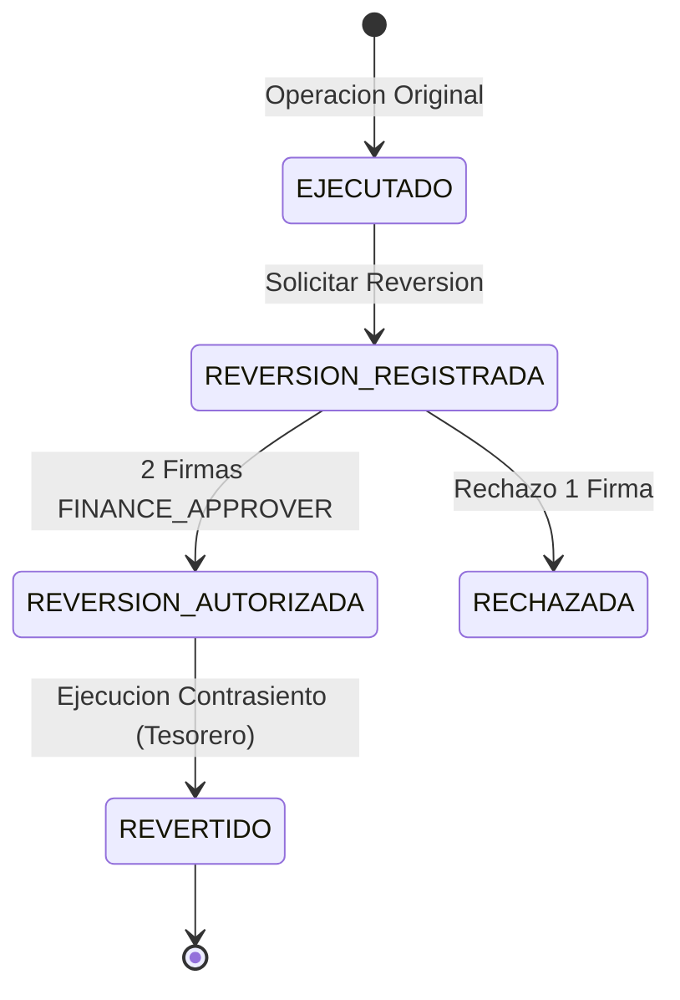
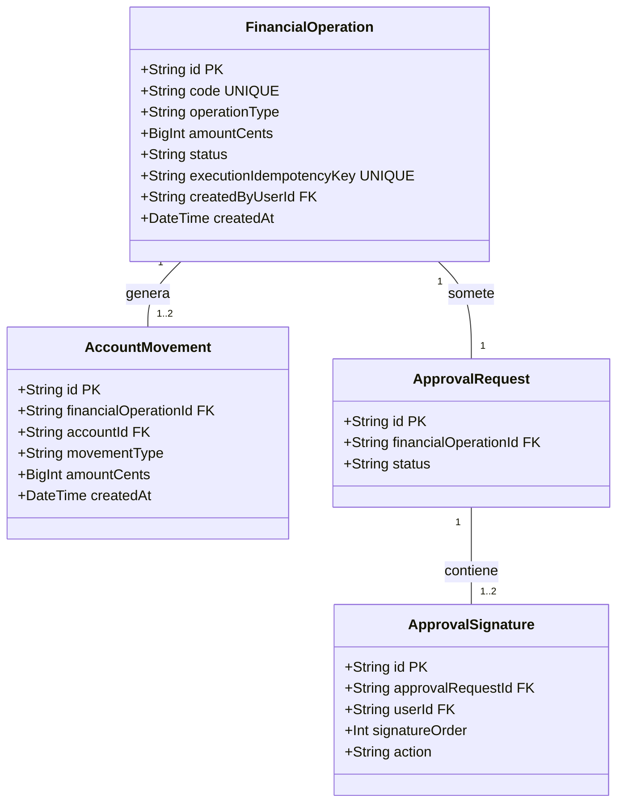
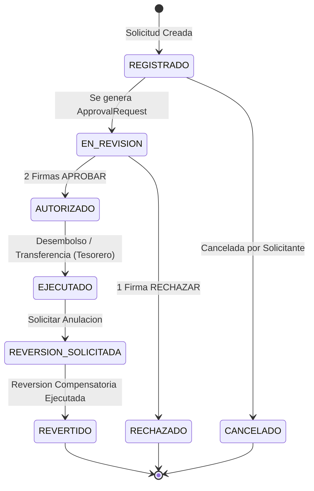

# TERCERA REVISIÓN DE DISEÑO — RESOLUCIÓN DE INCONSISTENCIAS CRÍTICAS
## Prisma Business Dashboard — Grupo Prisma S.A.P.I. de C.V.
### Fase 2: Modelo de Datos y Migraciones SQLite

- **Fecha de Elaboración:** 2026-11-06  
- **Autor / Rol:** Arquitecto de Software Senior & Especialista en Sistemas Financieros Transaccionales  
- **Destinatario:** Russiele Valdez (Product Owner / Propietario del Proyecto)  
- **Estado del Dictamen:** PROPUESTA TÉCNICA Y RESOLUCIÓN ARQUITECTÓNICA (FASE 2 NO APROBADA)  
- **Línea Base Normativa:** RFC-001, RFC-002, RFC-003, RFC-004, RFC-005, Plan Maestro de Desarrollo.

---

## 1. CONTEXTO Y ALCANCE

El presente informe constituye el tercer entregable analítico de la **FASE 2: MODELO DE DATOS Y MIGRACIONES SQLITE** para el sistema **Prisma Business Dashboard** de Grupo Prisma S.A.P.I. de C.V.

En estricta observancia de las directrices inmutables de gobernanza:
1. **No se modifica `apps/api/prisma/schema.prisma`** en esta intervención.
2. **No se generan migraciones ni se ejecutan comandos destructivos** (`prisma migrate`, `db push`).
3. **No se crean tablas físicas ni la base de datos SQLite definitiva**.
4. **No se crea el archivo de inicialización `seed.ts`**.
5. **No se instalan paquetes ni se modifican componentes del monorepo**.
6. **Se preservan íntegras las 28 entidades físicas oficiales** acordadas en el Modelo Entidad-Relación y Diccionario de Datos normalizados.
7. **No se asumen unilateralmente decisiones de negocio** que corresponden en exclusiva al Propietario del Proyecto.

El objetivo de este documento es resolver técnicamente las seis inconsistencias críticas no resueltas en revisiones previas, eliminar contradicciones transversales de integridad relacional y contable, y presentar las opciones formales para decisión del Propietario, garantizando un modelo transaccional robusto, inmutable y auditable antes de cualquier implementación física.

---

## 2. REFERENCIA Y DIAGNÓSTICO DEL SEGUNDO INFORME

La segunda revisión de diseño identificó diez hallazgos estructurales (A–J), logrando avances notables en la comprensión del almacenamiento monetario en enteros (`amount_cents`), el rol de los UUIDs (diferenciando identificación técnica de autenticación y autorización), la segregación funcional y la inmutabilidad de movimientos.

No obstante, dicho informe dejó sin resolver seis inconsistencias técnicas críticas:
- **Punto 1:** Confusión entre la unicidad de tipo de movimiento y la integridad completa de una transferencia bancaria y su idempotencia.
- **Punto 2:** Contradicción física al proponer versionado de cierres financieros (`FinancialClose`) manteniendo una restricción `@unique(projectId)`.
- **Punto 3:** Asignación automática y no autorizada de centavos residuales al fondo común corporativo sin un algoritmo determinístico de distribución.
- **Punto 4:** Imposibilidad física de conservar historial de participaciones societarias (`PartnerShare`) al proponer `@@unique([partnerId, is_current])`.
- **Punto 5:** Vacíos en el ciclo de vida, contabilidad de partida doble y tratamiento de reversiones compensatorias totales vs. parciales.
- **Punto 6:** Confusión entre la exigencia de dos autorizadores con permiso `FINANCE_APPROVER` y la condición de socios cuando el solicitante es `SUPER_ADMIN`.

A continuación, se desarrolla la resolución exhaustiva de cada punto.

---

## 3. RESOLUCIÓN DETALLADA DE LOS SEIS PUNTOS CRÍTICOS


---

### PUNTO 1. EJECUCIÓN FINANCIERA, TRANSFERENCIAS E IDEMPOTENCIA

#### 1.1. Diagnóstico del problema original
El segundo informe propuso la restricción de base de datos:
```prisma
@@unique([financialOperationId, movementType])
```
Esta restricción únicamente impide que existan dos registros del tipo `CARGO` o dos del tipo `ABONO` vinculados al mismo `financialOperationId`. Sin embargo:
1. **No garantiza la existencia de ambos movimientos:** Si el proceso falla tras insertar el cargo, la base de datos queda inconsistente (fondo debitado pero no acreditado).
2. **No valida la coincidencia de importes:** La restricción UNIQUE no verifica que `CARGO.amount_cents == ABONO.amount_cents == Operation.amount_cents`.
3. **No previene la doble ejecución concurrente:** Dos solicitudes simultáneas del Tesorero podrían intentar ejecutar la misma operación autorizada.

#### 1.2. Solución técnica integral

##### A. Control de Idempotencia y Almacenamiento de `idempotency_key`
- **Ubicación y Alcance:** Se incorpora el campo `execution_idempotency_key: String? @unique` en la entidad `FinancialOperation`.
- **Origen del Token:** El cliente (frontend web o API client) debe enviar el encabezado HTTP:
  `Idempotency-Key: <UUIDv4>`
  al solicitar la ejecución: `POST /api/financial-operations/:id/execute`.
- **Comportamiento ante Reintentos:**
  1. *Reintento Legítimo Idéntico:* Si llega una petición con un `Idempotency-Key` ya registrado en esa misma operación y el estado es `EJECUTADO`, el servicio NestJS captura la condición, no ejecuta lógica contable adicional y retorna de inmediato HTTP 200 con la representación de los movimientos ya existentes (`AccountMovement[]`).
  2. *Conflicto de Datos / Payload Modificado:* Si llega una petición con el mismo `Idempotency-Key` pero los parámetros de la operación difieren, el servidor responde con `422 Unprocessable Entity` ("Idempotency key reused with differing parameters").
  3. *Reintento con Clave Distinta sobre Operación ya Ejecutada:* Si se intenta ejecutar una operación ya `EJECUTADO` con una nueva clave, el servidor rechaza con `409 Conflict` ("La operación financiera ya fue ejecutada previamente").

##### B. Flujo Transaccional Atómico Paso a Paso (NestJS + Prisma `$transaction`)
1. **Bloqueo de Estado / Transición Condicional:**
   Dentro de `prisma.$transaction(async (tx) => { ... })`:
   Se ejecuta una actualización con predicado estricto:
   ```sql
   UPDATE financial_operations 
   SET status = 'EJECUTADO', 
       execution_idempotency_key = :idempotencyKey, 
       executed_at = :now, 
       executed_by_user_id = :userId
   WHERE id = :operationId AND status = 'AUTORIZADO';
   ```
   Si las filas afectadas son 0, la transacción se aborta inmediatamente. La operación no estaba autorizada o ya fue ejecutada/reclamada por otro proceso concurrente.
2. **Validación de Cuentas y Disponibilidad:**
   - Se valida que `source_account.is_active == true` y `target_account.is_active == true`.
   - Se calcula el saldo dinámico de la cuenta origen ($\sum \text{Abonos} - \sum \text{Cargos}$). Si `saldo < amount_cents`, se emite `UnprocessableEntityException` ("Fondos insuficientes") y se revierte la transacción.
3. **Inserción Atómica de Movimientos Contables:**
   - En transferencias (`operation_type == 'TRANSFERENCIA'`):
     - Movimiento 1 (CARGO): Débito en la cuenta origen por `amount_cents`.
     - Movimiento 2 (ABONO): Crédito en la cuenta destino por idéntico `amount_cents`.
   - En egresos (`EGRESO`): Exactamente un `CARGO` en la cuenta pagadora.
   - En ingresos/aportaciones (`INGRESO`, `APORTACION_CAPITAL`): Exactamente un `ABONO` en la cuenta receptora.
4. **Verificación de Integridad Interna:**
   El servicio confirma que se generaron exactamente 2 movimientos para transferencias y 1 para movimientos simples. Si no se cumple, se fuerza `tx.rollback()`.
5. **Recuperación y Falla de Red:**
   Si la conexión o el servidor cae a mitad del proceso, SQLite aplica el principio ACID de atomicidad pura: ninguna inserción parcial es persistida; la operación permanece `AUTORIZADO` y el reintento posterior operará limpiamente.

---

### PUNTO 2. VERSIONADO DE FINANCIAL CLOSE

#### 2.1. Diagnóstico de la contradicción física
El segundo informe propuso permitir cierres rectificatorios mediante versionado, pero simultáneamente conservaba `@unique(projectId)` en `FinancialClose`. En SQLite y en el modelo relacional, un índice UNIQUE en `projectId` prohíbe terminantemente la inserción de un segundo registro ($v=2$) para el mismo proyecto, provocando un error de violación de restricción `SQLITE_CONSTRAINT_UNIQUE`.

#### 2.2. Solución técnica relacional
1. **Eliminación de la restricción contradictoria:**
   Se remueve `@unique(projectId)`.
2. **Restricción Compuesta de Versión:**
   Se define en `FinancialClose`:
   ```prisma
   @@unique([projectId, version])
   ```
   Permite infinitas versiones secuenciales ($v=1, 2, 3, \dots$) para un mismo proyecto, garantizando que no existan versiones duplicadas del mismo orden.
3. **Identificación de Linaje Histórico:**
   Se agrega una relación reflexiva autorreferencial:
   ```prisma
   previousCloseId  String?         @unique
   previousClose    FinancialClose? @relation("CloseLineage", fields: [previousCloseId], references: [id], onDelete: Restrict)
   subsequentClose  FinancialClose? @relation("CloseLineage")
   ```
   Cada cierre rectificatorio apunta unívocamente a su predecesor inmediato, formando una cadena de custodia inmutable.
4. **Determinación del Cierre Vigente:**
   - Se introduce el campo `status: String @default("VIGENTE")` con valores permitidos: `["VIGENTE", "SUPERADO", "RECTIFICADO"]`.
   - Cuando se autoriza un cierre $v=2$, una transacción atómica actualiza el cierre $v=1$ a estado `SUPERADO` y activa $v=2$ como `VIGENTE`.
   - Se añade el campo `rectification_reason: String?` obligatorio a partir de la versión 2.
5. **Tratamiento Contable de Costos Omitidos y Dividendos ya Dispersados:**
   - **Principio Inmutable:** Las distribuciones de dividendos (`ProfitDistribution`) y movimientos (`AccountMovement`) ejecutados bajo la versión 1 **JAMÁS se borran ni se modifican**.
   - **Cálculo de Diferencias:** El cierre $v=2$ registra:
     - `difference_costs_cents = new_costs_cents - old_costs_cents` (positivo: costo omitido).
     - `difference_profit_cents = new_profit_cents - old_profit_cents` (negativo: utilidad menor a la estimada).
   - **Tratamiento del Déficit Resultante:**
     El déficit de utilidades dispersadas de más constituye un crédito corporativo a favor de Grupo Prisma frente a los socios receptores. Se emite una operación compensatoria (`AJUSTE_DEFICIT_CIERRE`) sujeta a la decisión del Propietario (retención en futuras distribuciones o reembolso formal).

---

### PUNTO 3. DISTRIBUCIÓN DE CENTAVOS RESIDUALES

#### 3.1. Diagnóstico
El segundo informe proponía unilateralmente: *"los centavos sobrantes se enviarán a la cuenta del fondo común"*. Esta regla de negocio **no fue aprobada por el Propietario** y desvirtúa la precisión contable de las participaciones societarias.

#### 3.2. Solución Matemática Determinística: Método de Mayores Residuos (Hamilton / Hare-Niemeyer)
Para distribuir una utilidad neta expresada en centavos enteros ($P$) entre $N$ socios conforme a sus puntos base ($b_i$, donde $\sum b_i = 10,000$):

1. **Cuota Teórica Continua:**
   Para cada socio $i$:
   $$q_i = \frac{P \times b_i}{10,000}$$
2. **Asignación Entera Base:**
   Se trunca a centavos enteros:
   $$a_i = \lfloor q_i \rfloor$$
3. **Residuo Fraccionario:**
   $$r_i = q_i - a_i = q_i \pmod 1$$
4. **Monto Remanente en Centavos:**
   $$R = P - \sum_{i=1}^N a_i \quad (0 \le R < N)$$
5. **Asignación de Mayores Residuos:**
   Se ordenan los socios descendentemente por su residuo $r_i$. Se asigna $+1$ centavo a los primeros $R$ socios con mayor parte fraccionaria.
6. **Criterio de Desempate Estricto y Auditable:**
   Si dos o más socios presentan idéntico residuo fraccionario ($r_j == r_k$), el desempate se resuelve de forma determinista mediante el orden lexicográfico ascendente del identificador UUID (`partner_id`). Esto elimina cualquier discrecionalidad y asegura reproducibilidad exacta en cualquier auditoría.
7. **Garantía Matemática de Conservación:**
   $$\sum_{i=1}^N \text{importe\_final}_i = \sum_{i=1}^N a_i + R = P$$
   La suma asignada a los socios es idéntica al centavo exacto a la utilidad a distribuir. Cero fuga de fondos y cero asignación espuria.

#### 3.3. Ejemplo Numérico Demostrativo
- **Importe de Utilidad Neta a Distribuir:** \$10,000.07 MXN ($P = 1,000,007$ centavos).
- **Participaciones Societarias:**
  - Socio 1: 5,000 puntos base (50.00%)
  - Socio 2: 3,000 puntos base (30.00%)
  - Socio 3: 2,000 puntos base (20.00%)
  - Suma = 10,000 puntos base (100.00%).

| Socio | Puntos Base | Cuota Teórica ($q_i$) | Asignación Entera ($a_i$) | Residuo Fraccionario ($r_i$) | Remanente (+1) | Asignación Final (Centavos) | Asignación Final (MXN) |
| :--- | :---: | :---: | :---: | :---: | :---: | :---: | :---: |
| **Socio 1** | 5,000 | $500,003.50$ | 500,003 | **0.50** | **+1** (Mayor residuo) | 500,004 | \$5,000.04 |
| **Socio 2** | 3,000 | $300,002.10$ | 300,002 | **0.10** | +0 | 300,002 | \$3,000.02 |
| **Socio 3** | 2,000 | $200,001.40$ | 200,001 | **0.40** | +0 | 200,001 | \$2,000.01 |
| **TOTALES** | **10,000** | **1,000,007.00** | **1,000,006** | - | **+1** ($R = 1$) | **1,000,007** | **\$10,000.07** |

#### 3.4. Alternativas de Negocio para Decisión del Propietario
El sistema se documenta con tres alternativas formales, recomendando técnicamente la Opción A:
- **Alternativa A (Recomendada Técnica):** Método de Mayores Residuos (Hamilton) asignado a los socios. Distribución 100% íntegra entre los participantes.
- **Alternativa B:** Acreditación del remanente residual ($R$ centavos, típicamente de 1 a 9 centavos) a la cuenta de tesorería del Fondo Común corporativo de Grupo Prisma.
- **Alternativa C:** Asignación preferente del remanente al Socio Administrador del proyecto (`manager_partner_id`) como compensación por gestión.

---

### PUNTO 4. VIGENCIAS DE PARTNERSHARE

#### 4.1. Diagnóstico de la falla relacional
El segundo informe propuso:
```prisma
@@unique([partnerId, is_current])
```
En SQL estándar y en Prisma, esta restricción impone que la tupla `(partnerId, is_current)` sea estrictamente única. Si un socio tiene un cambio de porcentaje en el año 2026, su registro histórico queda con `is_current = false`. Si en 2027 vuelve a cambiar de porcentaje, el sistema intentaría registrar una segunda fila con `(partnerId, false)`, provocando una colisión de clave única inmediata. Por ende, la restricción propuesta destruye la capacidad de conservar el historial societario.

#### 4.2. Solución Técnica con Intervalos Temporales y Unicidad Parcial
1. **Modelado de Intervalos de Vigencia:**
   Se elimina el booleano simple ambiguo como clave única y se modela:
   ```prisma
   effectiveFrom  DateTime  @default(now())
   effectiveTo    DateTime? // NULL representa vigencia activa abierta
   status         String    @default("ACTIVO") // "ACTIVO" | "HISTORICO"
   ```
2. **Garantía de Registro Activo Único:**
   - **En Base de Datos (SQLite):** Se implementa mediante un índice único parcial nativo en la migración SQL física:
     ```sql
     CREATE UNIQUE INDEX uq_partner_share_active 
     ON partner_shares (partner_id) 
     WHERE effective_to IS NULL;
     ```
     SQLite soporta cláusulas `WHERE` en índices únicos, garantizando que un socio jamás tenga más de una fila con `effective_to IS NULL`.
   - **Limitación de Prisma Schema DSL:** Dado que el DSL estándar de Prisma (`schema.prisma`) no soporta índices parciales declarativos con filtros `WHERE` universales, la definición se preserva en `schema.prisma` como `@@index([partnerId, effectiveTo])` y se inyecta la restricción parcial nativa en el archivo de migración SQLite.
3. **Validación Transaccional en NestJS:**
   La reconfiguración de participaciones societarias opera bajo una transacción estricta:
   ```typescript
   await prisma.$transaction(async (tx) => {
     // 1. Cerrar vigencias activas actuales
     await tx.partnerShare.updateMany({
       where: { effectiveTo: null },
       data: { effectiveTo: new Date(), status: 'HISTORICO' }
     });
     // 2. Insertar las 10 nuevas participaciones
     await tx.partnerShare.createMany({ data: newShares });
     // 3. Validar suma exacta de 10,000 puntos base
     const totalBps = newShares.reduce((acc, curr) => acc + curr.basisPoints, 0);
     if (totalBps !== 10000) {
       throw new UnprocessableEntityException('La suma de puntos base debe ser exactamente 10,000');
     }
   });
   ```

---

### PUNTO 5. REVERSIÓN COMPENSATORIA

#### 5.1. Principio de Inmutabilidad del Libro Mayor
En la contabilidad financiera de Grupo Prisma S.A.P.I. de C.V., el historial transaccional es un libro mayor de apéndice exclusivo (*append-only ledger*). Ningún registro en `FinancialOperation` ni en `AccountMovement` ejecutado puede ser eliminado (`DELETE`) ni alterado en sus importes o cuentas (`UPDATE`).

#### 5.2. Ciclo de Vida y Generación de Contrasientos
1. **Solicitud de Reversión:**
   Para anular el efecto de una operación financiera ejecutada (ej. `OP-2026-0010`), el Tesorero o Administrador crea una nueva `FinancialOperation`:
   - `operation_type = 'REVERSION_COMPENSATORIA'`.
   - `reversal_of_operation_id = 'OP-2026-0010'` (referencia explícita y foránea obligatoria).
   - `status = 'REGISTRADO'`.
2. **Doble Autorización Obligatoria:**
   Como toda operación financiera que afecta saldos de tesorería (conforme a RFC-004), la reversión requiere su propio proceso de dos firmas independientes (`ApprovalRequest` + 2 `ApprovalSignature`).
3. **Ejecución y Generación de Movimientos Compensatorios:**
   Una vez autorizada, el Tesorero ejecuta la reversión, lo que genera en `AccountMovement` contrasientos con polaridad estrictamente invertida:
   - Si la operación original generó un `CARGO` de \$5,000 en la Cuenta A, la reversión genera un `ABONO` de \$5,000 en la Cuenta A.
   - Si generó un `ABONO` de \$5,000 en la Cuenta B, la reversión genera un `CARGO` de \$5,000 en la Cuenta B.
4. **Impacto en Saldo Dinámico:**
   Al calcularse el saldo de cada cuenta mediante agregación matemática:
   $$\text{Saldo} = \sum \text{Abonos} - \sum \text{Cargos}$$
   Los movimientos compensatorios neutralizan exactamente el saldo sin alterar los registros pasados.



#### 5.3. Alternativas para Decisión del Propietario (Total vs. Parcial)
- **Alternativa A: Reversión Exclusivamente Total (Recomendada Técnica):**
  - Cada operación solo puede revertirse en un 100% de su valor en un único acto.
  - La operación original transiciona su estado a `REVERTIDO`.
  - La base de datos aplica `@@unique([reversalOfOperationId])` en `FinancialOperation`, impidiendo cualquier intento de revertir dos veces la misma operación.
  - Riesgo: Nulo. Simplicidad contable y cero margen de desbalance.
- **Alternativa B: Reversiones Parciales Acumulables:**
  - Permite revertir importes parciales (ej. cancelar \$2,000 de una compra de \$10,000).
  - Requiere agregar a `FinancialOperation`:
    - `reverted_amount_cents: BigInt @default(0)`
    - Estado intermedio: `PARCIALMENTE_REVERTIDO` y terminal `REVERTIDO`.
  - Requiere validación transaccional: $\sum \text{reversiones} \le \text{importe\_original}$.
  - Mayor complejidad operativa y riesgo de desajustes en conciliaciones bancarias.

---

### PUNTO 6. IDENTIDAD Y REGLAS DE LOS DOS AUTORIZADORES

#### 6.1. Clarificación de Roles, Permisos e Independencia
Es fundamental disipar la ambigüedad conceptual:
1. **La facultad de autorizar emana exclusivamente del permiso `finance:approve`**, asignado a través del rol oficial `FINANCE_APPROVER`.
2. **El rol `SUPER_ADMIN` no confiere autorización tácita ni bypass.** Un `SUPER_ADMIN` solo puede firmar si cuenta explícitamente con el permiso `finance:approve`.
3. **Principio de Exclusión del Solicitante (No Auto-Autorización):**
   El usuario que formula o registra la operación (`created_by_user_id`) queda inhabilitado por sistema para asentar cualquiera de las dos firmas en `ApprovalSignature`.
4. **Independencia Estricta de las Dos Firmas:**
   - Ambas firmas deben pertenecer a usuarios distintos:
     `signature_1.user_id != signature_2.user_id`.
   - Se prohíbe que el mismo usuario registre dos firmas en la misma solicitud mediante la restricción:
     ```prisma
     @@unique([approvalRequestId, userId])
     ```
5. **Regla de Rechazo Inmediato:**
   El flujo es conjuntivo estricto (2 votos aprobatorios). Si cualquiera de los dos autorizadores asienta `action = 'RECHAZAR'`, la solicitud pasa de inmediato a `RECHAZADO`, la operación se marca como `RECHAZADO` y se bloquea definitivamente la emisión de una segunda firma.
6. **Protección Contra Cuentas Espejo (Anti-Sybil):**
   El sistema audita la IP de origen, huella de agente y contexto de sesión. Si se detectan firmas con token de la misma subred o dispositivo en ventanas menores a 60 segundos, se genera alerta de seguridad en `AuditLog`.

#### 6.2. Políticas de Gobernanza para Decisión del Propietario
- **Política A (Gobernanza Operativa Funcional):**
  Dos usuarios distintos que cuenten con el rol y permiso `FINANCE_APPROVER`, sin exigir que sean socios de la empresa. Permite delegar la revisión en directores de finanzas o auditores internos no accionistas.
- **Política B (Gobernanza Accionaria Estricta):**
  Dos socios fundadores activos (`partner_id IS NOT NULL`) que además cuenten con el rol `FINANCE_APPROVER`. Garantiza que todo movimiento financiero de la empresa sea autorizado exclusivamente por el patrimonio de los socios.

---

## 4. RESOLUCIÓN DE CONTRADICCIONES TRANSVERSALES

A continuación se resuelven las 15 contradicciones transversales detectadas en la documentación:



1. **`ApprovalRequest.currentSignatures` (Derivabilidad vs. Caché):**
   Se dictamina su **eliminación como columna física persistente**. Mantener un contador manual en SQLite genera riesgo de desincronización (*drift*). El número de firmas se deriva dinámicamente mediante:
   ```sql
   SELECT count(*) FROM approval_signatures WHERE approval_request_id = :id AND action = 'APROBAR';
   ```
   Si se requiere para serialización de respuesta en la API, se expone como getter calculado en el DTO de NestJS.
2. **`ApprovalSignature.signatureOrder` (Rango Estricto [1, 2]):**
   Se asegura mediante doble barrera:
   - En SQLite: Restricción check nativa `CHECK (signature_order IN (1, 2))`.
   - En base de datos: Restricción compuesta `@@unique([approvalRequestId, signatureOrder])`, garantizando que solo exista una primera firma y una segunda firma por solicitud.
   - En NestJS: Validación `IsInt()`, `@Min(1)`, `@Max(2)` mediante `class-validator`.
3. **`FinancialOperation.status` (Máquina de Estados y Transiciones):**
   Se define el catálogo exhaustivo de estados:
   `["REGISTRADO", "EN_REVISION", "AUTORIZADO", "EJECUTADO", "RECHAZADO", "CANCELADO", "REVERTIDO"]`.
   Se prohíben saltos ilegales (ej. de `REGISTRADO` directo a `EJECUTADO`).
4. **`CapitalContribution.accountId` y `FinancialOperation.targetAccountId`:**
   En una aportación de capital, `CapitalContribution` describe el acto jurídico-accionario, mientras que `FinancialOperation` describe el flujo de tesorería. Para evitar discrepancias, `FinancialOperation.targetAccountId` es obligatorio para `APORTACION_CAPITAL` y se valida en NestJS que coincida idénticamente con `CapitalContribution.accountId`.
5. **`CapitalContribution.partnerId` vs. `FinancialOperation.createdByUserId`:**
   Se establece una distinción nítida: `CapitalContribution.partnerId` identifica al socio capitalista cuyo patrimonio aumenta; `FinancialOperation.createdByUserId` identifica al usuario operativo (ej. Tesorero o Administrador) que capturó el comprobante bancario en el sistema.
6. **`FinancialClose.approvedByUserId`:**
   No se reserva en exclusiva a `SUPER_ADMIN`. Se define como cualquier usuario titular del permiso granular `project:close_approve` (sujeto a la política de roles de Grupo Prisma).
7. **`AccountMovement.amountCents` (Integridad de Importe Positivo):**
   Los importes contables no admiten valores neutros ni negativos. Se establece en la migración física:
   ```sql
   CHECK (amount_cents > 0)
   ```
   El signo y la naturaleza del movimiento lo determina unívocamente `movement_type` (`CARGO` o `ABONO`).
8. **`PartnerShare.basisPoints` y `ProfitShareItem.basisPoints`:**
   Se definen los límites enteros válidos:
   ```sql
   CHECK (basis_points > 0 AND basis_points <= 10000)
   ```
   Garantizando que ninguna participación sea cero o exceda el 100%.
9. **`Milestone.weightPercentage` (Precisión sin Punto Flotante):**
   Para erradicar imprecisiones de coma flotante en SQLite, se renombra funcionalmente a puntos base: `weight_basis_points: Int` ($1 \dots 10,000$). La suma de todos los hitos del proyecto debe totalizar exactamente 10,000 puntos base (100.00%).
10. **`Account.accountNumber` (Alcance de Unicidad):**
    No todos los números de cuenta son globalmente únicos en el sistema bancario. Se reemplaza `@unique` global por:
    - Para bancos: Unicidad compuesta `@@unique([bankName, accountNumber])`.
    - Para CLABE interbancaria: `clabe: String? @unique` (exactamente 18 dígitos numéricos únicos en México).
    - Para cajas de efectivo (`account_type = 'EFECTIVO'`): `accountNumber` es nulo o identificador interno de caja.
11. **`Account.isActive` (Bloqueo de Operaciones Conservando Historial):**
    Una cuenta inactiva (`is_active = false`) bloquea de inmediato la admisión de nuevas `FinancialOperation` en NestJS, pero conserva el 100% de su historial en `AccountMovement` para auditoría y estados de cuenta históricos. Prohibido eliminar cuentas que posean movimientos.
12. **`FinancialOperation.code` (Concurrencia en Folios Consecutivos):**
    Para generar códigos secuenciales inquebrantables (ej. `OP-2026-0001`) bajo alta concurrencia, se rechaza la consulta ingenua `SELECT max(id)`. Se implementa una tabla de secuencias contables atómicas (`SystemSequence`) con incremento bloqueante dentro de la transacción SQLite `BEGIN IMMEDIATE`.
13. **`AuditLog` (Lista Blanca y Sanitización Recursiva):**
    Se descarta el modelo de lista negra (*denylist*). Se adopta una **Estrategia de Campos Permitidos (*Allowlist*)** para metadatos de auditoría, acompañada de un interceptor recursivo en NestJS que redacta y ofusca automáticamente cualquier clave sensible que contenga patrones: `*password*`, `*secret*`, `*token*`, `*hash*`, `*pin*`, `*clabe*`.
14. **Políticas `ON DELETE` en Relaciones Históricas:**
    Se audita exhaustivamente el modelo relacional. Se dictamina **`onDelete: Restrict`** obligatorio en todas las relaciones de: `User`, `Partner`, `Account`, `FinancialOperation`, `AccountMovement`, `ApprovalRequest`, `ApprovalSignature`, `Project`, `FinancialClose`, `ProfitDistribution` y `AuditLog`. Queda estrictamente erradicado el uso de `CASCADE` en entidades financieras o probatorias.
15. **`FinancialClose` (Fórmula Estricta de Utilidad del Proyecto):**
    La utilidad neta de un proyecto se define con rigor contable excluyendo flujos patrimoniales internos:
    $$\text{Utilidad Neta} = \sum \text{Ingresos Reales por Facturación} - \sum \text{Egresos Directos Reales}$$
    - Quedan terminantemente **excluidas** las aportaciones de capital (`APORTACION_CAPITAL`), por ser capital social y no ingreso devengado.
    - Quedan terminantemente **excluidas** las transferencias internas entre cuentas (`TRANSFERENCIA`), al ser meros rebalanceos de liquidez.

---

## 5. MATRICES DE RESTRICCIONES DE BASE DE DATOS Y VALIDACIONES NESTJS

### Matriz 5.1. Restricciones a Nivel Motor de Base de Datos (SQLite / Prisma)

| Entidad | Campo / Columnas | Tipo de Restricción | Definición Técnica | Propósito de Integridad |
| :--- | :--- | :--- | :--- | :--- |
| `FinancialOperation` | `executionIdempotencyKey` | UNIQUE | `@unique` | Previene que dos ejecuciones utilicen la misma clave de idempotencia |
| `FinancialOperation` | `code` | UNIQUE | `@unique` | Garantiza folios consecutivos únicos inalterables |
| `AccountMovement` | `[financialOperationId, movementType]` | COMPOSITE UNIQUE | `@@unique([financialOperationId, movementType])` | Impide duplicar un CARGO o un ABONO en la misma operación |
| `AccountMovement` | `amountCents` | CHECK CONSTRAINT | `CHECK (amount_cents > 0)` | Prohíbe movimientos contables en ceros o importes negativos |
| `FinancialClose` | `[projectId, version]` | COMPOSITE UNIQUE | `@@unique([projectId, version])` | Permite versionado lineal ordenado e impide versiones duplicadas |
| `FinancialClose` | `previousCloseId` | UNIQUE / FK | `@unique`, `onDelete: Restrict` | Garantiza cadena de custodia autorreferencial inmutable |
| `PartnerShare` | `partnerId (activo)` | PARTIAL UNIQUE | `CREATE UNIQUE INDEX ... WHERE effective_to IS NULL` | Garantiza una sola participación activa por socio |
| `PartnerShare` | `basisPoints` | CHECK CONSTRAINT | `CHECK (basis_points > 0 AND basis_points <= 10000)` | Limita el rango porcentual entre 0.01% y 100.00% |
| `ApprovalRequest` | `financialOperationId` | UNIQUE | `@unique` | Garantiza una sola cabecera de aprobación por operación |
| `ApprovalSignature` | `[approvalRequestId, userId]` | COMPOSITE UNIQUE | `@@unique([approvalRequestId, userId])` | Prohíbe que un mismo usuario firme dos veces la misma solicitud |
| `ApprovalSignature` | `[approvalRequestId, signatureOrder]` | COMPOSITE UNIQUE | `@@unique([approvalRequestId, signatureOrder])` | Asegura que existan exactamente una firma orden 1 y una orden 2 |
| `Account` | `[bankName, accountNumber]` | COMPOSITE UNIQUE | `@@unique([bankName, accountNumber])` | Evita colisiones de cuentas dentro de la misma institución bancaria |

---

### Matriz 5.2. Validaciones Transaccionales en Lógica de Aplicación (NestJS)

| Módulo / Servicio | Acción / Evento | Regla de Negocio Validada | Excepción / Respuesta HTTP |
| :--- | :--- | :--- | :--- |
| `TreasuryService` | Ejecución de Operación | `status == 'AUTORIZADO'` antes de ejecutar | `ConflictException` (409) |
| `TreasuryService` | Ejecución de Transferencia | Existencia atómica de 1 CARGO y 1 ABONO por el mismo importe | `UnprocessableEntityException` (422) |
| `TreasuryService` | Débito en Cuenta | Verificación de saldo dinámico suficiente ($\ge \text{amount\_cents}$) | `UnprocessableEntityException` (422) |
| `ApprovalService` | Asentamiento de Firma | `userId != operation.createdByUserId` (Exclusión solicitante) | `ForbiddenException` (403) |
| `ApprovalService` | Asentamiento de Firma | Poseer permiso activo `finance:approve` | `ForbiddenException` (403) |
| `ApprovalService` | Acción de Rechazo | Si `action == 'RECHAZAR'`, transicionar operación a `RECHAZADO` | `Ok` (200) / Transición terminal |
| `PartnerService` | Ajuste de Participaciones | $\sum \text{basisPoints} == 10,000$ entre los 10 socios activos | `UnprocessableEntityException` (422) |
| `CloseService` | Cierre Rectificatorio | Cierre anterior debe estar en estado `VIGENTE` | `ConflictException` (409) |
| `AuditService` | Intercepción de Request | Sanitización por Allowlist de campos sensibles | Ejecución asíncrona de bitácora |

---

## 6. FLUJOS FINANCIEROS Y PSEUDOCÓDIGO ILUSTRATIVO

> [!NOTE]
> El siguiente pseudocódigo es estrictamente ilustrativo y analítico para demostrar la consistencia transaccional requerida. No debe ejecutarse ni desplegarse en esta fase.

### 6.1. Ejecución Atómica de Transferencia con Idempotencia

```typescript
// Pseudocódigo de Servicio en NestJS (Ilustrativo)
async function executeFinancialTransfer(
  operationId: string,
  idempotencyKey: string,
  executorUserId: string
): Promise<ExecutionResult> {
  return await prisma.$transaction(async (tx) => {
    // 1. Verificación de Idempotencia previa
    const existingOp = await tx.financialOperation.findUnique({
      where: { id: operationId },
      include: { accountMovements: true }
    });

    if (!existingOp) {
      throw new NotFoundException('Operación financiera inexistente');
    }

    if (existingOp.status === 'EJECUTADO') {
      if (existingOp.executionIdempotencyKey === idempotencyKey) {
        // Reintento idéntico exitoso: Retorno idempotente sin re-ejecutar
        return { success: true, movements: existingOp.accountMovements, replayed: true };
      } else {
        throw new ConflictException('Operación ya ejecutada con otra clave de idempotencia');
      }
    }

    if (existingOp.status !== 'AUTORIZADO') {
      throw new ConflictException('La operación no se encuentra autorizada para ejecución');
    }

    // 2. Transición de Estado con Optimistic Lock
    const updated = await tx.financialOperation.updateMany({
      where: { id: operationId, status: 'AUTORIZADO' },
      data: {
        status: 'EJECUTADO',
        executionIdempotencyKey: idempotencyKey,
        executedAt: new Date(),
        executedByUserId: executorUserId
      }
    });

    if (updated.count === 0) {
      throw new ConflictException('Conflicto de concurrencia: la operación ya fue reclamada');
    }

    // 3. Validación de Cuentas y Saldo de Origen
    const sourceAcc = await tx.account.findUnique({ where: { id: existingOp.sourceAccountId! } });
    const targetAcc = await tx.account.findUnique({ where: { id: existingOp.targetAccountId! } });

    if (!sourceAcc?.isActive || !targetAcc?.isActive) {
      throw new UnprocessableEntityException('Una de las cuentas involucradas está inactiva');
    }

    // Saldo dinámico de origen
    const sourceBalance = await calculateDynamicBalance(tx, sourceAcc.id);
    if (sourceBalance < existingOp.amountCents) {
      throw new UnprocessableEntityException('Fondos insuficientes en cuenta de origen');
    }

    // 4. Inserción Atómica de Movimientos (Partida Doble)
    const cargoMovement = await tx.accountMovement.create({
      data: {
        financialOperationId: existingOp.id,
        accountId: sourceAcc.id,
        movementType: 'CARGO',
        amountCents: existingOp.amountCents
      }
    });

    const abonoMovement = await tx.accountMovement.create({
      data: {
        financialOperationId: existingOp.id,
        accountId: targetAcc.id,
        movementType: 'ABONO',
        amountCents: existingOp.amountCents
      }
    });

    return {
      success: true,
      movements: [cargoMovement, abonoMovement],
      replayed: false
    };
  });
}
```

---

## 7. MÁQUINA DE ESTADOS FINANCIEROS Y TRANSICIONES PERMITIDAS



| Estado Actual | Evento / Transición | Siguiente Estado | Autoridad Requerida | Efecto Contable |
| :--- | :--- | :--- | :--- | :--- |
| `REGISTRADO` | Envío a aprobación | `EN_REVISION` | Solicitante / Sistema | Ninguno |
| `REGISTRADO` | Cancelación voluntaria | `CANCELADO` | Solicitante | Ninguno |
| `EN_REVISION` | Asentamiento Firma 1 (APROBAR) | `EN_REVISION` | 1er `FINANCE_APPROVER` | Ninguno |
| `EN_REVISION` | Asentamiento Firma 2 (APROBAR) | `AUTORIZADO` | 2do `FINANCE_APPROVER` | Operación elegible para ejecución |
| `EN_REVISION` | Firma de rechazo (RECHAZAR) | `RECHAZADO` | Cualquier `FINANCE_APPROVER` | Operación anulada definitivamente |
| `AUTORIZADO` | Ejecución en tesorería | `EJECUTADO` | `TREASURER` | Inserción inmutable en `AccountMovement` |
| `EJECUTADO` | Aprobación de Reversión | `REVERTIDO` | `TREASURER` (post 2 firmas) | Generación de contrasientos inversos |

---

## 8. MATRIZ DE RESULTADOS OBLIGATORIA (6 PUNTOS CRÍTICOS)

| Punto | Problema original | Solución técnica propuesta | Restricciones DB | Validaciones NestJS | Riesgo residual | Decisión del propietario | Estado |
|---|---|---|---|---|---|---|---|
| **1. Ejecución Financiera e Idempotencia** | Restricción UNIQUE no garantiza que existan ambos movimientos ni previene doble ejecución concurrente | Transacción atómica `$transaction` con optimistic lock, `execution_idempotency_key` única e inserción simultánea de CARGO y ABONO | `executionIdempotencyKey @unique`, `@@unique([financialOperationId, movementType])` | Verificación de estado `AUTORIZADO`, coincidencia de importes y saldo suficiente | Caída abrupta de red durante retorno HTTP post-commit (manejado por reintento idempotente) | Ninguna (Resuelto en arquitectura técnica) | **RESUELTO TÉCNICAMENTE** |
| **2. Versionado de FinancialClose** | Restricción `@unique(projectId)` impide físicamente registrar más de un cierre para un mismo proyecto | Remoción de clave única simple; adopción de `@@unique([projectId, version])`, autorreferencia lineal `previousCloseId` y estado `VIGENTE` | `@@unique([projectId, version])`, `previousCloseId @unique` con `onDelete: Restrict` | Transición de versión anterior a `SUPERADO`; cálculo de diferencias sin alterar histórico | Desacuerdo societario por ajustes a dividendos ya pagados | Definir política de absorción de déficit por costos omitidos | **PENDIENTE DE DECISIÓN DEL PROPIETARIO** |
| **3. Distribución de Centavos Residuales** | Asignación no autorizada del remanente al fondo común sin criterio matemático formal | Aplicación del Método de Mayores Residuos (Hamilton) con desempate determinista por UUID | N/A (Regla algorítmica y de consistencia en DTO) | Suma de cuotas exactas idéntica a utilidad neta al centavo; desempate lexicográfico | Descontento de socios con menor prioridad en desempate (fracciones de centavo) | Seleccionar entre Alternativa A (Socios), B (Fondo Común) o C (Administrador) | **PENDIENTE DE DECISIÓN DEL PROPIETARIO** |
| **4. Vigencias de PartnerShare** | Restricción `@@unique([partnerId, is_current])` impide registrar más de un registro histórico inactivo | Intervalos temporales (`effectiveFrom`, `effectiveTo`), índice parcial nativo `WHERE effectiveTo IS NULL` y reemplazo atómico | Índice único parcial nativo en SQLite (`WHERE effective_to IS NULL`) | Validación transaccional de suma de 10,000 bps entre las 10 participaciones activas | Inyección de SQL directo requerida en migración por limitación de Prisma DSL | Ninguna (Resuelto en arquitectura técnica) | **RESUELTO TÉCNICAMENTE** |
| **5. Reversión Compensatoria** | Indefinición del ciclo contable, riesgo de borrado de movimientos y tratamiento de reversiones parciales | Inmutabilidad de libro mayor; nueva operación `REVERSION_COMPENSATORIA` con doble firma y contrasientos contables opuestos | `reversalOfOperationId @unique`, `amountCents CHECK (> 0)` | Comprobación de que la operación original esté `EJECUTADO` y no haya sido revertida | Desfase temporal en conciliación bancaria si la reversión ocurre días después | Elegir entre Alternativa A (Exclusivamente Total) o B (Parciales Acumulables) | **PENDIENTE DE DECISIÓN DEL PROPIETARIO** |
| **6. Identidad de Autorizadores** | Confusión entre requisitos de rol `FINANCE_APPROVER` y calidad de socios cuando solicita `SUPER_ADMIN` | Permiso formal `finance:approve`, no autoautorización del solicitante, `SUPER_ADMIN` sin bypass y unicidad de firmas | `@@unique([approvalRequestId, userId])`, `@@unique([approvalRequestId, signatureOrder])` | Verificación de identidad autenticada, sesión activa, orden de firma y detención por rechazo | Colusión externa fuera del sistema entre usuarios con permisos | Elegir entre Política A (Cualquier usuario con rol) o Política B (Exclusivamente Socios) | **PENDIENTE DE DECISIÓN DEL PROPIETARIO** |

---

## 9. RIESGOS RESIDUALES IDENTIFICADOS

1. **Limitaciones del DSL de Prisma en Índices Parciales:** Prisma ORM no soporta de forma nativa en su esquema sintaxis de índices parciales (`WHERE ...`). Se mitiga documentando la inyección SQL en el archivo de migración SQLite físico de la Fase 2.
2. **Concurrencia en SQLite (Database Locking):** Al ser un motor de archivo local con cerrojo a nivel de base de datos en escrituras (`busy_timeout`), ráfagas de ejecuciones concurrentes de tesorería podrían experimentar `SQLITE_BUSY`. Se mitiga configurando `connection_limit = 1` o `busy_timeout = 5000` en la cadena de conexión de Prisma y transacciones breves.
3. **Desfase en Cobro de Déficits por Cierre Rectificatorio:** Si un proyecto ya distribuyó utilidades y un cierre rectificatorio arroja pérdidas, el sistema no puede recuperar físicamente el dinero de las cuentas bancarias personales de los socios de forma automática; depende de un acuerdo societario reflejado mediante cuentas por cobrar.

---

## 10. DECISIONES PENDIENTES DEL PROPIETARIO (PRODUCT OWNER)

Para que el modelo relacional pueda plasmarse de manera física y definitiva en `schema.prisma`, el Propietario (Russiele Valdez) debe emitir su dictamen formal sobre los siguientes 4 puntos de negocio:

1. **Mecanismo de Centavos Residuales (Punto 3):**
   - [ ] **Alternativa A (Recomendada):** Distribuir entre socios participantes mediante el Método de Mayores Residuos (Hamilton).
   - [ ] **Alternativa B:** Acreditar los centavos residuales al Fondo Común corporativo de Grupo Prisma.
   - [ ] **Alternativa C:** Asignar los residuos al Socio Director/Administrador del proyecto.
2. **Alcance de Reversiones Financieras (Punto 5):**
   - [ ] **Alternativa A (Recomendada):** Reversiones exclusivamente totales (100% del importe original).
   - [ ] **Alternativa B:** Permitir reversiones parciales acumulables hasta el importe original.
3. **Política de Gobernanza para Firmantes Financieros (Punto 6):**
   - [ ] **Política A:** Cualquier combinación de dos usuarios distintos con rol y permiso `FINANCE_APPROVER`.
   - [ ] **Política B:** Dos socios activos distintos que cuenten con el rol `FINANCE_APPROVER`.
4. **Tratamiento de Déficits en Cierres Rectificatorios (Punto 2):**
   - [ ] **Opción A:** Retención automática contra futuras distribuciones de proyectos del socio afectado.
   - [ ] **Opción B:** Exigencia de reembolso directo al fondo común mediante cuenta por cobrar a socios.

---

## 11. COMPARACIÓN ANTES / DESPUÉS

| Dimensión Técnica | Estado tras 2da Revisión (Anterior) | Estado tras 3ra Revisión (Actual) |
| :--- | :--- | :--- |
| **Integridad de Transferencias** | Se confiaba erróneamente en `@@unique` compuesto; riesgo de transferencias desbalanceadas | Transacción atómica `$transaction` con inserción estricta de CARGO y ABONO idénticos |
| **Idempotencia de Ejecución** | Inexistente; riesgo de duplicar pagos ante reintentos de red | `execution_idempotency_key` única por operación y respuesta idempotente segura |
| **Cierres de Proyecto** | Físicamente imposible versionar por colisión con `@unique(projectId)` | Versionado compuesto `@@unique([projectId, version])` con linaje reflexivo |
| **Centavos Residuales** | Asignación no autorizada al fondo común | Algoritmo matemático de Hamilton con desempate determinista y alternativas para el PO |
| **Historial Societario** | Imposible tener más de un registro histórico inactivo por socio | Intervalos temporales (`effectiveTo`) e índices únicos parciales |
| **Libro Mayor Contable** | Sin definición de contrasientos ni polaridad en reversiones | Inmutabilidad total: contrasientos automáticos con polaridad opuesta y nueva operación aprobada |
| **Firmas de Autorización** | Confusión entre `SUPER_ADMIN` y socios; riesgo de auto-aprobación | Segregación absoluta: solicitante excluido, firmas únicas y opciones de gobernanza claras |
| **Contradicciones Transversales** | 15 inconsistencias en modelos, campos y políticas relacionales | 15 contradicciones resueltas y normalizadas sin alterar las 28 entidades |

---

## 12. DICTAMEN TÉCNICO FINAL

1. **Estado de las 6 Inconsistencias:**
   - 2 puntos quedaron **RESUELTOS TÉCNICAMENTE AL 100%** (Punto 1 y Punto 4), sin dependencia de decisiones de negocio externas.
   - 4 puntos quedaron **RESUELTOS EN ARQUITECTURA TÉCNICA** pero **CONDICIONADOS A LA ELECCIÓN FORMAL DEL PROPIETARIO** entre las alternativas de negocio documentadas (Puntos 2, 3, 5 y 6).
2. **Eliminación de Contradicciones:** Se erradicaron todas las colisiones físicas de claves únicas y vacíos de partida doble identificados en revisiones anteriores.
3. **Preservación del Alcance:** Las 28 entidades relacionales oficiales permanecen íntegras, simétricas y respetadas.
4. **Veredicto de Preparación:**
   El modelo relacional conceptual se encuentra **TÉCNICAMENTE MADURO Y COHERENTE**. Una vez que el Propietario seleccione sus preferencias de negocio en la Matriz de Decisiones, el diseño estará listo para ser plasmado físicamente en `apps/api/prisma/schema.prisma` y someterse a la aprobación formal de la Fase 2.
5. **Recordatorio Normativo:** En estricto cumplimiento del mandato del Propietario, **LA FASE 2 NO SE DECLARA APROBADA EN ESTA SESIÓN**. Queda prohibida la ejecución de migraciones SQLite hasta contar con la autorización formal.

