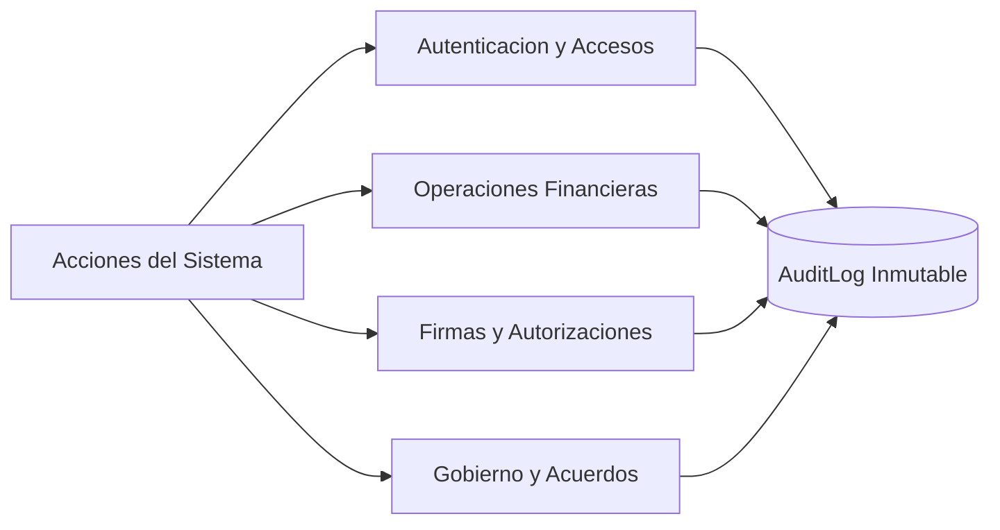

# Auditoría y Trazabilidad del Sistema
## Prisma Business Dashboard - Grupo Prisma S.A.P.I. de C.V.

Este documento establece la arquitectura, política de eventos y requerimientos de inmutabilidad para la bitácora de auditoría electrónica (Audit Log) de Grupo Prisma S.A.P.I. de C.V.

---

## 1. Principio de Registro Inmutable (Append-Only)

Toda acción crítica ejecutada en el sistema genera de forma transparente una entrada en la tabla `AuditLog`. Esta tabla posee las siguientes características de seguridad:

1. **Solo Inserción (Append-Only):** No existen métodos en los controladores ni servicios que permitan ejecutar `DELETE` o `UPDATE` sobre la tabla `AuditLog`.
2. **Generación en Servidor:** Las marcas de tiempo, direcciones IP y estados previos/posteriores son extraídos y procesados en el backend, imposibilitando la alteración de datos por parte del cliente React.
3. **Persistencia en la misma Transacción:** Cuando una acción de negocio modifica datos (ej. confirmación de firma o desembolso), el registro de auditoría se inserta dentro de la misma transacción de Prisma ORM (`$transaction`), asegurando que si la acción falla, el log no se escriba, y si la acción prospera, el log quede garantizado.

---

## 2. Catálogo de Eventos Auditables



### 2.1. Eventos de Identidad y Acceso (`AUTH_*`)
- `AUTH_LOGIN_SUCCESS`: Inicio de sesión exitoso con usuario, rol e IP.
- `AUTH_LOGIN_FAILED`: Intento fallido de autenticación (contraseña incorrecta o usuario inexistente).
- `AUTH_LOGOUT`: Cierre formal de sesión.
- `AUTH_PASSWORD_CHANGE`: Actualización de credenciales por parte del usuario o reseteo administrativo.

### 2.2. Eventos de Socios y Gobernanza (`PARTNER_*`)
- `PARTNER_CREATED`: Registro de nuevo socio en el padrón.
- `PARTNER_SHARE_UPDATED`: Modificación de la participación societaria acordada (requiere justificación).
- `PARTNER_CONTRIBUTION_RECORDED`: Registro de aportación dineraria al fondo común de tesorería.
- `PARTNER_STATUS_CHANGED`: Suspensión o reactivación de un socio.

### 2.3. Eventos de Tesorería (`TREASURY_*`)
- `TREASURY_ACCOUNT_CREATED`: Apertura de nueva cuenta de tesorería.
- `TREASURY_OPERATION_REQUESTED`: Solicitud formal de egreso, inversión o transferencia.
- `TREASURY_MOVEMENT_EXECUTED`: Confirmación de dispersión bancaria y afectación de saldo en libro mayor por el Tesorero.
- `TREASURY_REVERSAL_REQUESTED`: Solicitud de contrasiento compensatorio sobre una operación.

### 2.4. Eventos de Autorización (`APPROVAL_*`)
- `APPROVAL_SIGNATURE_1_ADDED`: Emisión de la primera firma digital por un `FINANCE_APPROVER`.
- `APPROVAL_SIGNATURE_2_ADDED`: Emisión de la segunda firma independiente y paso a estado `AUTORIZADO`.
- `APPROVAL_REJECTED`: Desestimación formal de la solicitud con registro del motivo escrito.

### 2.5. Eventos de Proyectos e Inversiones (`PROJECT_*` & `PROFIT_*`)
- `PROJECT_CREATED`: Registro de proyecto vehicular o inmobiliario.
- `PROJECT_STATUS_CHANGED`: Transición de fase (ej. de `ACTIVO` a `EN_CIERRE`).
- `PROJECT_DOCUMENT_UPLOADED`: Registro de metadatos de evidencias (facturas, fotos de remates).
- `PROFIT_AGREEMENT_APPROVED`: Formalización de acuerdo económico de utilidades sumando el 100.00%.
- `PROJECT_FINANCIAL_CLOSE_APPROVED`: Aprobación de cierre financiero formal tras conciliar cuentas.
- `PROFIT_DISTRIBUTED`: Liquidación y dispersión efectiva de dividendos a socios.

---

## 3. Estructura y Esquema del Registro de Auditoría

Cada fila en `AuditLog` almacena:

```json
{
  "id": "c1f7a8b2-4d2e-4b9a-8c11-9a7f3e5b6c89",
  "userId": "usr_998127391823",
  "userEmail": "socio.admin@grupoprisma.mx",
  "userRole": "ADMIN_FINANCIERO",
  "action": "TREASURY_TRANSACTION_EXECUTED",
  "entityName": "Transaction",
  "entityId": "trx_551029384712",
  "oldValues": {
    "status": "AUTORIZADO",
    "executedAt": null
  },
  "newValues": {
    "status": "EJECUTADO",
    "executedAt": "2026-11-05T20:30:00.000Z",
    "amountCents": 35000000
  },
  "ipAddress": "189.204.112.45",
  "userAgent": "Mozilla/5.0 (Windows NT 10.0; Win64; x64) Chrome/120.0",
  "timestamp": "2026-11-05T20:30:00.120Z"
}
```

---

## 4. Consulta y Fiscalización

- **Acceso:** Exclusivo para usuarios con rol `SUPER_ADMIN`.
- **Capacidades de Búsqueda:**
  - Filtrado por rango cronológico (fecha inicial y final).
  - Filtrado por usuario originador o afectado.
  - Filtrado por tipo de entidad y módulo (`Transaction`, `Project`, `Partner`).
  - Exportación de reportes de auditoría en formato estructurado para asambleas de socios o revisiones académicas.

