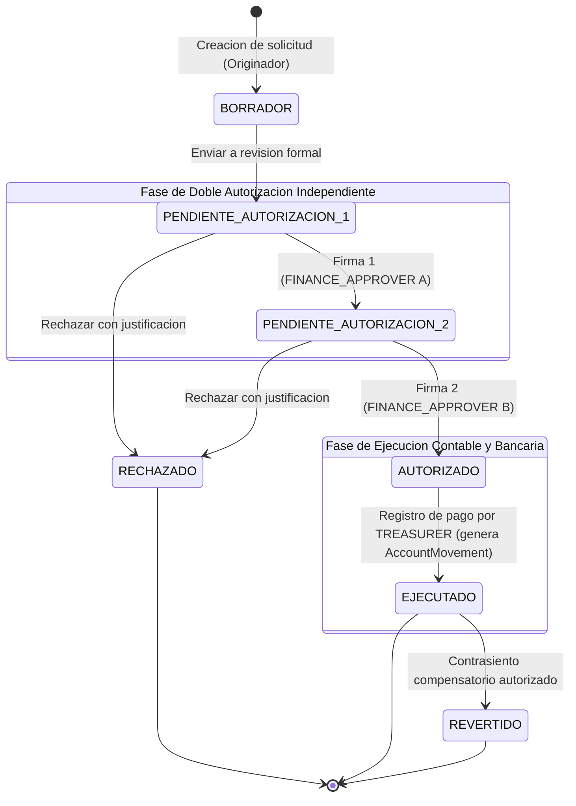

# Flujo de Autorizaciones Financieras (Regla 2-Man)
## Prisma Business Dashboard - Grupo Prisma S.A.P.I. de C.V.

Este documento detalla el ciclo de vida, la máquina de estados y las reglas lógicas que rigen el mecanismo de **Doble Autorización Obligatoria (Regla 2-Man)** y la **Separación Estricta entre Autorización y Ejecución** para todas las operaciones financieras sujetas a autorización de Grupo Prisma.

> [!IMPORTANT]
> **Observación Financiera Obligatoria (Doble Autorización Universal):**  
> Las dos autorizaciones independientes aplican a **todas las operaciones financieras sujetas a autorización**, no solamente a egresos. Incluye expresamente:
> 1. **Aportaciones de capital** (`APORTACION_CAPITAL`).
> 2. **Ingresos ordinarios y extraordinarios** (`INGRESO`).
> 3. **Egresos operativos y de proyectos** (`EGRESO`).
> 4. **Transferencias entre cuentas del grupo** (`TRANSFERENCIA`).
> 5. **Distribuciones de utilidades** (`DISTRIBUCION_UTILIDADES`).  
> Los flujos específicos podrán variar según la naturaleza de la operación, pero no deberán omitir los controles de doble firma independiente ni los registros de segregación correspondientes.

---

## 1. Máquina de Estados de Operaciones Financieras



---

## 2. Descripción de Estados y Separación de Responsabilidades

| Estado | Significado Técnico y Operativo | ¿Afecta Saldo? | Responsable / Rol Actuante |
| :--- | :--- | :---: | :--- |
| **`BORRADOR`** | Solicitud creada pero aún no enviada. Puede editarse libremente. | **NO** | Originador (`TREASURER` o `PROJECT_MANAGER`). |
| **`PENDIENTE_AUTORIZACION_1`** | Solicitud formal en espera de la primera firma digital independiente. | **NO** | `FINANCE_APPROVER` (distinto al solicitante). |
| **`PENDIENTE_AUTORIZACION_2`** | Primera firma validada. En espera de la segunda firma independiente. | **NO** | `FINANCE_APPROVER` (distinto a solicitante y firma 1). |
| **`AUTORIZADO`** | **La operación cuenta con las dos firmas requeridas.** Está lista para ser pagada, pero **aún no se descuenta dinero**. | **NO** | Sistema (cambio automático de estado). |
| **`EJECUTADO`** | **El Tesorero registra la dispersión bancaria real** (folio SPEI/cheque). Se crea el `AccountMovement` y el saldo se descuenta. Inmutable. | **SÍ** | `TREASURER` (Tesorero). |
| **`RECHAZADO`** | Un autorizador desestimó la operación con motivo escrito. El ciclo termina. | **NO** | `FINANCE_APPROVER` o `SUPER_ADMIN`. |
| **`REVERTIDO`** | La operación ejecutada fue compensada por una reversión autorizada. | **SÍ** (Neutralizado) | `TREASURER` tras doble firma de contrasiento. |

---

## 3. Matriz de Validación de Firmas (Reglas de Segregación)

Para otorgar cualquier firma digital sobre `ApprovalRequest`, el servicio `ApprovalsService` valida de manera obligatoria:

```text
Condición 1: Solicitante != Autorizador 1
Condición 2: Solicitante != Autorizador 2
Condición 3: Autorizador 1 != Autorizador 2
Condición 4: Rol(Autorizador) IN ['FINANCE_APPROVER', 'SUPER_ADMIN']
Condición 5: Rol(SUPER_ADMIN) NO tiene bypass ni permiso de firma única
Condición 6: Ejecutor != Autorizadores (Deseable contable: quien ejecuta el desembolso es el TREASURER)
```

### Tabla de Validación de Casos:

| Solicitante | Firma 1 (`FINANCE_APPROVER`) | Firma 2 (`FINANCE_APPROVER`) | Ejecución (`TREASURER`) | ¿Resultado? | Fundamento de Regla |
| :---: | :---: | :---: | :---: | :---: | :--- |
| Socio A | Socio A | - | - | ❌ **422 Unprocessable** | El solicitante no puede otorgar Firma 1 a su propio gasto. |
| Socio A | Socio B | Socio B | - | ❌ **422 Unprocessable** | El mismo autorizador no puede firmar dos veces la misma operación. |
| Socio A | Socio B | Socio A | - | ❌ **422 Unprocessable** | El solicitante no puede otorgar la Firma 2. |
| Socio A | Socio B | Socio C | Socio D (`TREASURER`) | ✅ **200 OK -> 201 Ejecutado** | Tres personas distintas firman y un cuarto ejecuta. Válido. |
| Socio A (`SUPER_ADMIN`) | Socio B | Socio C | Socio D (`TREASURER`) | ✅ **200 OK -> 201 Ejecutado** | El `SUPER_ADMIN` solicitó y dos socios independientes firmaron. |
| Socio B | Socio A (`SUPER_ADMIN`) | Socio C | Socio D (`TREASURER`) | ✅ **200 OK -> 201 Ejecutado** | El `SUPER_ADMIN` firma legalmente como Autorizador 1. |
| Socio B | Socio A (`SUPER_ADMIN`) | - | Socio A | ❌ **Bloqueado** | El `SUPER_ADMIN` no puede ejecutar con una sola firma. |

---

## 4. Metadatos de la Pista de Auditoría de Firmas

Cada firma en `ApprovalSignature` almacena indeleblemente:
1. `approval_request_id`: Identificador de la solicitud.
2. `authorizer_user_id`: Identificador del usuario que emitió la firma.
3. `signature_order`: Número ordinal de la firma (1 o 2).
4. `action`: `APROBAR` o `RECHAZAR`.
5. `notes`: Motivo escrito obligatorio en rechazo; observaciones en aprobación.
6. `ip_address`: Dirección IP cliente al momento de la firma.
7. `signed_at`: Marca de tiempo ISO-8601 del servidor.
