# Modelo de Roles y Permisos Granulares (RBAC)
## Prisma Business Dashboard - Grupo Prisma S.A.P.I. de C.V.

Este documento formaliza el modelo de control de acceso basado en roles (Role-Based Access Control - RBAC), la combinación de roles y el catálogo de permisos granulares del sistema.

---

## 1. Definición de los Seis Roles Oficiales

```mermaid
classDiagram
    class SUPER_ADMIN {
        +Gobernanza del grupo
        +Administracion de socios
        +Formalizacion de acuerdos al 100%
        +Aprobacion de cierres financieros
        -Prohibido auto-autorizar
    }
    class PARTNER {
        +Consulta general de padron
        +Visualizacion de Dashboard
        +Aportaciones de capital
        +Percepcion de dividendos
    }
    class TREASURER {
        +Administracion de cuentas
        +Solicitud de operaciones
        +Transferencias neutras
        +Ejecucion y desembolso bancario
        -No autoriza sus propias solicitudes
    }
    class FINANCE_APPROVER {
        +Evaluacion de solicitudes
        +Firma 1 y Firma 2 independientes
        +Rechazo fundamentado
        -Excluido si es solicitante
    }
    class PROJECT_MANAGER {
        +Registro de proyectos
        +Gestion de presupuestos e hitos
        +Convocatoria de reuniones y minutas
        +Solicitud de gastos de su proyecto
    }
    class PROJECT_MEMBER {
        +Colaboracion en proyectos
        +Carga de avances y evidencias
        +Consulta operativa
    }
```

1. **`SUPER_ADMIN` (Super Administrador):** Socio fundador con atribuciones de gobernanza corporativa, administración del padrón de socios, asignación de roles, formalización de acuerdos de utilidades y aprobación de cierres financieros.
2. **`PARTNER` (Socio del Grupo):** Perfil base que ostentan los 10 socios fundadores. Concede derechos de consulta general, visualización de dashboard ejecutivo, registro de aportaciones de capital y consulta de dividendos asignados.
3. **`TREASURER` (Tesorero / Administrador de Cuentas):** Encargado de la operatividad bancaria, conciliación de tesorería, solicitud de movimientos de fondos, transferencias internas y **registro de la ejecución efectiva de pagos (`AccountMovement`)**.
4. **`FINANCE_APPROVER` (Autorizador Financiero):** Socio o directivo facultado para firmar digitalmente autorizaciones de egreso (Firma 1 o Firma 2). No puede autorizar operaciones que haya originado ni duplicar su firma.
5. **`PROJECT_MANAGER` (Líder / Gestor de Proyecto):** Responsable operativo directo de un proyecto de inversión (compra de vehículos en remate o litigios/remodelación de inmuebles). Administra cronograma, presupuesto, hitos, reuniones y tareas.
6. **`PROJECT_MEMBER` (Integrante de Proyecto):** Colaborador asignado a un proyecto. Registra actualizaciones periódicas, tareas pendientes y documentos probatorios.

---

## 2. Principio de Combinación de Roles y Permisos Granulares

Para evitar rigideces y duplicidad de código, el sistema no evalúa roles como strings fijos mutuamente excluyentes, sino como conjuntos agregados de **permisos granulares** vinculados al usuario mediante la relación muchos a muchos (`UserRole` y `RolePermission`):

> [!NOTE]
> **Ejemplo de Combinación:**  
> Un socio fundador puede ostentar simultáneamente los roles:
> - `PARTNER` + `FINANCE_APPROVER` (Socio facultado para autorizar operaciones ajenas).
> - `PARTNER` + `PROJECT_MANAGER` (Socio responsable directo de un proyecto automotriz).
> - `SUPER_ADMIN` + `PARTNER` (Socio fundador que administra la plataforma).

### Catálogo de Permisos Granulares del Sistema:
- `partners:read`: Consultar padrón de socios y participaciones acordadas.
- `partners:manage`: Modificar datos y participaciones de socios (`SUPER_ADMIN`).
- `partners:contribute`: Registrar aportaciones de capital al fondo común.
- `treasury:read`: Consultar cuentas bancarias y balances derivados.
- `treasury:manage_accounts`: Crear o modificar cuentas de tesorería.
- `treasury:request_operation`: Emitir solicitudes de egreso o fondeo.
- `treasury:transfer`: Registrar transferencias neutras entre cuentas propias.
- `treasury:execute_payment`: **Registrar la dispersión bancaria y generar movimiento contable.**
- `treasury:request_reversal`: Solicitar contrasiento de reversión compensatoria.
- `approvals:sign`: Emitir firma digital de aprobación (Firma 1 o 2).
- `approvals:reject`: Rechazar una operación pendiente con motivo justificado.
- `projects:create`: Dar de alta proyectos de inversión.
- `projects:manage_assigned`: Modificar hitos, partidas y cronograma de proyectos a cargo.
- `projects:view`: Consultar expediente completo de proyectos.
- `projects:collaborate`: Subir evidencias, minutas y registrar actividades.
- `profits:configure_agreement`: Formalizar reparto de utilidades al 100%.
- `profits:financial_close`: Aprobar cierre financiero formal de proyecto.
- `profits:distribute`: Emitir órdenes de liquidación de dividendos.
- `dashboard:view_global`: Consultar tablero ejecutivo con Recharts.
- `audit:read`: Consultar bitácora inmutable de eventos.

---

## 3. Matriz de Permisos por Rol Oficial

| Permiso Granular | `SUPER_ADMIN` | `PARTNER` | `TREASURER` | `FINANCE_APPROVER` | `PROJECT_MANAGER` | `PROJECT_MEMBER` |
| :--- | :---: | :---: | :---: | :---: | :---: | :---: |
| `partners:read` | ✅ | ✅ | ✅ | ✅ | ✅ | ❌ |
| `partners:manage` | ✅ | ❌ | ❌ | ❌ | ❌ | ❌ |
| `partners:contribute` | ✅ | ✅ | ✅ | ❌ | ❌ | ❌ |
| `treasury:read` | ✅ | ✅ | ✅ | ✅ | ✅ | ❌ |
| `treasury:manage_accounts`| ✅ | ❌ | ✅ | ❌ | ❌ | ❌ |
| `treasury:request_operation`| ✅ | ❌ | ✅ | ❌ | ✅ (Su proyecto)| ❌ |
| `treasury:transfer` | ✅ | ❌ | ✅ | ❌ | ❌ | ❌ |
| `treasury:execute_payment` | ❌ | ❌ | ✅ | ❌ | ❌ | ❌ |
| `treasury:request_reversal`| ✅ | ❌ | ✅ | ❌ | ❌ | ❌ |
| `approvals:sign` | ✅ (No solicitante)| ❌ | ❌ | ✅ (No solicitante) | ❌ | ❌ |
| `approvals:reject` | ✅ (No solicitante)| ❌ | ❌ | ✅ (No solicitante) | ❌ | ❌ |
| `projects:create` | ✅ | ❌ | ❌ | ❌ | ✅ | ❌ |
| `projects:manage_assigned` | ✅ | ❌ | ❌ | ❌ | ✅ (Asignado) | ❌ |
| `projects:view` | ✅ | ✅ | ✅ | ✅ | ✅ | ✅ (Asignado) |
| `projects:collaborate` | ✅ | ❌ | ❌ | ❌ | ✅ (Asignado) | ✅ (Asignado) |
| `profits:configure_agreement`| ✅ | ❌ | ❌ | ❌ | ❌ | ❌ |
| `profits:financial_close` | ✅ | ❌ | ❌ | ❌ | ❌ | ❌ |
| `profits:distribute` | ✅ | ❌ | ✅ | ❌ | ❌ | ❌ |
| `dashboard:view_global` | ✅ | ✅ | ✅ | ✅ | ❌ | ❌ |
| `audit:read` | ✅ | ❌ | ❌ | ❌ | ❌ | ❌ |

---

## 4. Seguridad de Autenticación y Sesiones

### 4.1. Hashing de Contraseñas (bcrypt)
- Las contraseñas en texto plano nunca se persisten; se genera hash adaptativo con bcrypt.
- **Propuesta Técnica Preliminar:** Cost factor `>= 10 rounds` (sujeto a validación de rendimiento en servidor por el PO).

### 4.2. Control de Sesiones y Tokens
- La entidad `Session` registra cada inicio de sesión con su IP y user agent.
- Permite la revocación remota de tokens en caso de extravío de dispositivo.
- **Propuesta Técnica Preliminar:** Access Token con vigencia de 15 minutos y Refresh Token rotativo con vigencia de 7 días (sujeto a ratificación formal del PO).
