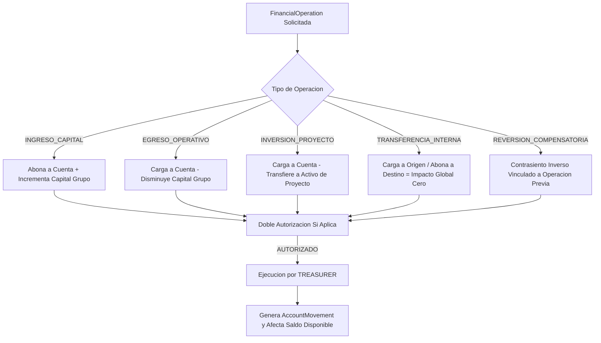

# Reglas Financieras y Contables
## Prisma Business Dashboard - Grupo Prisma S.A.P.I. de C.V.

Este documento establece las políticas de control financiero, cálculo dinámico de balances, clasificación de operaciones y gobernanza contable que rigen la administración de recursos de Grupo Prisma S.A.P.I. de C.V.

---

## 1. Principio Fundamental: Precisión en Centavos Enteros

Para erradicar discrepancias por redondeo de coma flotante binaria (estándar IEEE 754), el sistema adopta la regla de dinero exacto:

1. **Almacenamiento:** Todo importe en pesos mexicanos (MXN) se almacena como un valor entero equivalente al número de centavos:
   $$\text{Centavos} = \text{Monto en Pesos} \times 100$$
   *Ejemplo:* $\$150,250.75\text{ MXN} \longrightarrow 15025075\text{ centavos}$.
2. **Cálculos Aritméticos:** Todas las operaciones de adición, sustracción y prorrateo se ejecutan exclusivamente en centavos enteros.
3. **Prorrateo de Utilidades y Centavo Residual:** En distribuciones porcentuales que arrojen fracciones de centavo, el residuo se asigna al socio con mayor porcentaje o al fondo común, garantizando que:
   $$\sum \text{Utilidades Liquidadas en Centavos} = \text{Utilidad Neta del Proyecto en Centavos}$$

---

## 2. Separación Conceptual de Derechos y Recursos

El sistema distingue formalmente tres dimensiones contables y jurídicas que no deben confundirse:
1. **Participación Societaria Acordada:** Porcentaje inicial de tenencia acordado al 10.00% entre los 10 socios fundadores. No otorga automáticamente derechos a gastos ni obliga a aportaciones fijas.
2. **Aportaciones Reales de Capital (`CapitalContribution`):** Depósitos en dinero transferidos por socios a cuentas de tesorería del grupo para crear liquidez.
3. **Distribución de Utilidades (`ProfitDistribution`):** Ganancias netas generadas tras el cierre de un proyecto de inversión específico, repartidas según el `ProfitAgreement` (que suma exactamente el 100.00%).

---

## 3. Clasificación de Cuentas Financieras

| Tipo de Cuenta | Propósito Operativo | Saldo Mínimo Permitido |
| :--- | :--- | :---: |
| **BANCARIA** | Cuentas de cheques en instituciones bancarias reguladas en México (Banorte, BBVA, etc.). Concentran el fondo común y reciben aportaciones. | $0.00 (No sobregiro) |
| **CAJA_CHICA** | Fondos rotativos en efectivo para gastos menores de proyectos (traslados, peritajes, cerrajería, trámites en juzgados). | $0.00 (No sobregiro) |
| **FONDO_INVERSION** | Cuentas o contratos de inversión para el rendimiento del capital ocioso mientras no esté asignado a proyectos. | $0.00 |

---

## 4. Tipología de Operaciones y Movimientos Contables

> [!IMPORTANT]
> **Observación Financiera Obligatoria (Doble Autorización Universal):**  
> Las dos autorizaciones independientes aplican a **todas las operaciones financieras sujetas a autorización**, no solamente a egresos. Esto incluye expresamente:
> - **Aportaciones** (`APORTACION_CAPITAL`).
> - **Ingresos** (`INGRESO`).
> - **Egresos** (`EGRESO`).
> - **Transferencias** (`TRANSFERENCIA`).
> - **Distribuciones** (`DISTRIBUCION_UTILIDADES`).  
> Los flujos podrán variar según el tipo de operación, pero no deberán omitir los controles que correspondan ni la intervención de dos autorizadores facultados (`FINANCE_APPROVER`).

### Separación entre Operación y Movimiento Contable:
- **`FinancialOperation`:** Representa la solicitud, intención de gasto o transferencia, con su justificación y su proceso de aprobación de firmas independientes.
- **`AccountMovement`:** Representa el apunte contable real en el libro mayor inmutable (cargo o abono), registrado con folio bancario por el `TREASURER` una vez que la operación cuenta con las dos firmas de autorización.

---

## 5. Fórmula Dinámica de Balance de Cuenta

El saldo contable disponible de cualquier cuenta financiera $A$ en un instante $t$ se determina por:

$$\text{Saldo Disponible}(A) = \sum_{m \in \text{AccountMovement}(A), m.\text{type} = \text{'ABONO'}} m.\text{amount\_cents} - \sum_{m \in \text{AccountMovement}(A), m.\text{type} = \text{'CARGO'}} m.\text{amount\_cents}$$

---

## 6. Procedimiento de Reversión Compensatoria

Bajo ninguna circunstancia se permite eliminar o alterar un movimiento contable ni una operación en estado `EJECUTADO`:
1. Se genera una `FinancialOperation` de tipo `REVERSION_COMPENSATORIA`.
2. Se vincula al `original_operation_id`.
3. Se invierte la polaridad contable o las cuentas de cargo/abono.
4. Se exige un campo de justificación fundamentado.
5. Se somete al flujo obligatorio de doble autorización independiente.
6. Al completarse la segunda firma, el `TREASURER` registra la ejecución del contrasiento en `AccountMovement` y la operación original pasa al estado de `REVERTIDO`.
