# Roadmap de Entregas y Evolución
## Prisma Business Dashboard - Grupo Prisma S.A.P.I. de C.V.

Este documento establece la hoja de ruta estratégica del producto, organizada en incrementos iterativos de valor (Releases) sin fechas ficticias, alineada con el ciclo académico y la madurez técnica del sistema.

---

## 1. Visión Estratégica del Roadmap

```mermaid
gantt
    title Secuencia de Incrementos del Roadmap
    dateFormat  X
    axisFormat %s

    section Release 0.1: Fundamentos
    Documentacion y Gobernanza (Fase 0)      :milestone, m0, 0, 0
    Workspace Monorepo y Git (Fase 1)       :active, f1, 0, 1

    section Release 0.2: Nucleo de Datos
    Esquema Prisma y SQLite (Fase 2)        :f2, after f1, 1
    Auth JWT y Padrón de 10 Socios (Fase 3) :f3, after f2, 1

    section Release 0.3: MVP Financiero
    Tesoreria y Regla 2-Man (Fase 4)        :f4, after f3, 2

    section Release 0.4: Inversiones
    Proyectos de Autos/Inmuebles (Fase 5)   :f5, after f4, 2

    section Release 1.0: Release Candidata
    Dashboard Recharts y Analitica (Fase 6) :f6, after f5, 1
    Web Services Swagger y Externo (Fase 7) :f7, after f6, 1

    section Release 1.1: Cierre Academico
    QA Integral y Pruebas Jest (Fase 8)     :f8, after f7, 1
    Documento Academico PDF y Demo (Fase 9) :milestone, m9, after f8, 0
```

---

## 2. Definición de Incrementos (Releases)

### Release 0.1: Fundamentos y Gobernanza
- **Fases Incluidas:** Fase 0 (Definición y Documentación) y Fase 1 (Configuración de Entorno).
- **Hito de Negocio:** Establecimiento de la línea base documental, repositorio estructurado con Git, backend NestJS y frontend Vite limpios y compilables.
- **Entregable:** Repositorio base con linters, TypeScript estricto y documentación técnica completa en `docs/`.

### Release 0.2: Núcleo de Datos y Gestión de Socios
- **Fases Incluidas:** Fase 2 (Modelo de Datos) y Fase 3 (Autenticación y Socios).
- **Hito de Negocio:** Base de datos SQLite inicializada con Prisma ORM, seeding de los 10 socios fundadores al 10%, autenticación JWT con bcrypt y control de acceso RBAC.
- **Entregable:** Inicio de sesión operativo y pantalla de consulta del padrón de socios con perfiles protegidos.

### Release 0.3: MVP Financiero (Tesorería y Doble Autorización)
- **Fases Incluidas:** Fase 4 (Tesorería y Aprobaciones).
- **Hito de Negocio:** El fondo común opera de forma segura. Se registran cuentas bancarias, solicitudes de egreso en centavos, doble firma obligatoria e inmutabilidad de movimientos con reversión.
- **Entregable:** Módulo de tesorería y bandeja de doble autorización funcional en web.

### Release 0.4: Gestión de Inversiones y Acuerdos de Utilidad
- **Fases Incluidas:** Fase 5 (Administración de Proyectos).
- **Hito de Negocio:** Registro y control de proyectos en remates vehiculares e inmobiliarios, seguimiento de presupuesto, hitos, documentos y acuerdos de utilidades validados al 100%.
- **Entregable:** Vistas de proyectos con seguimiento de atrasos, minutas y formalización de liquidaciones.

### Release 1.0: Plataforma Integral y Tablero Directivo (RC)
- **Fases Incluidas:** Fase 6 (Dashboard Ejecutivo) y Fase 7 (Web Services).
- **Hito de Negocio:** Tablero interactivo con Recharts para asambleas de socios, documentación Swagger interactiva en `/api/docs` y consumo de API externa de tipo de cambio.
- **Entregable:** Plataforma web completa conectada de extremo a extremo.

### Release 1.1: Estabilización, Certificación QA y Entrega Académica
- **Fases Incluidas:** Fase 8 (Pruebas y QA) y Fase 9 (Publicación y PDF Académico).
- **Hito de Negocio:** Cobertura de pruebas unitarias y E2E superior al 80%, auditoría de seguridad sin vulnerabilidades y documento PDF formal para la evaluación de la Unidad 3 de la UTC.
- **Entregable:** Documento académico final, repositorio verificado y video de demostración.

