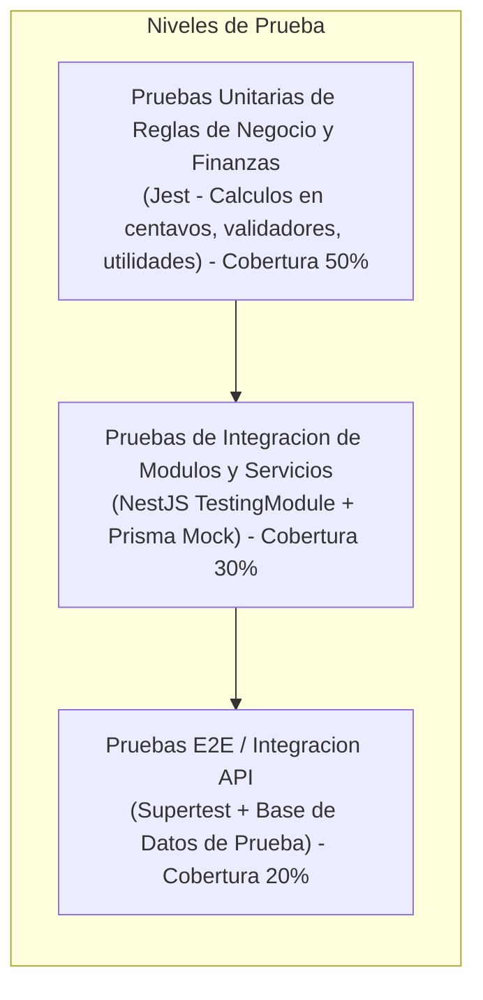

# Estrategia Integral de Pruebas de Software
## Prisma Business Dashboard - Grupo Prisma S.A.P.I. de C.V.

Este documento establece la estrategia, herramientas, niveles y criterios de calidad para la verificación y validación (V&V) del software mediante pruebas automatizadas y manuales.

---

## 1. Pirámide de Pruebas del Sistema

---

## 2. Tecnologías y Herramientas de Prueba

| Herramienta | Nivel de Prueba | Alcance y Propósito |
| :--- | :--- | :--- |
| **Jest** | Unitarias e Integración | Pruebas de funciones matemáticas puras, formateo de moneda, servicios de NestJS y lógica de cálculo de saldos. |
| **Supertest** | E2E y API REST | Simulación de llamadas HTTP contra los controladores de NestJS para verificar códigos de estado (200, 201, 400, 401, 403, 422), validación de DTOs y Guards de autenticación. |
| **Prisma Mock / SQLite Test DB** | Persistencia | Base de datos SQLite aislada en memoria o archivo temporal para ejecutar pruebas de integración sin contaminar datos reales. |
| **React Testing Library** | Componentes UI | Verificación de renderizado de componentes de React, disparadores de eventos y tablas financieras. |

---

## 3. Áreas Críticas de Prueba Obligatoria

### 3.1. Pruebas Financieras y Aritméticas (Tolerancia Cero a Errores)
- **Conversión de Centavos:** Garantizar que ninguna operación admita valores flotantes o genere pérdida de precisión en divisiones o multiplicaciones.
- **Cálculo Dinámico de Balances:** Validar que el saldo de una cuenta sea exactamente igual a la suma de ingresos ejecutados menos egresos ejecutados.
- **Neutralidad de Transferencias:** Comprobar que una transferencia interna debite exactamente lo mismo que acredita, manteniendo inalterado el balance global.

### 3.2. Pruebas de Seguridad y Regla 2-Man (Doble Firma)
- **Auto-autorización:** Intentar que el usuario solicitante firme como Autorizador 1 o 2 (debe retornar 422 Unprocessable Entity).
- **Firma Duplicada:** Intentar que el mismo usuario firme ambas autorizaciones (debe retornar 422 Unprocessable Entity).
- **Intento de Bypass por SUPER_ADMIN:** Intentar forzar el estado `AUTORIZADO` con rol de superadministrador sin contar con las dos firmas previas (debe retornar 403 Forbidden).
- **Inmutabilidad:** Intentar invocar un método `DELETE` o mutar importes sobre una transacción en estado `EJECUTADO` (debe ser bloqueado a nivel de servicio y controlador).

### 3.3. Pruebas de Acuerdos de Utilidades y Proyectos
- **Suma de Acuerdos:** Intentar guardar un acuerdo que sume 9,999 o 10,001 puntos base (debe ser rechazado con error 400 Bad Request).
- **Dispersión sin Cierre:** Intentar dispersar dividendos sobre un proyecto en estado `ACTIVO` o `PLANEACION` (debe bloquearse hasta que esté formalmente `EN_CIERRE` y con acuerdo aprobado).

---

## 4. Métricas y Criterios de Aceptación de QA

- **Cobertura de Código (Code Coverage):** Mínimo **80% de cobertura de líneas y ramas** en los módulos críticos de `TreasuryModule`, `ApprovalsModule` y `ProfitSharingModule`.
- **Ejecución Automatizada:** Las suites de prueba deben ejecutarse de forma limpia mediante `npm test` y `npm run test:e2e` sin arrojar advertencias ni fallos.

