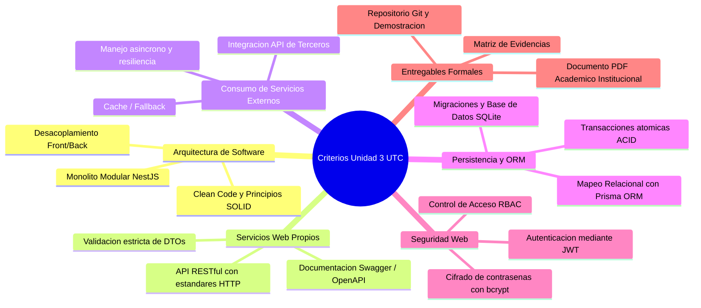

# Requisitos Académicos - Unidad 3
## Desarrollo Web Integral - Universidad Tecnológica de Coahuila (UTC)
### Carrera: Ingeniería en Desarrollo y Gestión de Software (9 IDGSA)

Este documento especifica los requisitos de evaluación y rúbrica académica establecidos para la **Unidad 3** de la asignatura **Desarrollo Web Integral**, alineando cada componente del sistema **Prisma Business Dashboard** a los estándares evaluados por la institución.

---

## 1. Ficha Técnica Académica

| Parámetro | Detalle Institucional |
| :--- | :--- |
| **Institución** | Universidad Tecnológica de Coahuila (UTC) |
| **Programa Educativo** | Ingeniería en Desarrollo y Gestión de Software |
| **Grado y Grupo** | 9° Cuatrimestre - IDGSA |
| **Materia** | Desarrollo Web Integral |
| **Unidad Temática** | Unidad 3: Arquitectura y Servicios Web Empresariales |
| **Proyecto Integrador** | Prisma Business Dashboard |
| **Empresa Caso de Estudio** | Grupo Prisma S.A.P.I. de C.V. |
| **Alumno / Desarrollador** | Russiele Valdez |

---

## 2. Rúbrica de Evaluación y Criterios Institucionales

---

## 3. Desglose de Competencias a Demostrar

### Competencia 1: Diseño e Implementación de Servicios Web (API REST)
- **Requisito:** Implementar servicios web empresariales propios que respeten las convenciones REST (verbos `GET`, `POST`, `PUT`/`PATCH`, `DELETE`, uso adecuado de códigos de estado HTTP 2xx, 4xx, 5xx y serialización JSON).
- **Cumplimiento en Prisma Dashboard:** Backend en NestJS con módulos de Tesorería, Socios, Proyectos y Aprobaciones documentados con `@nestjs/swagger`.

### Competencia 2: Consumo de Servicios Web de Terceros
- **Requisito:** Demostrar la capacidad de consumir, procesar y presentar información obtenida de un servicio web externo ajeno a la aplicación.
- **Cumplimiento en Prisma Dashboard:** Módulo de consumo HTTP para consultar el tipo de cambio oficial (USD/MXN Banxico o servicio de divisas) integrado en la valuación de activos vehiculares e inmobiliarios.

### Competencia 3: Persistencia de Datos mediante ORM
- **Requisito:** Administrar el almacenamiento relacional de información utilizando un Mapeador Objeto-Relacional (ORM) moderno, garantizando migraciones y relaciones estructuradas.
- **Cumplimiento en Prisma Dashboard:** SQLite gobernado exclusivamente por Prisma ORM con 12 modelos relacionales, integridad referencial y transacciones atómicas (`$transaction`).

### Competencia 4: Seguridad, Autenticación y Autorización
- **Requisito:** Incorporar esquemas de seguridad basados en estándares de la industria que protejan los recursos contra accesos no autorizados.
- **Cumplimiento en Prisma Dashboard:** Autenticación perimetral mediante JWT con rotación de tokens, contraseñas cifradas con algoritmo hash adaptativo bcrypt (cost factor >= 10) y Guards de roles (RBAC) con flujo 2-Man de doble firma.

### Competencia 5: Documento Técnico Académico Formal (PDF)
- **Requisito:** Elaboración de una memoria técnica en formato PDF con estructura formal: Portada institucional, Índice, Introducción, Justificación, Diagramas de Arquitectura (C4, UML, MER), Evidencias de Ejecución (capturas de endpoints y UI), Pruebas y Conclusiones.
- **Cumplimiento en Prisma Dashboard:** Redacción del reporte técnico compilado en la Fase 9 utilizando las matrices y registros de `docs/`.

